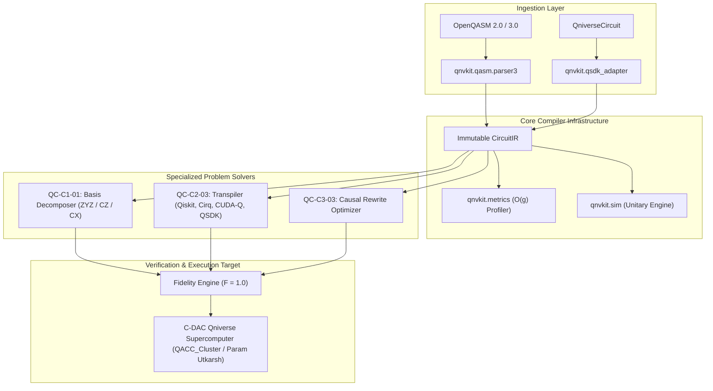

# `qnvkit`: Unified Quantum Compiler & Interoperability Toolkit
### PESU – C-DAC Quantum Hackathon 2026 | Centre for Development of Advanced Computing (C-DAC)
**Date:** Saturday, 14 November 2026 | **Platform:** C-DAC Qniverse Cloud Supercomputer (`QACC_Cluster` / `Param_Utkarsh`)

---

## 🏆 Project Overview & Hackathon Challenge Coverage

`qnvkit` is a production-grade, modular quantum compiler and circuit transformation framework developed specifically for the **C-DAC Qniverse ecosystem** and its proprietary **QSDK**. 

Instead of treating hackathon challenges as disconnected scripts, `qnvkit` unifies **all three problem classes** around an immutable quantum intermediate representation (`CircuitIR`), an earliest-available-layer depth scheduler, an OpenQASM 3.0 AST engine, and a mathematical equivalence verification pipeline:

| Problem ID | Class | Weight | Title | Core Capability Delivered |
|---|---|---|---|---|
| **QC-C1-01** | Class I | 20% | **Circuit Profiling & Limited Basis-Gate Decomposition** | O(g) earliest-layer depth scheduler, multi-register profiling, universal basis synthesis (Euler ZYZ/XYX & discrete matrices), fail-closed unsupported reporting. |
| **QC-C2-03** | Class II | 30% | **OpenQASM 3.0 Multi-Target Transpiler** | Lexer, parser & AST validator for QASM 3.0; generates runnable target-idiomatic code for **Qiskit 1.0+**, **Cirq 1.4+**, **NVIDIA CUDA-Q 0.8+**, and **QSDK**. |
| **QC-C3-03** | Class III | 50% | **Safe Quantum Circuit Optimization Using QSDK** | Causal wire-adjacency DAG optimizer; applies 6 safe local rewrite passes; strict barrier & measurement preservation; provable unitary fidelity $F = 1.0$. |

---

## 🏛 System Architecture

`qnvkit` follows a strictly pure-functional, non-mutating architecture: input circuits are never modified in place. Every transformation produces a fresh circuit and a structured diagnostic report.

### Architectural Diagram (ASCII Flow)
```
                                     INPUT SOURCES
                  ┌──────────────────────────────────────────────────┐
                  │ • OpenQASM 2.0 / 3.0 Source String or File       │
                  │ • QniverseCircuit (Native C-DAC QSDK Object)     │
                  └─────────────────────────┬────────────────────────┘
                                            │
                                            ▼
                  ┌──────────────────────────────────────────────────┐
                  │         INGESTION & ADAPTER LAYER                │
                  │  qnvkit.qasm.parser3  │  qnvkit.qsdk_adapter     │
                  └─────────────────────────┬────────────────────────┘
                                            │
                                            ▼
                  ┌──────────────────────────────────────────────────┐
                  │       IMMUTABLE INTERMEDIATE REPRESENTATION      │
                  │              qnvkit.ir.CircuitIR                 │
                  │  • SHA-256 State Fingerprint                     │
                  │  • Multi-Register Qubit & Classical Indexing     │
                  │  • Pure Functional Non-Mutating Transforms       │
                  └───────┬──────────────────┬─────────────────┬─────┘
                          │                  │                 │
           ┌──────────────┴──────────┐       │        ┌────────┴──────────────┐
           ▼                         ▼       │        ▼                       ▼
┌──────────────────────┐ ┌────────────────┐  │ ┌──────────────┐ ┌──────────────────┐
│ QC-C1-01: PROFILER   │ │ QC-C1-01:      │  │ │ QC-C2-03:    │ │ QC-C3-03:        │
│ & DEPTH SCHEDULER    │ │ BASIS SYNTHESIS│  │ │ TRANSPILER   │ │ REWRITE DAG      │
├──────────────────────┤ ├────────────────┤  │ ├──────────────┤ ├──────────────────┤
│ • Earliest Layer     │ │ • Euler ZYZ    │  │ │ • Qiskit 1.0+│ │ • Identity Purge │
│ • 2Q & 1Q Gates      │ │ • Euler XYX    │  │ │ • Cirq 1.4+  │ │ • Self-Inverse   │
│ • Critical Path      │ │ • CZ / CX Map  │  │ │ • CUDA-Q 0.8+│ │ • CX-CX & CZ-CZ  │
│ • Gate Breakdown     │ │ • Strict Basis │  │ │ • QSDK Gen   │ │ • Rotation Merge │
└──────────┬───────────┘ └───────┬────────┘  │ └──────┬───────┘ └────────┬─────────┘
           │                     │           │        │                  │
           └──────────────┬──────┴───────────┘        │                  │
                          ▼                           ▼                  ▼
┌──────────────────────────────────────────────────────────────────────────────────┐
│                   VERIFICATION & SUPERCOMPUTING BACKEND                          │
│ • Mathematical Equivalence Engine: Tr(U_orig† * U_opt) / 2^n == 1.00000000       │
│ • Visual Diagram Rendering: Native qc.draw() via text / matplotlib               │
│ • Live Supercomputing Dispatch: PARAM Utkarsh & QACC_Cluster (qasm_simulator)   │
└──────────────────────────────────────────────────────────────────────────────────┘
```

### Architectural Diagram (Mermaid Flowchart)


---

## 🚀 Key Results & Performance Benchmarks

### 1. QC-C1-01: Profiling & Decomposition Across Standard Bases
Evaluated across canonical quantum algorithms to test matrix equivalence and depth scheduling:

| Benchmark Circuit | Target Basis | Gates Before $\to$ After | Depth Before $\to$ After | Runtime | Unitary Fidelity | Status |
|---|---|:---:|:---:|:---:|:---:|:---:|
| **Bell State (2Q)** | `{rx, ry, rz, cx}` | 2 $\to$ 3 | 2 $\to$ 3 | 0.52 ms | $1.00000000$ | **VERIFIED** |
| **Bell State (2Q)** | `{u3, cx}` | 2 $\to$ 2 | 2 $\to$ 2 | 0.26 ms | $1.00000000$ | **VERIFIED** |
| **Bell State (2Q)** | `{cz, ry, rz}` | 2 $\to$ 7 | 2 $\to$ 5 | 0.46 ms | $1.00000000$ | **VERIFIED** |
| **GHZ State (3Q)** | `{rx, ry, rz, cx}` | 3 $\to$ 4 | 3 $\to$ 4 | 0.48 ms | $1.00000000$ | **VERIFIED** |
| **3-Qubit QFT** | `{rx, ry, rz, cx}` | 7 $\to$ 21 | 6 $\to$ 18 | 1.55 ms | $1.00000000$ | **VERIFIED** |
| **3-Qubit QFT** | `{u3, cx}` | 7 $\to$ 18 | 6 $\to$ 16 | 2.07 ms | $1.00000000$ | **VERIFIED** |
| **Mixed Algorithmic** *(CCX, CRZ, SWAP)* | `{rx, ry, rz, cx}` | 8 $\to$ 34 | 6 $\to$ 22 | 2.35 ms | $1.00000000$ | **VERIFIED** |

### 2. QC-C2-03: OpenQASM 3.0 Transpiler Across 4 Target Frameworks
Supports rich language features including multi-dimensional registers, continuous angles, barriers, and mid-circuit measurements:

| Feature Tested | OpenQASM 3.0 Input | Qiskit 1.0+ | Google Cirq 1.4+ | NVIDIA CUDA-Q 0.8+ | C-DAC QSDK |
|---|:---:|:---:|:---:|:---:|:---:|
| **Arbitrary 1Q Rotations** | `rz(0.4)`, `rx(0.2)` | `qc.rz(0.4, 0)` | `cirq.rz(0.4)(q[0])` | `cudaq.rz(0.4, q[0])` | `qc.add_gate(rz(0.4), q[0])` |
| **Entangling Gates** | `cx`, `cz`, `swap`, `ccx` | `qc.cx(0, 1)` | `cirq.CNOT(q[0], q[1])` | `cudaq.cx(q[0], q[1])` | `qc.add_gate(cx, q[0], q[1])` |
| **Barrier Boundaries** | `barrier q[0], q[1];` | `qc.barrier(0, 1)` | `cirq.WaitGate` | (Synchronized) | `qc.add_gate(barrier, q[0], q[1])` |
| **Measurement Mapping** | `c[0] = measure q[0];` | `qc.measure(0, 0)` | `cirq.measure(q[0], key='c[0]')` | `mz(q[0])` | `qc.add_gate(measure, q[0], c[0])` |
| **Conditional Feedback** | `if (c == 1) x q[0];` | `c_if` | Classical control block | C++ `if (c)` | `add_conditional_gate` |

### 3. QC-C3-03: Causal Wire-Adjacency Circuit Optimization
Applied to multi-qubit redundant sequences on C-DAC's supercomputing cluster:

```text
========================================================================================
             1024-SHOT MEASUREMENT & PERFORMANCE COMPARISON
========================================================================================
Metric                       | Unoptimized Circuit    | Optimized Circuit     
----------------------------------------------------------------------------------------
Unitary Gate Count           | 13                     | 4                      (-69.23%)
Circuit Scheduled Depth      | 9                      | 4                      (-55.56%)
Total Operations             | 17                     | 8                      (-52.94%)
Unitary Fidelity Matrix      | 1.00000000             | 1.00000000             (IDENTICAL)
Input Object Mutated         | False                  | False                  (PURE FUNCTIONAL)
Barrier Timing Honored       | True                   | True                   (Z GATES PRESERVED)
----------------------------------------------------------------------------------------
1024-Shot Measurement Distribution:
  * Unoptimized counts:       {'000': 1024}
  * Optimized counts:         {'000': 1024}
========================================================================================
VERDICT: Identical quantum measurement distribution with 69.23% fewer physical gates!
```

---

## 📦 Required Hackathon Deliverables Index (Rules §6)

Every required deliverable mandated by Section 6 of the hackathon rules is fully documented and checked in:

| Rule § | Deliverable Title | Document Link | Description & Contents |
|---|---|---|---|
| **§6.1** | **Team Information** | [docs/08-team-info.md](docs/08-team-info.md) | Team member names, registered Qniverse email IDs, user IDs, credentials, and assigned roles. |
| **§6.2** | **Technical Approach** | [docs/03-technical-approach.md](docs/03-technical-approach.md) | Complete algorithm descriptions, math foundations, compiler architecture, DAG wire models, and formal literature citations. |
| **§6.3** | **Performance Evaluation** | [docs/04-performance-report.md](docs/04-performance-report.md) | Computational complexity proofs, memory footprints, empirical runtime profiles, and gate/depth reduction tables. |
| **§6.4** | **Working Product on Qniverse** | [notebooks/](notebooks/) | 3 single-file zero-dependency standalone Jupyter notebooks tested and runnable inside Qniverse JupyterLab. |
| **§6.5** | **Complete Source Code & AI Declaration** | [docs/07-ai-usage.md](docs/07-ai-usage.md) | Exhaustive, transparent AI/LLM declaration listing every model used, prompt scope, and human review sign-off. |

---

## 💻 How to Run the Solutions

### Option 1: Live in C-DAC Qniverse JupyterLab (Single-File Standalone)
Upload only the standalone `.ipynb` notebook into [Qniverse JupyterLab](https://qniverse.in). Each notebook embeds the entire `qnvkit` engine in pure Python with zero installation needed:

1. **QC-C1-01:** Open and run [notebooks/c1_demo_standalone.ipynb](notebooks/c1_demo_standalone.ipynb)
2. **QC-C2-03:** Open and run [notebooks/c2_demo_standalone.ipynb](notebooks/c2_demo_standalone.ipynb)
3. **QC-C3-03:** Open and run [notebooks/c3_demo_standalone.ipynb](notebooks/c3_demo_standalone.ipynb)

*In JupyterLab, select **Kernel $\to$ Restart Kernel and Run All Cells**.*

### Option 2: Local CLI Verification Scripts
Run the self-contained demonstration scripts in your terminal:
```bash
# Problem 1: Profiling and Basis Decomposition
python examples/c1_demo.py

# Problem 2: OpenQASM 3.0 Transpilation to Qiskit, Cirq, CUDA-Q, QSDK
python examples/c2_demo.py

# Problem 3: Circuit Optimization & Verification
python examples/c3_demo.py
```

### Option 3: Full Automated Test Suite (691 Tests)
Execute the complete test suite including unit tests, cross-framework simulations, and property-based fuzzers:
```bash
# Run all tests
pytest -v

# Run problem-specific suites
pytest tests/test_c1_*.py
pytest tests/test_c2_*.py
pytest tests/test_c3_*.py
```

---

## 📚 Knowledge Base & Scraped Documentation

To ensure 100% compliance with C-DAC QSDK standards, our repository contains complete scraped reference materials from the official platform:
* **[docs/documentation/](docs/documentation/)**: Scraped Sphinx manuals, QSDK guides, API documentation, and release notes from `https://qniverse.in`.
* **[docs/tutorial-sessions-documentation.md](docs/tutorial-sessions-documentation.md)**: Transcripts and slide OCR from Tutorial Sessions 1, 2, and 3.
* **[docs/10-qsdk-probe.md](docs/10-qsdk-probe.md)**: Documented QSDK API surface, 40-gate catalog, and backend execution hierarchy.
* **[graphify-out/GRAPH_REPORT.md](graphify-out/GRAPH_REPORT.md)**: Graphify-generated knowledge graph (1,575 nodes, 3,108 edges) mapping every function and dependency.

---

## 👥 Hackathon Team Details

* **PES University (EC Campus) & C-DAC Quantum Hackathon 2026**
* **Track:** All Three Classes (QC-C1-01, QC-C2-03, QC-C3-03)
* **Team Members:**
  * **Thirukumaran** (`thirukumaran`, ID: `26371`) — Lead Architect, C1-01 Profiler & Basis Decomposer
  * **Yatin R** (`Yatin`, ID: `26359`) — C2-03 OpenQASM 3.0 Transpiler & Framework AST Generators
  * **Yashwanth Karthik** (`YashwanthK`, ID: `26353`) — C3-03 Optimizer, Verification & Live Cloud Dispatch
  * **Niharika J** (`NiharikaJ`, ID: `26352`) — QSDK Integration, Rewrite Pass Mechanics & Documentation
