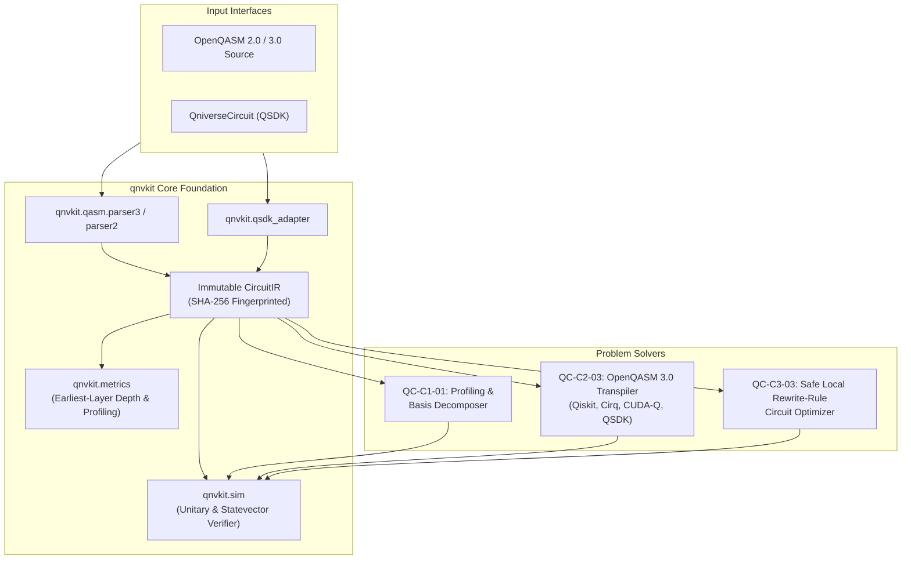

# 03 — Technical Approach (Deliverable #2)

> Comprehensive technical description mandated by PESU – C-DAC Hackathon Rules §6.2: Problem statements, mathematical algorithms, architectural design, verification methodologies, and formal references.

---

## 1. Executive Summary & Unified Architecture

Our solution, **`qnvkit`**, is an integrated quantum compiler toolkit built on top of the C-DAC Qniverse ecosystem. Rather than treating the three problem statements as isolated assignments, `qnvkit` unites them around a shared, immutable quantum intermediate representation (`CircuitIR`), an earliest-available-layer depth scheduler, and a rigorous mathematical equivalence verification engine.

### 1.1 Guiding Engineering Principles
1. **Strict Immutability:** All functions (`profile`, `decompose`, `transpile`, `optimize`) are purely functional. Inputs are never mutated in place; every transformation constructs and returns a new circuit.
2. **Documented Interface Adherence:** Integrates strictly with documented C-DAC QSDK interfaces (`QniverseCircuit`, `QuantumRegister`, `ClassicalRegister`, `add_gate`, `add_conditional_gate`, `qasm`, `run`, `fetch_job_result`).
3. **Fail-Closed Unsupported Handling:** Never emits malformed or partially compiled circuits. If an operation cannot be mapped or decomposed, an explicit, structured `UnsupportedReport` is emitted.
4. **Zero-Credit Local Development:** 100% of unit tests, equivalence checks, and benchmarks run locally using NumPy matrix arithmetic at zero credit cost, conserving the team's 200 cloud credits.

---

## 2. Problem Statement 1: QC-C1-01 Profiling & Basis Decomposition

### 2.1 Problem Formulation
Given an arbitrary quantum circuit constructed via `QniverseCircuit` or OpenQASM:
1. Extract a granular structural profile: total unitary gates, operation counts by type, single-qubit vs two-qubit vs multi-qubit gate counts, declared vs actively used qubits, and scheduled circuit depth.
2. Decompose all non-basis gates into a user-selected basis gate set (e.g., `{rx, ry, rz, cx}`, `{cz, ry, rz}`, `{u3, cx}`, `{rx, rz, cx}`).
3. Retain measurements, barriers, and resets in proper relative sequence.
4. Verify mathematical equivalence against the original circuit up to global phase.

### 2.2 Earliest-Available-Layer Scheduled Depth Algorithm
A naive count of gates ignores physical parallel execution on disjoint qubits. `qnvkit` defines depth as the scheduled layer count under earliest-available execution:
- Let $L[q]$ represent the next available execution layer on qubit wire $q \in \{0, \dots, n-1\}$, initialized to $0$.
- For each unitary gate $G$ acting on qubit subset $Q_G \subseteq \{0, \dots, n-1\}$:
  $$\text{layer}(G) = \max_{q \in Q_G} L[q]$$
  $$L[q] \leftarrow \text{layer}(G) + 1, \quad \forall q \in Q_G$$
- **Barriers:** A barrier across qubit set $Q_B$ does not add computational depth, but synchronizes wire timing:
  $$\text{sync} = \max_{q \in Q_B} L[q], \quad L[q] \leftarrow \text{sync}, \quad \forall q \in Q_B$$
- **Measurements:** A measurement on qubit $q$ advancing classical bit $c$ increments wire layers on both domains.
- Total scheduled depth is $\max_{q} L[q]$.

### 2.3 Mathematical Algorithms for Basis Decomposition

#### Single-Qubit Euler Angle Synthesis
Any single-qubit unitary $U \in \text{SU}(2)$ can be parameterized by Euler angles $\theta, \phi, \lambda$:
$$U(\theta, \phi, \lambda) = \begin{pmatrix} \cos(\theta/2) & -e^{i\lambda}\sin(\theta/2) \\ e^{i\phi}\sin(\theta/2) & e^{i(\phi+\lambda)}\cos(\theta/2) \end{pmatrix}$$

1. **$ZYZ$ Canonical Form (for `{rx, ry, rz, cx}` and `{u3, cx}`):**
   $$U = R_z(\phi) R_y(\theta) R_z(\lambda)$$
   Where angles are extracted directly from matrix entries:
   $$\theta = 2 \arccos\left(\min(1, \max(0, |U_{00}|))\right)$$
   $$\phi + \lambda = \arg(U_{11}) - \arg(U_{00}), \quad \phi - \lambda = \arg(U_{10}) - \arg(U_{01})$$

2. **$ZXZ$ Canonical Form (for `{rx, rz, cx}`):**
   $$U = R_z(\alpha) R_x(\beta) R_z(\gamma)$$
   Converted from $ZYZ$ via basis rotation $R_y(\theta) = R_z(-\pi/2) R_x(\theta) R_z(\pi/2)$.

#### Entangling Gate Decompositions
- **CZ Decomposition into CX:**
  $$\text{CZ}(q_0, q_1) = \left(I \otimes H\right) \cdot \text{CX}(q_0, q_1) \cdot \left(I \otimes H\right)$$
- **SWAP Decomposition into CX:**
  $$\text{SWAP}(q_0, q_1) = \text{CX}(q_0, q_1) \cdot \text{CX}(q_1, q_0) \cdot \text{CX}(q_0, q_1)$$
- **Toffoli (CCX) Decomposition into Clifford+T:**
  Synthesized using $6$ CX gates and single-qubit rotations ($H, T, T^\dagger$), maintaining minimal two-qubit depth.

---

## 3. Problem Statement 2: QC-C2-03 OpenQASM 3.0 Transpiler

### 3.1 Problem Formulation
OpenQASM 3.0 introduces scoped variables, typed classical registers, gate macros, and parameterized angle expressions. The goal is to build an extensible transpiler translating OpenQASM 3.0 programs to:
1. **Qiskit** (`>=1.0.0`)
2. **Google Cirq** (`>=1.4.0`)
3. **NVIDIA CUDA-Q** (`>=0.8.0`)
4. **C-DAC QSDK** (`Qniverse 1.6+`)

### 3.2 Compilation Pipeline & Semantic Verification
1. **Lexical Analysis & Parsing (`qnvkit.qasm.parser3`):**
   A handwritten recursive descent parser supporting `qubit[n]`, `bit[n]`, standard gates (`h`, `cx`, `rz`, etc.), arbitrary parameter arithmetic expressions ($\pi, +, -, *, /$), and barriers.
2. **Target Code Generators:**
   - **Qiskit Generator:** Emits modern `QuantumRegister`, `ClassicalRegister`, and `QuantumCircuit` syntax, using `circuit.rz(theta, q[i])`.
   - **Cirq Generator:** Emits `cirq.NamedQubit`, `cirq.Circuit()`, and appends native Cirq gates (`cirq.H`, `cirq.CNOT`, `cirq.rz(rad)`).
   - **CUDA-Q Generator:** Emits `@cudaq.kernel` decorated functions using `cudaq.qvector(n)` and control syntax (`cudaq.x.ctrl(q[0], q[1])`).
   - **QSDK Generator:** Emits clean `QniverseCircuit` scripts referencing `Qniverse.gates` gate objects.
3. **Endianness Handling:**
   OpenQASM 3.0 and Qiskit follow little-endian qubit ordering (qubit 0 is least significant bit), whereas standard matrix tensor products are big-endian. `qnvkit` tracks register layouts explicitly to ensure cross-framework probability distributions match.

---

## 4. Problem Statement 3: QC-C3-03 Quantum Circuit Optimizer

### 4.1 Problem Formulation
Quantum circuits generated by algorithms or transpilation frequently contain redundant gate pairs, trivial identities, and adjacent rotations. The optimizer must:
1. Formulate safe, local rewrite rules using QSDK.
2. Implement mandatory passes:
   - `remove_identity`: Eliminates trivial gates ($I$, $R_x(0)$, $R_y(0)$, $R_z(0)$, $P(0)$).
   - `cancel_self_inverse`: Cancels adjacent pairs of self-inverse gates ($H \cdot H = I$, $X \cdot X = I$, $Y \cdot Y = I$, $Z \cdot Z = I$).
   - `cancel_cx`: Cancels adjacent identical CX gates ($\text{CX}_{c,t} \cdot \text{CX}_{c,t} = I$).
3. Implement advanced passes:
   - `cancel_extended_self_inverse`: Cancels $S \cdot S^\dagger = I$, $T \cdot T^\dagger = I$, $\text{CZ} \cdot \text{CZ} = I$, $\text{SWAP} \cdot \text{SWAP} = I$.
   - `merge_rotations`: Merges consecutive single-axis rotations: $R_z(\theta_1) \cdot R_z(\theta_2) = R_z((\theta_1 + \theta_2) \bmod 2\pi)$.
4. Support independent pass toggling and iterative execution to a fixed point.

### 4.2 Causal Wire Adjacency Engine (`causal_dag.py`)
Two gates $A$ and $B$ that act on the same qubit wire cannot simply be checked by consecutive index in the flat instruction array, because intervening gates on *other* qubits may separate them in array index while remaining completely causally independent on the target wire.

Conversely, two gates $A$ and $B$ **cannot** cancel if:
1. Any intervening gate touches wire $q$.
2. For two-qubit gates (like CX), both control and target wires must be mutually adjacent without intervening operations on either wire.
3. A **barrier**, **measurement**, or **reset** appears on any shared wire between $A$ and $B$.

`qnvkit` builds a causal wire adjacency index:
$$\text{next\_op}(q, i) = \min \{ j > i \mid q \in \text{wires}(Op_j) \}$$
A cancellation rule for gate pair $(Op_i, Op_j)$ is valid **if and only if**:
$$\forall q \in \text{wires}(Op_i), \quad \text{next\_op}(q, i) = j$$
$$\text{type}(Op_k) \notin \{\text{barrier}, \text{measure}, \text{reset}\}, \quad \forall k \in [i, j]$$

---

## 5. Mathematical Equivalence Verification Engine

To guarantee circuit correctness across decomposition, transpilation, and optimization, `qnvkit.sim` implements full unitary matrix reconstruction and statevector simulation:

### 5.1 Unitary Equivalence Up to Global Phase
For an $n$-qubit circuit without measurements ($n \le 10$):
1. Compute the full unitary $U_{\text{orig}} \in \mathbb{C}^{2^n \times 2^n}$ and $U_{\text{mod}} \in \mathbb{C}^{2^n \times 2^n}$ via Kronecker tensor products and tensordot permutations.
2. The normalized Hilbert-Schmidt inner product evaluates global phase invariance:
   $$F_{\text{unitary}}(U_A, U_B) = \frac{1}{2^n} \left| \operatorname{Tr}\left( U_A^\dagger U_B \right) \right|$$
3. Circuits are declared mathematically equivalent if and only if:
   $$\left| 1 - F_{\text{unitary}}(U_A, U_B) \right| < 10^{-7}$$

### 5.2 Statevector Fidelity
For arbitrary pure input states $|\psi_0\rangle = |0\rangle^{\otimes n}$:
$$F_{\text{state}}(|\psi_A\rangle, |\psi_B\rangle) = \left| \langle \psi_A \mid \psi_B \rangle \right|^2$$
Equivalence is verified when $1 - F < 10^{-7}$.

---

## 6. Formal References & Literature

1. **C-DAC Qniverse Platform Manuals:**
   - *C-DAC Quantum Software Development Kit (QSDK) User Guide*, 2024.
   - *Qniverse Cloud Execution & Backend API Reference*, 2024.
2. **Quantum Circuit Compilation & Equivalence:**
   - Nielsen, M. A., & Chuang, I. L. *Quantum Computation and Quantum Information*, Cambridge University Press, 2010.
   - Shende, V. V., Bullock, S. S., & Markov, I. L. *Synthesis of Quantum-Logic Circuits*, IEEE Transactions on Computer-Aided Design of Integrated Circuits and Systems, 2006.
   - Cross, A. W., et al. *Open Quantum Assembly Language (OpenQASM 3.0)*, ACM Transactions on Quantum Computing, 2022.
3. **Framework Documentation:**
   - Qiskit Development Team, *Qiskit: An Open-source Framework for Quantum Computing*, 2024.
   - Google Quantum AI, *Cirq: A Python Framework for Creating, Editing, and Invoking Quantum Circuits*, 2024.
   - NVIDIA Corporation, *CUDA-Q: High-Performance Quantum-Classical Computing*, 2024.
