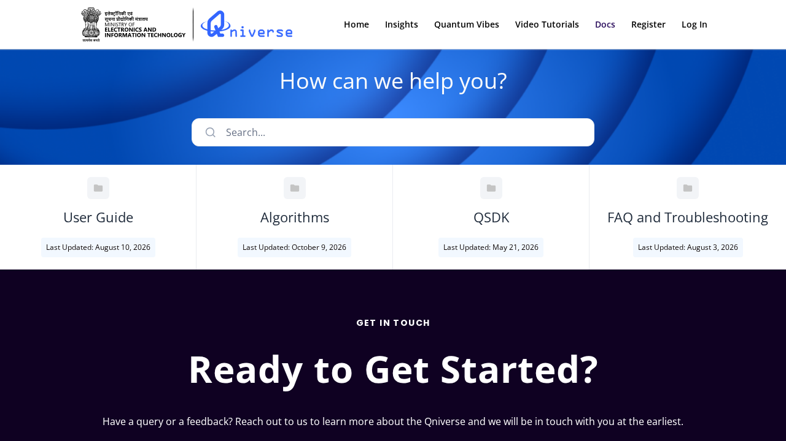
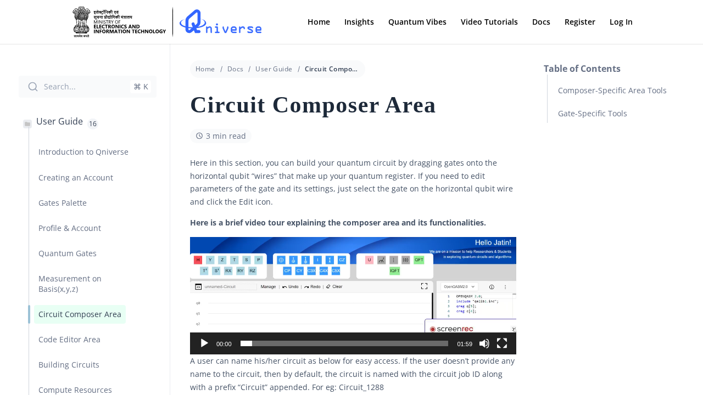
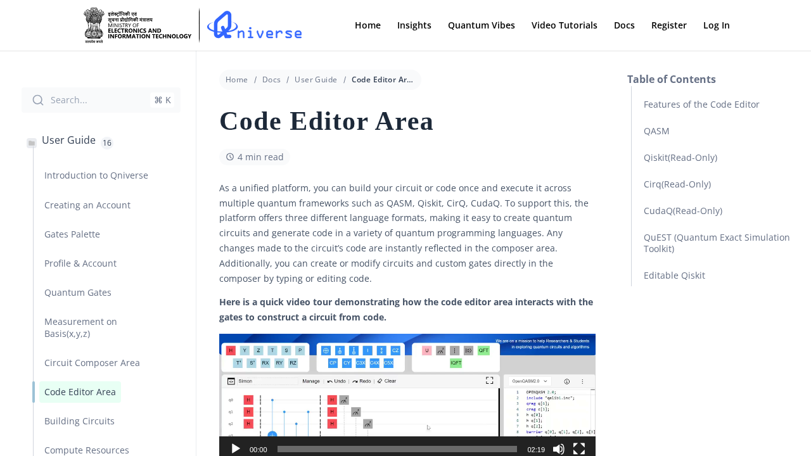
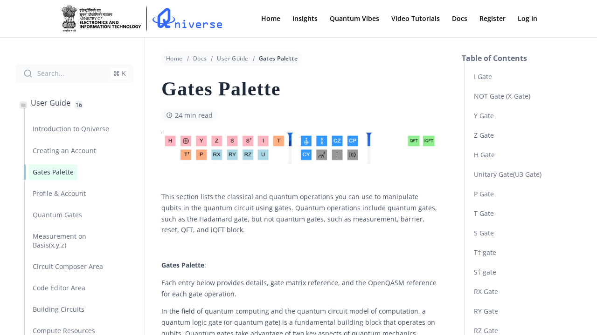
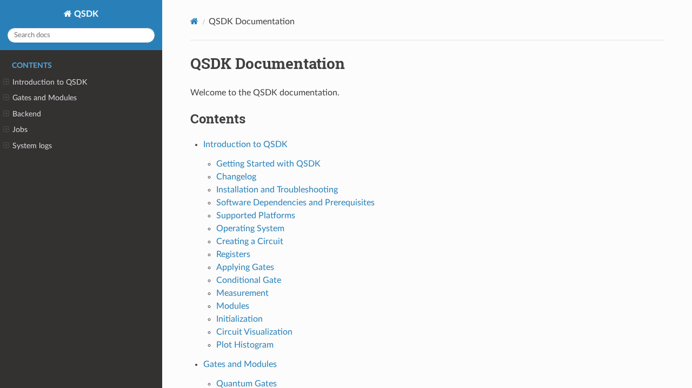
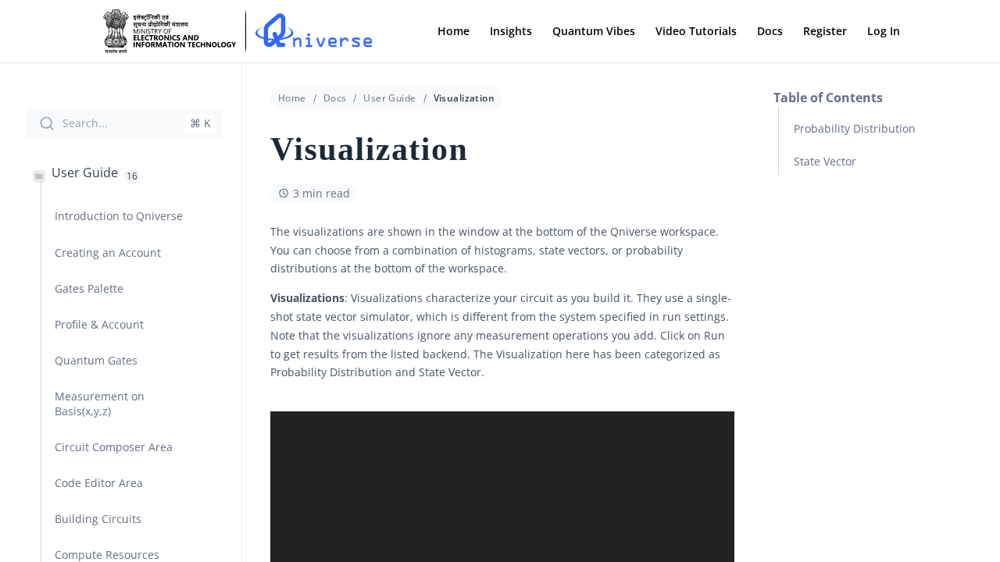

# Qniverse Platform Documentation

Comprehensive, offline-ready documentation scraped directly from the official **Qniverse** platform ([https://qniverse.in/docs/](https://qniverse.in/docs/)) and the **QSDK Sphinx Manual** ([https://qniverse.in/docs-category/qsdk/](https://qniverse.in/docs-category/qsdk/)).

Developed and maintained by the **Centre for Development of Advanced Computing (C-DAC)** under the National Quantum Mission, **Qniverse** is India's premier cloud-based quantum computing platform offering graphical circuit composition, multi-framework code synthesis, quantum simulation across CPU/GPU clusters (including PARAM Supercomputers and the QACC cluster), and an extensive suite of quantum algorithms.

---

## Visual Architecture & Platform Tour

````carousel

<!-- slide -->

<!-- slide -->

<!-- slide -->

<!-- slide -->

<!-- slide -->

````

---

## Documentation Structure

The documentation is organized into four core modules:

| Section | Description | Articles | Location |
|---|---|:---:|---|
| **[Platform Overview](docs-portal-overview.md)** | Main Qniverse documentation landing page, resource cards, and portal highlights. | 1 | `docs/documentation/docs-portal-overview.md` |
| **[Release Notes](release-notes.md)** | Complete release history (v1.6.0 through v1.0.0), detailing new CPU/GPU simulators and features. | 1 | `docs/documentation/release-notes.md` |
| **[User Guide](user-guide/)** | Getting started, account setup, Circuit Composer, Code Editor, hardware backends, noise modeling, visualization, and execution. | 16 | `docs/documentation/user-guide/` |
| **[Quantum Algorithms](algorithms/)** | 30 comprehensive algorithm tutorials with mathematical expressions, circuit steps, complexity analysis, and video walkthroughs. | 30 | `docs/documentation/algorithms/` |
| **[QSDK Documentation](qsdk/)** | Official Python SDK guide, installation across OSs, registers, gate construction, custom modules, backend selection, and remote job submission. | 15 | `docs/documentation/qsdk/` |
| **[FAQ & Troubleshooting](faq-and-troubleshooting/)** | Platform feedback, error troubleshooting, terms of service, and privacy policies. | 2 | `docs/documentation/faq-and-troubleshooting/` |

---

## 1. User Guide (`user-guide/`)

The User Guide provides end-to-end instructions for modeling and executing quantum circuits on Qniverse:

1. [01. Introduction to Qniverse](user-guide/01-introduction-to-qniverse.md) — Platform overview, key capabilities, and architecture.
2. [02. Creating an Account](user-guide/02-creating-an-account.md) — Registration, verification, and onboarding.
3. [03. Profile & Account Management](user-guide/03-profile-and-account.md) — Managing user credentials, API keys, and settings.
4. [04. Circuit Composer Area](user-guide/04-circuit-composer-area.md) — Graphical drag-and-drop circuit canvas, timeline tools, and gate configuration.
5. [05. Code Editor Area](user-guide/05-code-editor-area.md) — Integrated code editor supporting Qiskit, Cirq, OpenQASM, CudaQ, Braket, and Q# generation.
6. [06. Building Circuits](user-guide/06-building-circuits.md) — Step-by-step circuit construction, qubit allocation, and barrier placement.
7. [07. Gates Palette](user-guide/07-gates-palette.md) — Catalog of available quantum gates, categorizations, and icons.
8. [08. Quantum Gates Reference](user-guide/08-quantum-gate-reference.md) — Formal definitions, unitarity properties, and matrix representations.
9. [09. Measurement on Basis(x,y,z) & Gate Matrices](user-guide/09-measurement-on-basis-gate-matrices.md) — Pauli matrices, Bloch sphere transformations, and projective measurements.
10. [10. Compute Resources](user-guide/10-computing-resources.md) — CPU, GPU, and high-performance computing allocations.
11. [11. Backend Systems](user-guide/11-backend-systems.md) — Overview of available simulators, statevector backends, and PARAM supercomputer connections.
12. [12. Noise Modeling in Qniverse](user-guide/12-noise-modeling.md) — Simulating realistic quantum hardware noise (depolarizing, bit-flip, phase-flip, amplitude damping).
13. [13. Running Circuits](user-guide/13-running-circuits.md) — Selecting shot counts, seed, simulator targets, and executing workloads.
14. [14. Visualization](user-guide/14-visualization.md) — Statevector sphere, Bloch sphere, Q-sphere, measurement histograms, and probability distributions.
15. [15. View Jobs](user-guide/15-view-jobs.md) — Tracking execution status (Queued, Running, Completed, Failed), retrieving histograms, and export options.
16. [16. Launch Notebook (Qniverse Labs)](user-guide/16-launch-notebook-labs-resources.md) — JupyterLab environment pre-configured with QSDK and high-performance libraries.

---

## 2. Quantum Algorithms Library (`algorithms/`)

Qniverse includes a rich library of 30 standard and advanced quantum algorithms across fundamentals, optimization, chemistry, machine learning, communication, and error correction:

### Fundamental & Oracle Algorithms
- [01. Deutsch Function](algorithms/01-deutsch-function.md) — Constant vs. balanced function evaluation on 1 qubit.
- [02. Deutsch-Jozsa Algorithm](algorithms/02-deutsch-jozsa-algorithm.md) — Exponential speedup for determining function global properties on $n$ qubits.
- [03. Bernstein-Vazirani Algorithm](algorithms/03-bernstein-vazirani-algorithm.md) — Finding hidden bit strings $s \in \{0,1\}^n$ in a single query.
- [04. Simon’s Algorithm](algorithms/04-simons-algorithm.md) — Finding hidden XOR mask with exponential speedup over classical algorithms.
- [05. Grover’s Search Algorithm](algorithms/05-grovers-algorithm-search.md) — Quadratic speedup for searching unsorted databases of size $N$ in $O(\sqrt{N})$ steps.
- [06. Quantum Phase Estimation (QPE)](algorithms/06-quantum-phase-estimation-qpe.md) — Estimating eigenphases $\theta$ of unitary operators $U|u\rangle = e^{2\pi i \theta}|u\rangle$.
- [07. Quantum Fourier Transform (QFT)](algorithms/07-quantum-fourier-transform-qft.md) — Quantum analogue of discrete Fourier transform with exponential gate reduction.
- [08. Shor’s Factoring Algorithm](algorithms/08-shors-algorithm-factorization.md) — Polynomial time integer factorization via modular order finding.

### Quantum Information & Communication
- [09. Quantum Teleportation](algorithms/09-quantum-teleportation.md) — Transmitting an unknown quantum state using Bell entanglement and 2 classical bits.
- [10. Superdense Coding](algorithms/10-superdense-coding.md) — Transmitting 2 classical bits using a single entangled qubit.
- [11. Quantum N-Qubit Teleportation (Unitary-Control)](algorithms/11-quantum-n-qubit-teleportation-unitary-control.md) — Generalized multi-qubit state transfer with unitary feedforward.
- [17. Quantum Veto Algorithm](algorithms/17-quantum-veto-algorithm.md) — Anonymous distributed veto voting protocol using entangled states.
- [18. Quantum Digital Signature (QDS)](algorithms/18-quantum-digital-signature-qds.md) — Unforgeable cryptographic message signing backed by quantum physics.
- [19. Quantum Private Comparison (QPC)](algorithms/19-quantum-private-comparison-qpc.md) — Secure multi-party computation to compare private values without disclosure.

### Variational & Optimization Algorithms
- [13. Variational Quantum Eigensolver (VQE)](algorithms/13-variational-quantum-eigensolver-vqe.md) — Hybrid quantum-classical optimization to find ground state molecular energies.
- [14. QAOA for Max-Cut](algorithms/14-qaoa-for-max-cut.md) — Quantum Approximate Optimization Algorithm applied to combinatorial graph cuts.
- [15. Portfolio Optimization using QAOA](algorithms/15-portfolio-optimization-using-qaoa.md) — Financial Markowitz mean-variance optimization on quantum circuits.
- [16. Harrow-Hassidim-Lloyd (HHL) Algorithm](algorithms/16-harrow-hassidim-lloyd-hhl-algorithm.md) — Solving linear systems $A\vec{x} = \vec{b}$ with exponential speedup.
- [27. Suzuki-Trotter Time-Evolution](algorithms/27-suzuki-trotter-time-evolution.md) — Simulating Hamiltonian dynamics $e^{-iHt}$ via operator splitting.

### Quantum Machine Learning (QML)
- [20. QSVM (Quantum Support Vector Machine)](algorithms/20-qsvm.md) — Quantum kernel methods for classification in high-dimensional Hilbert spaces.
- [21. QKMeans Algorithm](algorithms/21-qkmeans-algorithm.md) — Quantum distance estimation for unsupervised data clustering.
- [22. Quantum KNN (K-Nearest Neighbors)](algorithms/22-quantum-knn-algorithm.md) — Quantum fidelity / inner product computation for classification.
- [23. Quantum Hierarchical Clustering (QHC)](algorithms/23-quantum-hierarchical-clustering-qhc.md) — Tree-based agglomerative clustering via quantum states.
- [24. Quantum Perceptron Algorithm](algorithms/24-quantum-perceptron-algorithm.md) — Quantum neural activation function and hyper-plane learning.
- [25. Quantum Principal Component Analysis (QPCA)](algorithms/25-quantum-principal-component-analysis-qpca.md) — Density matrix exponentiation to reveal dominant eigenspaces.
- [26. Quantum Neural Network (QNN)](algorithms/26-quantum-neural-network-qnn.md) — Parameterized quantum circuits (PQC) trained via gradient descent.

### Quantum Walks & Dynamics
- [12. Quantum Walks Algorithm (1D)](algorithms/12-quantum-walks-algorithm-1d.md) — Discrete-time quantum random walk demonstrating ballistic wave spreading.

### Quantum Error Correction (QEC)
- [28. QEC: Three-Qubit Repetition Code](algorithms/28-qec-three-qubit-repetition-code.md) — Bit-flip error detection and correction using syndrome ancillae.
- [29. QEC: Shor’s Nine-Qubit Code](algorithms/29-qec-shors-nine-qubit-code.md) — Concatenated code correcting arbitrary single-qubit errors (bit-flip and phase-flip).
- [30. QEC: Steane Seven-Qubit Code](algorithms/30-qec-steane-seven-qubit-code.md) — CSS code encoding 1 logical qubit into 7 physical qubits with transversal Clifford gates.

---

## 3. QSDK Python Technical Manual (`qsdk/`)

The QSDK is C-DAC's Python software development kit powering Qniverse. It provides APIs for constructing circuits, managing registers, choosing backends, and executing jobs remotely.

- [00. QSDK Portal Overview](qsdk/00-qsdk-portal-overview.md) — Summary of the SDK and high-level architecture.
- [01. Index](qsdk/01-index.md) — Welcome guide and Sphinx table of contents.
- [02. Introduction to QSDK](qsdk/02-introduction-index.md) — Key concepts and design philosophy.
- [03. Getting Started](qsdk/03-getting-started.md) — Installation across Windows, Linux, and macOS, prerequisites, troubleshooting, and CPU/GPU support.
- [04. Creating a Circuit](qsdk/04-creating-a-circuit.md) — Register instantiation, gate addition, conditional execution, measurements, and submodules.
- [05. Gates & Modules Overview](qsdk/05-gates-and-modules-index.md) — Module composition and gate management.
- [06. Quantum Gates Reference](qsdk/06-quantum-gates.md) — Single-qubit, controlled, and parameterized gate definitions in QSDK.
- [07. Backend Systems Overview](qsdk/07-backends-index.md) — Simulators and compute cluster targets.
- [08. Backend Selection](qsdk/08-backend-systems-selection.md) — Configuring execution targets (local CPU, CUDA-accelerated GPU, and remote PARAM supercomputers).
- [09. Job APIs Overview](qsdk/09-job-apis-index.md) — Remote job execution interfaces.
- [10. Submitting & Managing Jobs](qsdk/10-submitting-and-managing-jobs.md) — Submitting jobs, querying status, and extracting result dictionaries.
- [11. System Logs & Support Overview](qsdk/11-system-logs-and-support-index.md) — Logging levels and diagnostics.
- [12. Licenses](qsdk/12-licenses.md) — Licensing and open-source acknowledgments.
- [13. Support & Contact](qsdk/13-support.md) — Developer assistance, community forums, and C-DAC support channels.
- [14. QACC Live REST API Reference](qsdk/14-live-rest-api-reference.md) — Live REST API endpoints (`/qacc/v1/backends`, `/processor-info`, `/submit-job`), JWT authentication, and HPC simulator details for Param Utkarsh and QACC Cluster.
- `qsdk/sources/` — Unmodified reStructuredText (`.rst.txt`) source files matching the Sphinx distribution.

---

## 4. FAQ and Troubleshooting (`faq-and-troubleshooting/`)

- [01. Bug Report & Feedback](faq-and-troubleshooting/01-bug-report-feedback.md) — Reporting anomalies, submitting feature requests, and contacting the engineering team.
- [02. Terms & Privacy](faq-and-troubleshooting/02-terms-and-privacy.md) — Terms of service, platform usage rules, and data privacy policies.

---

## Assets & Offline Media

- **Formulas, Matrices & Diagrams:** Stored in `assets/images/` and referenced locally so the documentation remains 100% functional offline.
- **High-Resolution Screenshots:** Stored in `assets/screenshots/` captured via `rustwright` and `playwright`.
