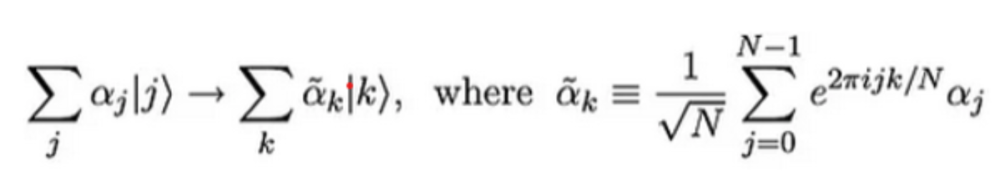

# Quantum Fourier Transform (QFT)

> **Category:** Algorithms | **Source:** [https://qniverse.in/docs/quantum-fourier-transform-qft/](https://qniverse.in/docs/quantum-fourier-transform-qft/)

The Quantum Fourier Transform (QFT) is a fundamental quantum algorithm used in various other quantum algorithms. While QFT is employed in Shor’s algorithm and other quantum algorithms for its ability to transform between time and frequency domains efficiently.

QFT transforms quantum states from one basis to another, specifically between the computational (Z) and Fourier basis. While classical Fourier Transform operates on continuous functions, QFT operates on the amplitudes of quantum states, which can represent multiple possibilities simultaneously due to superposition.

The Hadamard gate (H-gate) acts as the single-qubit QFT in quantum circuits, converting between the Z-basis and X-basis states. The QFT is also applicable to multi-qubit systems, where it transforms the entire quantum state from the computational basis to the Fourier basis.

One of the most prominent applications of QFT is in Shor’s algorithm, a quantum algorithm for integer factorization, where it enables efficient computation of the discrete Fourier transform, a crucial step in the algorithm’s implementation. Additionally, QFT finds applications in quantum phase estimation, quantum error correction, and various quantum machine learning algorithms. Despite its significance, the implementation of QFT in large-scale quantum systems remains a challenge due to the sensitivity of quantum states to errors and decoherence.

**Step 1:**

Apply a Hadamard gate (H-gate) to the first qubit(most significant qubit).

Apply controlled rotations (phase gates) on the first qubit controlled by all other qubits.

**Step 2:**

Controlled Rotations:

For each qubit j from 2 to n:

  * Apply Hadamard gate (H-gate) to qubit j.
  * Apply controlled rotations (phase gates) on qubit j, controlled by qubits j+1 to n.
  * The phases will be π/2^(k-j), where k=j+1, j+2, …..n.

**Step 3:**

Swap Gates

Perform swap gates to reverse the order of the qubits.

**Starting with a short video tour of how the circuit looks for the 2-Qubit Selection and the results obtained on submitting the circuit.**

[▶️ Video Demonstration: QFT-2.mp4](https://qniverse.in/wp-content/uploads/2024/05/QFT-2.mp4)
