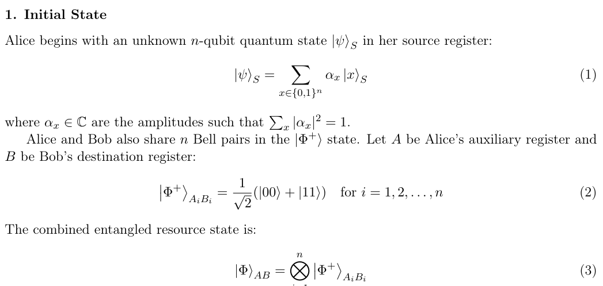
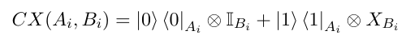
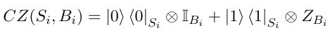
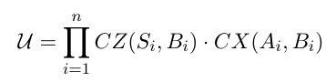
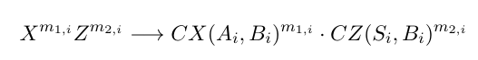
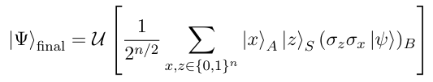
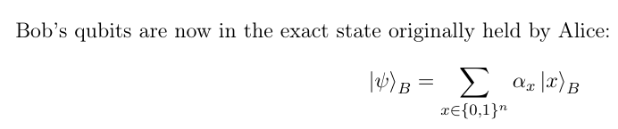

# Quantum N Qubit Teleportation(Unitary-Control Implementation)

> **Category:** Algorithms | **Source:** [https://qniverse.in/docs/quantum-n-qubit-teleportationunitary-control-implementation/](https://qniverse.in/docs/quantum-n-qubit-teleportationunitary-control-implementation/)

### What is the n-Qubit Quantum Teleportation Algorithm?

The n-qubit quantum teleportation protocol is a sophisticated generalization of the standard Bennett et al. protocol. It facilitates the transfer of an arbitrary, unknown n-qubit quantum state from a sender (Alice) to a receiver (Bob) without the physical transmission of the qubits themselves. While the textbook protocol relies on mid-circuit measurements and classical communication, this specific **Unitary-Control Implementation** utilizes the Principle of Deferred Measurement.

In this framework, Alice’s qubits are not measured immediately; instead, they serve as control registers for **Controlled-X (CX)** and **Controlled-Z (CZ)** gates acting on Bob’s qubits. This maintains the entire system in a coherent quantum state throughout the process, making it ideal for quantum hardware or simulators where real-time classical feed-forward is not available.

**Below is a short video showing how the circuit looks for the 2-Qubit Selection, with the option to set the parameters by choosing from the GHZ State(Sampled Entangled State) & Custom State(Separable).**

### Process of n-Qubit Quantum Teleportation

In this implementation, the transfer of the quantum state |ψ⟩ is achieved through high-dimensional entanglement and coherent gate operations. Alice and Bob initially share n maximally entangled Bell pairs. The protocol consists of entangling the source state with the shared resource, followed by a unitary correction phase that “pushes” the quantum information into Bob’s register.

**2\. Bell-Basis Rotation**

Alice performs a local transformation to project her two registers (S and A) into the Bell basis. For each qubit i, she applies:

a. A **CNOT** gate: CX(Si,Ai), where the source qubit is the control.  
b. A **Hadamard** gate: H(Si) on the source qubit.

This operation entangles the unknown state with the shared resource, distributing the quantum information across the tripartite system.

**3\. Unitary Pauli Corrections (Coherent Control)**

In this coherent implementation of quantum teleportation, the classical communication channel is eliminated through the use of quantum-controlled unitary operations. After the rotation phase, Alice’s auxiliary qubits (Ai) and source qubits (Si) encode the necessary correction information in superposition. Instead of performing measurements and sending classical bits, these qubits directly control Pauli correction gates applied to Bob’s corresponding qubits (Bi).

• **Bit-Flip Correction (X):** For each qubit i, a controlled-X (CNOT) gate is applied where Alice’s auxiliary qubit Ai serves as the control and Bob’s qubit Bi as the target. This operation implements the conditional transformation:

The gate applies an X (bit-flip) operation to Bi if and only if Ai is in state |1⟩.

• **Phase-Flip Correction (Z):** Similarly, for each qubit i, a controlled-Z gate is applied with Alice’s source qubit Si as control and Bob’s qubit Bi as target:

This applies a Z (phase-flip) operation to Bi when Si is in state |1⟩.

The complete correction operator U is a tensor product of these controlled operations, applied in sequence:

**Mathematical Justification:** The correction operations are derived from the measurement-based protocol via the Principle of Deferred Measurement. In the standard teleportation protocol, the Bell measurement on qubits (Si, Ai) yields outcomes m1, i,m2, i ∈ {0,1}, with Bob applying Xm1, i Zm2, i to Bi. In the coherent version, the measurement is deferred and replaced by quantum-controlled operations:

  
Since the control qubits (Ai, Si) are in superposition states encoding all possible measurement outcomes, the corrections are applied coherently across all branches of the superposition.

**4\. Final State and Verification**

Upon application of the unitary correction operator U, the system transforms:

where σx = Xx1 ⊗···⊗Xxn and σz = Zz1 ⊗·········⊗Zzn are Pauli operators.

After simplification, the state factorizes as:

### Key observations through the state

**1\. State Factorization:** The final state demonstrates complete factorization between Alice’s registers (A and S) and Bob’s register (B). The entanglement originally present between S and B has been transferred to create a product state.

**2\. No-Cloning Theorem Preservation:** Alice’s original state |ψ⟩S is no longer present in her register. The protocol achieves state transfer rather than duplication, respecting the fundamental quantum constraint against cloning arbitrary quantum states.

**3\. Deterministic Operation:** Unlike probabilistic teleportation protocols, this coherent implementation succeeds with unit probability, as unitary gates have replaced all measurement operations.

**4\. Information Flow:** Quantum information has been transmitted from Alice to Bob without any physical particle traveling between them, demonstrating genuine quantum teleportation.

### Key Features of this Implementation

•**Coherent Logic:** By avoiding mid-circuit measurement, the circuit remains “fully quantum”, which is compatible with all current quantum simulators and NISQ hardware. This approach maintains quantum coherence throughout the computation and enables more efficient error correction in fault-tolerant implementations.

• **Mathematical Equivalence:** Leverages the Principle of Deferred Measurement to ensure the outcome is identical to the measurement-based protocol. This equivalence is provable via commutation relations between controlled operations and the original measurement operators.

**• Scalability:** The framework allows for the teleportation of complex multi-qubit states, including GHZ and W-states. The O(n) gate complexity and nearest-neighbor connectivity requirements make it suitable for near-term quantum architectures.

**• Resource Efficiency:** Compared to measurement-based approaches, this implementation reduces the need for classical control circuitry and synchronization, potentially lowering latency in distributed quantum systems.

•**Fault Tolerance Compatibility:** The unitary nature of all operations makes this protocol naturally compatible with quantum error correction codes, where measurements are expensive and introduce additional latency.

### Potential Applications

**• Quantum Internet:** Serving as the primary mechanism for state transfer between network nodes. This protocol enables quantum routing, distributed entanglement generation, and secure quantum communication without quantum repeaters.

•**Distributed Quantum Computing:** Facilitating the movement of quantum data between spatially separated processing units. Applications include load balancing across quantum processors, modular quantum computing architectures, and quantum cloud computing services.

• **Quantum Sensing:** Relocating fragile entangled states to low-noise environments for high precision metrology. This allows sensors to operate in challenging conditions while processing occurs in protected quantum memories.

• **Quantum Error Correction:** Enabling fault-tolerant quantum computation through state transfer between logical qubits in different error correction blocks, facilitating code switching and lattice surgery operations.

**• Quantum Memory Networks:** Creating distributed quantum storage systems where states can be teleported between memories to optimize retrieval times and storage durations based on environmental conditions.

**• Fundamental Tests:** Providing experimental platforms for testing quantum foundations, including studies of causality in quantum networks, verification of no-signaling principles, and exploration of various interaction-based effects on entanglement.
