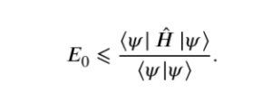
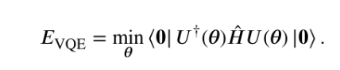
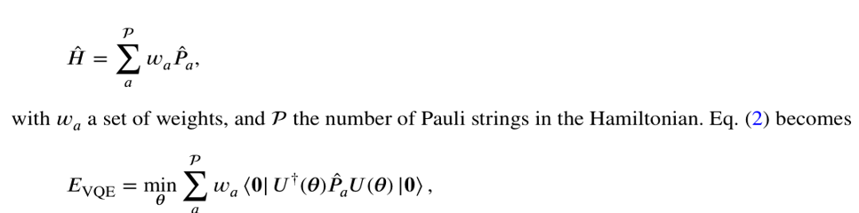
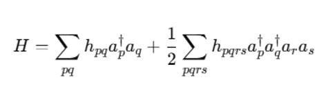

# Variational Quantum Eigensolver (VQE)

> **Category:** Algorithms | **Source:** [https://qniverse.in/docs/variational-quantum-eigensolver-vqe/](https://qniverse.in/docs/variational-quantum-eigensolver-vqe/)

VQE is a hybrid quantum-classical algorithm designed to estimate the expectation value of the Hamiltonian, which corresponds to the ground state energy of a quantum system. In essence, it combines the power of quantum devices to explore the energy landscape of a molecule or material with the computational efficiency of classical algorithms to optimize the variational parameters.

**Presenting here with a short video tour of how the VQE Algorithm is implemented and runs in Qniverse**

[▶️ Video Demonstration: vqe.mp4](https://qniverse.in/wp-content/uploads/2025/04/vqe.mp4)

## How does VQE work?

  * Ansatz Preparation:

  * Quantum Circuit Execution:

  * Classical Optimization:
  * Iteration and Convergence: 
    1. Steps 2 and 3 are repeated iteratively until the energy expectation value converges to a minimum.
    2. This minimum value provides an estimate of the system’s ground state energy.

## Working of VQE in Qniverse

Step 1: Select the Molecule  
Use the dropdown menu to choose the molecule you want to simulate. Available options include “BeH₂,” “H₂O,” “LiH,” etc.  
For now, select the H₂ (Hydrogen) molecule.

Step 2: Define Molecular Geometry  
Next, specify the geometry of the selected molecule by entering the atomic coordinates.  
For the H₂ molecule, you can set the initial positions as follows:

  * Place the first hydrogen atom at coordinates: (0 Å, 0 Å, 0 Å)
  * Place the second hydrogen atom at a distance of 623 Å along the x-axis, with y and z coordinates as 0, i.e., (1.623 Å, 0 Å, 0 Å)

This defines the bond length between the two hydrogen atoms as 1.623 Å.

Step 3: Load the Quantum Circuit

Click on the “Load Circuit” button. This will automatically generate and display the corresponding Qiskit code in the editable code area.

Step 4: Define Molecular Basis and Properties  
To build the molecular geometry in the simulation, you need to define the basis set and other molecular properties:

  * Basis Set: Use the STO-3G basis, a commonly used minimal basis set for molecules.
  * Charge: Set the charge to 0, since the H₂ molecule is electrically neutral.
  * Multiplicity: Set the multiplicity to 1, indicating a singlet state (i.e., all electrons are paired).

These inputs are essential to generate the molecular structure and calculate quantum chemistry.

Step 5: Use PySCF to Generate Molecular Properties  
Utilize PySCF (Python-based Simulations of Chemistry Framework) to analyze the molecular structure.  
Pass the defined molecule to the PySCFDriver, which will compute the molecular integrals and return essential electronic structure properties.

Step 6: Apply Freeze-Core Approximation

To simplify the problem, apply the FreezeCoreTransformer. This reduces the number of orbitals by freezing core electrons and optionally removing selected orbitals.

freeze_core=True,

remove_orbitals=[4, 5, 6]

This transformation returns a reduced electronic structure problem optimized for simulation.

Step 7: Map to Qubit Hamiltonian using Parity Mapper  
To convert the molecular Hamiltonian into a qubit representation, use the Parity Mapper (a fermion-to-qubit mapping technique) along with the second-quantized operators from the transformed problem.

mapper = ParityMapper(num_particles=num_particles)

qubit_op = mapper.map(problem.second_q_ops()[0])

This results in the qubit Hamiltonian, which can now be used in quantum algorithms such as VQE.

Step 8: Create the Ansatz Circuit for VQE

To run the Variational Quantum Eigensolver (VQE), an ansatz, which is the parameterized quantum circuit used to approximate the molecule’s ground state, needs to be defined.

Start by preparing the initial quantum state using the Hartree-Fock method:

init_state = HartreeFock(num_spatial_orbitals, num_particles, mapper)

Then, define the variational form using the UCCSD (Unitary Coupled Cluster with Singles and Doubles) ansatz:

ansatz = UCCSD(num_spatial_orbitals, num_particles, mapper, initial_state=init_state)

Alternatively, a hardware-efficient ansatz like EfficientSU2 can be used:

ansatz = EfficientSU2(num_qubits=qubit_op.num_qubits, entanglement=’linear’, initial_state=init_state)

For molecular simulations, UCCSD is generally more chemically accurate and better suited, so choose it as our ansatz for this simulation.

Step 9: Set the Optimizer and Estimator

To minimize the expectation value of the qubit Hamiltonian, use a classical optimizer that updates the parameters of the ansatz circuit. For this, choose the SLSQP (Sequential Least Squares Programming) optimizer, which is a gradient-based method known to work efficiently for VQE-like problems. However, you can experiment with other optimizers such as COBYLA, SPSA, or L-BFGS-B based on performance needs.

optimizer = SLSQP(maxiter=10)

Next, define the Estimator, which is used to evaluate the expectation value of the Hamiltonian with respect to the parameterized quantum state. This is a crucial component in the VQE loop.

aer_estimator = Estimator(approximation=True)

The approximation=True flag enables certain optimizations for faster evaluation, though it may introduce minor approximations.

Step 10: Set Up the VQE Algorithm

After defining the ansatz, optimizer, and estimator, configure the Variational Quantum Eigensolver (VQE) algorithm. VQE is a hybrid quantum-classical method where a parameterized quantum circuit (the ansatz) is used to prepare quantum states. A classical optimizer updates these parameters to minimize the expected energy of the Hamiltonian. This step essentially combines all components into a working VQE instance.

vqe = VQE(

ansatz=var_form,

optimizer=optimizer,

estimator=aer_estimator)

Step 11: Compute the Ground State Energy

In this step, the VQE algorithm is executed by applying it to the qubit Hamiltonian obtained from the molecule. The quantum circuit is evaluated using the estimator, and the classical optimizer iteratively updates the parameters to minimize the energy. The result provides an estimate of the ground state energy of the molecule.

result = vqe.compute_minimum_eigenvalue(qubit_op)

print(“VQE ground state energy:”, result.eigenvalue.real)

Step 12: Classical Ground State Energy (Exact Solver)

To verify the accuracy of the VQE result, perform a classical simulation of the ground state energy using the NumPyMinimumEigensolver. This exact solver provides the true lowest eigenvalue of the qubit Hamiltonian, which is feasible for small systems. Comparing the VQE result with this classical value allows us to assess the performance and accuracy of our quantum algorithm.

def exact_solver(qubit_op, problem):

sol = NumPyMinimumEigensolver().compute_minimum_eigenvalue(qubit_op)

result = problem.interpret(sol)

return result

exact_result = exact_solver(qubit_op, problem)

print(“Exact ground state energy:”, exact_result.total_energies[0].real)

## Key Concepts in VQE

Hamiltonian:

  * The Hamiltonian, denoted by H, is the operator that represents the total energy of the quantum system.

  * In the context of chemistry, it often represents the electronic structure of a molecule.

  * The Hamiltonian is typically a Hermitian operator, ensuring that its eigenvalues (energy levels) are real.

# Ground State: The lowest energy state of a quantum system.

# Wavefunction: A mathematical function that describes the state of a quantum system.

#Ansatz (trial state or trial wavefunction)

A parameterized quantum circuit that prepares a trial wave function for the system. Common ansatzes include:

Types of ansatz

  1. Hardware-Efficient Ansatz = This uses layers of parameterized single-qubit rotations and entangling gates.
  2. Chemistry-Inspired Ansatz (e.g., UCCSD) = the Unitary Coupled Cluster with Single and Double excitations (UCCSD) is commonly used for molecular or chemistry Hamiltonians. It’s more complex, but it works well for chemistry problems.
  3. Problem-Specific Ansatz: In some cases, custom ansätze that leverage knowledge about the problem (such as symmetry or low-energy subspaces) can be more effective.

Expectation Value: The average value of a physical observable (like energy) when measured in a given quantum state.

## Mathematical Formulation of VQE

VQE optimizes an upper bound for the lowest possible expectation value of an observable for a trial wave function. Namely, providing a Hamiltonian ‘ H ‘and a trial wavefunction |Ψ>. The ground state energy associated with this Hamiltonian ‘ Eo‘ is bounded by.

The objective of the VQE is, therefore, to find a parameterization of |Ψ> such that the expected value of the Hamiltonian is minimized.

In mathematical terms, aim to find an approximation to the eigenvector |Ψ> of the Hermitian operator ‘ H ‘ corresponding to the lowest eigenvalue Eo. To translate this minimization task into a problem that can be executed on a quantum computer, one must start by defining a so-called ansatz wave function that can be implemented on a quantum device as a series of quantum gates. i.e, can only be performed unitary operations or measurements on a quantum computer. Do this by using parameterized unitary operations

Therefore, express |Ψ> as the application of a generic parameterized U(θ) unitary to an initial state for ‘n’ qubits, with θ denoting a set of parameters taking values in ( π to -π )

The VQE optimization problem, written as

Is also referred to as the cost function of the VQE optimization problem. can continue this by writing the Hamiltonian in a form that is directly measurable on a quantum computer as a weighted sum of spin operators. Observables suitable for direct measurement on a quantum device are tensor products of spin operators (Pauli operators). can be defined as Pauli strings, with N being the number of qubits used to model the wavefunction.

The Hamiltonian can be written as.

Where the hybrid nature of the VQE becomes apparent, each term corresponds to the expectation value of a Pauli string and can be computed on a quantum device, while the summation and minimization are computed on a conventional computer.

# Molecular Hamiltonian

For quantum chemistry problems, start with the electronic structure problem. The Hamiltonian can be expressed as:

Where:

  * h_pq: One-electron integrals.
  * h_pqrs: Two-electron integrals.
  * a†p, a†q: Fermionic creation and annihilation operators.

Ansatz

The ansatz is a parameterized quantum circuit that prepares a trial wavefunction, |ψ(θ)⟩, for the system.

The parameters θ are a set of variational parameters that control the state of the qubits.

Mathematically, the ansatz can be represented as a unitary operator U(θ) acting on an initial state |ψ₀⟩:  
|ψ(θ)⟩ = U(θ) |ψ₀⟩

Choices for the ansatz include:

Variational Quantum Eigensolver (VQE) Ansatz: A circuit composed of layers of single-qubit rotations (e.g., Rx, Ry, Rz gates) followed by entangling gates (e.g., CNOT gates). In a hardware-efficient ansatz, the circuit might consist of layers where:

  1. You apply single-qubit rotation gates RX(θ), RY(θ), and RZ(θ) to each qubit, with parameters θ as variational parameters.
  2. Apply entangling gates like CNOT or CZ gates to pairs of qubits.
  3. Repeat these layers several times to increase expressibility.

Expectation Value calculation

The expectation value of the energy for a given state |ψ(θ)⟩ is calculated as: ⟨E(θ)⟩ = ⟨ψ(θ)|H|ψ(θ)⟩

This represents the average energy of the system when measured in the state prepared by the ansatz.

Variational Principle:

The variational principle states that the expected value of the energy for any trial wavefunction is always greater than or equal to the true ground state energy.

Mathematically:  
⟨E(θ)⟩ ≥ E₀, where E₀ is the ground state energy of the system.

Expectation Value: calculate the Expectation Value of a measurement Outcome based on the result from QC, which has Hamiltonian in X, Y, and Z terms, s so for each term, need to run the circuit and store the result. Then you multiply the correlation expectation value by its coefficient, then you sum it up, and that’s your result.

For the General Hamiltonian, you run the circuit 3 times.

  1. One measurement on the x basis
  2. One measurement in the y basis
  3. One measurement in the z basis

Expectation Value Update: for each measurement outcome expectation value is updated by adding the product of the sign and the normalised frequency of that outcome, counts[CT]/shots

If the measurement outcome is “1,” the sign is set to -1 (indicating a negative contribution to the expectation value) if the ct is “0,” the sign remains +1

Ex. suppose counts ={“0”, 600, “1”, 400}, total shots = 1000

Expectation value = (+1) 600 / 1000 + (-1) 400 / 1000

= 0.6 – 0.4 == 0.2

+1: more aligned to 0 outcome

-1: indicate state more aligned with the 1 outcome basis

Classical Optimization:

A classical optimization algorithm (e.g., gradient descent, conjugate gradient) is used to minimize the energy expectation value ⟨E(θ)⟩ by adjusting the variational parameters θ.

The goal is to find the set of parameters that minimizes the energy and provides an estimate of the ground state energy.

# Theoretical Underpinnings

  * Quantum-Classical Hybrid Approach: VQE leverages the power of both quantum and classical computers. Quantum devices are used to prepare and measure the state of the system, while classical computers perform the optimization and control of the quantum hardware.
  * Variational Principle: The variational principle provides a theoretical foundation for the VQE algorithm, ensuring that the estimated energy is an upper bound to the true ground state energy.
  * Entanglement: Entanglement plays a crucial role in VQE. By creating entanglement between qubits, the ansatz can explore a richer space of quantum states and potentially achieve lower energy values.

## VQE Pipeline

1.A) Hamiltonian construction and representation

The first step in the VQE is to define the system for which the ground state is sought.. This can be a molecular Hamiltonian for electronic structure, a solid-state system, a spin lattice model, a nuclear structure problem Hamiltonian, or a Hamiltonian describing any other quantum system.

The first pre-processing step of the VQE in which a set of basis functions for the Hamiltonian to be expressed as a quantum observable of the electronic wave function

1.B) Encoding of operators

The second pre-processing step of the VQE is where the Hamiltonian is encoded into a set of operators that can be measured on a Quantum Computer, using the qubit register wavefunction. To do this, fermionic operators in the Hamiltonian are mapped to spin operators using an encoding

The encoding of operators on Qubit registers on quantum computers can only measure observables expressed in a Pauli basis due to the two-level nature of spins for ‘ N ’ qubits.

In first quantization, the operators can be directly translated into spin operators that can be measured on quantum computers, as they are not used to enforce the antisymmetry of the wave function.

In second quantization, the Hamiltonian is expressed as a linear combination of fermionic operators, which are defined to obey this antisymmetry relationship, unlike Pauli operators. The role of a fermionic to spin encoding is, therefore to construct observables from Pauli operators

1.C) Measurements Strategy and Grouping

The next step in the VQE pipeline is to determine how measurements are distributed and organized to efficiently extract the required expectation values from the trial wave function.

To achieve a precision of the expectation value of an operator, we need to perform multiple repetitions of the circuit execution, with each execution concluding with a measurement. The goal of our measurement strategy is to minimize the number of repetitions required.

The third step in the pre-processing, where operators defined in (1.B) are grouped to be measured simultaneously later on, usually requires an add-on to the quantum circuit for each group to rotate the measurement basis to a basis in which all operators in the group are diagonalized.

1.D) Ansatz and state preparation:

Once the Hamiltonian has been prepared such that its expectation value can be measured on a quantum device, we can turn to the preparation of the trial wave function. To do this, one must decide on a structure for the parametrized quantum circuit, denoted as an ansatz. It is used to produce the trial state, with which the Hamiltonian can be measured. Upon successful optimization of the ansatz parameters, the trial state becomes a model for the ground state wave function of the system studied.

D 1.1) The VQE Loop

1.1 a) Ansatz and trial state preparation: The first step of the VQE loop is to apply the ansatz to the initialized qubit register. Before the first iteration of the VQE, all the parameters of the ansatz also need to be initialized

1.1 b) Basis rotation and measurement: Once the trial wave function has been prepared, it must be rotated into the measurement basis of the operator of interest (quantum computers in general measure in Z basis) or a diagonal basis of a specific group of Pauli strings

1.1 (c) Observable computation: The expectation value to be computed depends on the optimization strategy used; in any case, however, these are reconstituted by weighted summation on conventional hardware or using a machine learning technique

1.1(d) Parameters update: Based on the observables computed and the optimization strategy, can be computed and apply updates to the ansatz parameters can be computed and a new iteration of the VQE.

## Molecule Selection

The dropdown menu with options like “BeH2,” “H2O,” “LiH,” etc., is a crucial aspect of this VQE algorithm. It allows users to choose the specific molecule they want to investigate.

## Applications of VQE

Chemistry and Materials Science:  
Calculating ground state energies of molecules.  
Simulating chemical reactions.  
Designing new materials with desired properties.

Drug Discovery:  
Simulating molecular interactions to identify potential drug candidates.

Quantum Machine Learning:  
Training variational quantum classifiers

## Advantages of VQE

Versatility: It can be applied to a wide range of quantum systems.  
Hybrid Approach: Leverages the strengths of both quantum and classical computers.  
Scalability: It can be potentially scaled to larger systems as quantum hardware improves.
