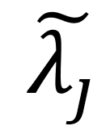
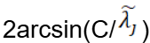

# Harrow-Hassidim-Lloyd(HHL) Algorithm

> **Category:** Algorithms | **Source:** [https://qniverse.in/docs/harrow-hassidim-lloydhhl-algorithm/](https://qniverse.in/docs/harrow-hassidim-lloydhhl-algorithm/)

The Harrow-Hassidim-Lloyd (HHL) algorithm is a quantum algorithm designed to solve linear systems of equations of the form _Ax = b_. HHL offers an exponential speedup in the matrix dimension N over classical methods, provided the matrix is well-conditioned, sparse, and Hermitian, and the goal is obtaining properties of _x_ from the state |x⟩, not the classical vector itself. The runtime scales polynomially with A’s condition number (κ) and sparsity and only logarithmically with N.

**Presenting here with a short video tour of how the HHL Algorithm is implemented and runs in Qniverse**

[▶️ Video Demonstration: https://qniverse.in/wp-content/uploads/2025/04/HHL-algo.mp4?_=1](https://qniverse.in/wp-content/uploads/2025/04/HHL-algo.mp4?_=1)

## Steps of HHL Algorithm

**State Preparation:** Prepare a quantum state |b⟩ corresponding to the vector b.

**Quantum phase estimation(QPE):** Apply the Quantum Phase Estimation algorithm. This typically involves using Hamiltonian simulation based on the matrix A (specifically, the unitary evolution e^iAt ) to estimate the eigenvalues of λj of A. The estimated eigenvalues are stored in a quantum register.

**Controlled Rotation:** Introduce an ancilla qubit and apply a controlled rotation, conditioned on the eigenvalue register |⟩. The rotation angle is  where C is a constant, ensuring that the ancilla qubit encodes 1/(λ_j ) ̃.

Measurement of the Ancilla qubit: Measure the ancilla qubit. The algorithm is considered successful only if the measurement outcome is |1⟩.

**Uncomputation:** Reverse the Quantum Phase Estimation step (often called Inverse QPE or IQPE). This procedure disentangles the eigenvalue register from the main system register and ideally returns the eigenvalue register to the all-zero state, |0…0⟩.

After completing these steps (precisely, after measuring the ancilla qubit as |1⟩), the state remaining in the primary system register is the quantum state |x⟩. This state’s amplitudes are proportional to the components of the solution vector _x_.

## Key Requirements & Parameters for HHL Algorithm

  1. **Matrix A:**

  * It must be Hermitian (or transformed into a Hermitian matrix).
  * It needs to be  _s_ -sparse (having  _s_ non-zero entries per row/column) to allow for efficient Hamiltonian simulation (specifically, simulation of the evolution operator e^iAt).
  * Its condition number, kappa (κ), the largest to smallest eigenvalue magnitude ratio, must be manageable (not excessively large).

  2. **Vector b:**

An efficient quantum state preparation procedure to create the state |b⟩ corresponding to the vector _b_ must exist. 

  3. **Output:**

The primary output is the quantum state **|x****⟩**. The goal is often not to obtain the full classical vector **x** , but rather to use the state **|x****⟩** to compute properties of the solution, such as an expectation value like **⟨****x|M|x****⟩** for some operator **M**.

  4. **Key Parameters Influencing Performance:**

N: Dimension of the matrix A.

kappa (κ): Condition number of matrix A.

s: Sparsity of matrix A.

epsilon (ε): Desired precision or maximum error allowed in the final state or result.

Time(t): Evolution time of the Hamiltonian, used in the QPE step.

## Advantages of HHL Algorithm

  * The runtime of the HHL algorithm scales at poly(log N, κ, s, 1/ε), precisely in O(log(N)^k^2 s^2/ϵ).
  * The main advantage of HHL is the potential for an exponential speedup in terms of the matrix dimension N compared to classical algorithms (like Conjugate Gradient: O(Nslog(1/ε))), _when_ N is large and k, s, 1/ε, remain relatively small (ideally, growing only polylogarithmically with N).

****

## Limitations of HHL Algorithm

  1. **Input/Output:** Requires quantum state preparation for _b_ and outputs a quantum state |x⟩, not the classical vector _x_. Reading out all amplitudes of |x⟩ takes O(N) time, negating the exponential speedup. Useful only if the desired output is a property of _x_ (e.g., an expectation value) computable from |x⟩.
  2. Condition Number (k): The runtime depends polynomially on k, which can be very large for ill-conditioned matrices.
  3. Sparsity (s): Assumes A is sparse for efficient Hamiltonian simulation.
  4. Hermiticity: Requires A to be Hermitian or transformed into a Hermitian matrix.
  5. Hardware limitation: The algorithm assumes Quantum computers are fault-tolerant. However, current versions of quantum computers are generally NISQ type.

## Applications of the HHL Algorithm

The HHL algorithm has promising applications in various domains where solving large linear systems is essential. Some key areas include:

  * **Machine Learning** : Many machine learning algorithms, such as linear regression and classification, involve solving systems of equations. The HHL algorithm enables quantum-enhanced approaches that can provide significant speedups, particularly for high-dimensional data. 
  * **Quantum Chemistry and Physics** : Simulating quantum systems often involves solving systems of equations derived from discretized differential equations. HHL can help compute physical observables efficiently.
  * **Optimization Problems** : Many convex optimization problems require matrix inversion or linear system solutions. HHL can be integrated into quantum optimization frameworks to provide speedups.
