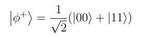
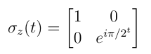
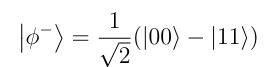
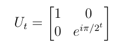

# Quantum Veto Algorithm

> **Category:** Algorithms | **Source:** [https://qniverse.in/docs/quantum-veto-algorithm/](https://qniverse.in/docs/quantum-veto-algorithm/)

## Introduction

Quantum Anonymous Veto (QAV) is a quantum protocol designed to allow a group of participants to collectively vote on a decision with veto power, while maintaining the anonymity of each individual’s vote. In Protocol A, only two qubits are used, and a Bell state is prepared and shared among all participants in sequential iterations. Each vetoer is assigned two quantum operators: one corresponding to the decision to veto and another for abstaining. Based on whether they wish to cast a veto or not, they apply the respective operator to the qubit passed to them. This preserves anonymity while allowing the system to reflect whether a veto has occurred.

**Presenting here with a short video tour of how the Quantum Veto Algorithm is implemented and runs in Qniverse**

[▶️ Video Demonstration: https://qniverse.in/wp-content/uploads/2025/04/quantum-veto-algo.mp4?_=1](https://qniverse.in/wp-content/uploads/2025/04/quantum-veto-algo.mp4?_=1)

## Theoretical Explanation of Protocol A

Protocol A is an iterative quantum protocol designed to detect whether any participants have exercised their veto power anonymously. The protocol uses only two qubits — one home qubit and one travel qubit — initially prepared in a Bell state. The general flow is as follows:  
• Step A1: A verifier (VA) prepares the maximally entangled Bell state:

VA retains the first qubit (home qubit), while the second qubit (travel qubit) is sequentially passed to all the voters.

Step A2: Each voter is assigned two operators — a phase gate and an identity gate. If the voter chooses to veto, they apply a phase rotation gate:

If they choose not to veto, they apply the identity operator. Here, t denotes the current iteration number, starting from t = 0.

Step A3: After the travel qubit passes through all voters, it is sent back to the verifier (VA), who performs a Bell basis measurement using both the home and travel qubits. Based on the resulting quantum state, VA can determine whether the state has changed (indicating a veto) or not (indicating no veto).

Step A4: If the result is inconclusive, the protocol is repeated in the next iteration with t incremented by 1. Each iteration refines the phase rotation applied by vetoers as e^iπ/2t, allowing the protocol to converge to a conclusive result eventually.

## Why are multiple iterations required?

The number of iterations required to obtain a conclusive result depends entirely on how many voters have used their veto power. Specifically:  
1\. If an odd number of voters apply the veto in an iteration with t = 0, the final quantum state becomes:

which is orthogonal to the initial state and thus conclusively indicates a veto. In this case, only one iteration is required.

2\. If the number of vetoes is 4n + 2, the final state remains inconclusive after the first iteration, and the protocol needs to run for at least t = 1. At t = 1,  
The phase rotation becomes e^iπ/2 = i.

For example:

– 1 veto: |ψ⟩ → i|ψ⟩

– 2 vetoes: |ψ⟩ → −|ψ⟩ (conclusive)

– 3 vetoes: |ψ⟩ → −i|ψ⟩

– 4 vetoes: |ψ⟩ → |ψ⟩ (inconclusive)

– 6 vetoes: |ψ⟩ → −|ψ⟩ (conclusive)  
So, 2 iterations are required for 4n + 2 vetoes to detect a conclusive change

3\. If the number of vetoes is a multiple of 4 (i.e., 4n), the protocol may require up to 1 +log2n iterations to reach a conclusive result. In each iteration, the phase resolution increases, gradually allowing the interference pattern to shift and reveal the underlying veto pattern through the accumulated phase

4\. If no veto is applied, the state always remains unchanged and matches the initial Bell state |ϕ+⟩, which is a conclusive indication of no veto. Thus, Protocol A efficiently uses iterative phase encodings and entangled states to  
preserve anonymity while conclusively detecting the presence of vetoes, without revealing the identity of any participant

## Mathematical Explanation of Protocol A with 4 Voters

Protocol A begins with the verifier (VA) preparing a Bell state:

The first qubit is retained by VA (home qubit), while the second qubit (travel qubit) is  
passed through all the voters. Each voter applies a unitary Ut on the travel qubit only  
if they wish to use their veto power, where t is the current iteration number. The  
unitary is defined as:

**Explanation of Phase Accumulation**

In each iteration t, a voter applying a veto introduces a phase: e^iπ/2t  
Let k be the number of vetoes in a given iteration. The total global phase becomes:  
Total phase = (e^iπ/2t )^k = e^ikπ/2t  
• If this phase results in the final state becoming |ϕ−⟩, a conclusive result is achieved.  
• If the state remains |ϕ+⟩, the result is inconclusive, and the next iteration is performed.

## Iteration Logic

• For an odd number of vetoes (1 or 3), the phase eiπ or ei3π = −1 results in |ϕ−⟩ after 1 iteration.  
• For 2 vetoes (4n+2 form), |ϕ−⟩ appears in 2nd iteration due to total phase i^2 = −1.  
• For 4 vetoes (multiples of 4), the phase is cyclic and only becomes −1 in the 3rd iteration: e^i4π/4 = e^iπ = −1.

Thus, the protocol terminates in:

• 1 iteration for the odd number of vetoes.  
• 2 iterations for veto count = 4n +2 (e.g., 2, 6).  
• Up to 1+log2 n iterations for veto count = 4n (e.g., 4, 8)

## Conclusion

Protocol A of Quantum Anonymous Veto provides a secure and anonymous method of detecting a veto without revealing the identity of the vetoer. The use of only two qubits and iterative rounds makes it practical for near-term quantum computers like IBMQ
