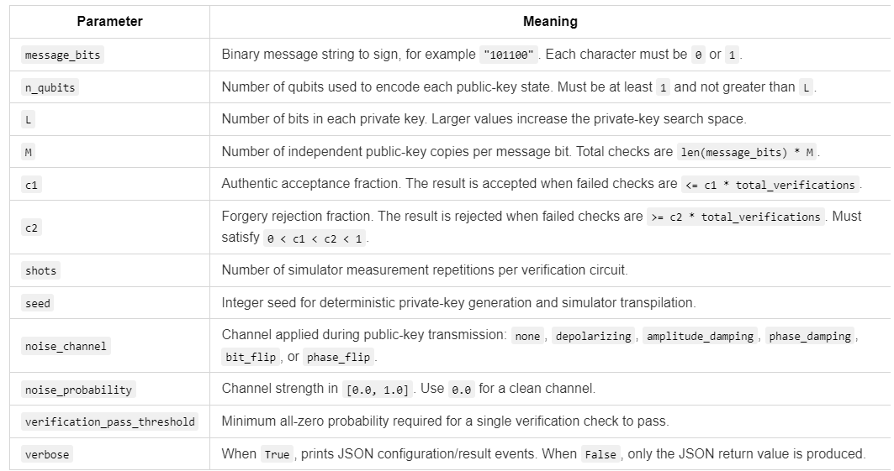

# Quantum Digital Signature(QDS) Algorithm

> **Category:** Algorithms | **Source:** [https://qniverse.in/docs/quantum-digital-signatureqds-algorithm/](https://qniverse.in/docs/quantum-digital-signatureqds-algorithm/)


## Quantum Digital Signatures

Digital signatures are among the most widely deployed cryptographic primitives in modern computing. Every signed software update, TLS handshake, and authenticated email leans on the same promise: a message came from who it claims to be, and arrived as it was sent. This explains how that promise can be rebuilt on quantum mechanics instead of computational hardness, and walks through the small protocol implemented in this repository. It assumes no quantum background – only some patience with the fact that measurement and copying behave differently at the scale of single qubits.

## What does a signature have to guarantee?

Three properties matter here, and conflating them hides the interesting part.

Authenticity is identity: the recipient can confirm the message came from the claimed signer and no one else. Integrity is tamper-evidence: any change after signing is detectable. Both are what people usually picture when they hear “signature,” and both are relatively easy to reason about.

The third property, non-repudiation, is subtler, and it is where signatures earn their legal and commercial weight. Non-repudiation means the signer cannot later deny having signed. A signature on a contract is valuable precisely because the signer cannot credibly claim someone else produced it. The catch is that in a distributed setting this becomes a consistency requirement rather than a property of any single check: two recipients who each verify the same signed message must reach the same verdict. If Alice could craft something that Bob accepts but Charlie rejects, she could honor or disown it at will, and the signature would mean nothing in a dispute. Non-repudiation therefore lives in the agreement between verifiers, not inside one verification. This distinction quietly shapes the verdict rule described later, and it is also the hardest of the three to provide – the original Gottesman– Chuang protocol spends most of its machinery on it.

## Why is the classical foundation at risk?

RSA-style signatures derive all three properties from a single assumption: that recovering the private key from the public key means solving a problem – factoring, or discrete logarithms – that no feasible computer cracks quickly. The assumption has held in practice, but it is a claim about which algorithms exist and what hardware can run them, not a law of nature.

Shor’s algorithm withdraws that safety against a quantum adversary. A large fault-tolerant quantum computer factors integers and computes discrete logarithms in polynomial time, collapsing the distance between producing a signature and forging one. The threat is narrow and specific: it attacks the hardness assumption, leaving the protocol logic untouched. That specificity is the whole motivation for a different foundation – one where forging stays out of reach even for an adversary with unbounded computation.

## Security from physics rather than hardness

Gottesman and Chuang’s 2001 proposal trades the computational assumption for two physical facts no amount of computing power can route around.

The first is no-cloning: an unknown quantum state cannot be copied. The second is that measurement is both destructive and incomplete – pulling classical information out of a quantum state disturbs it and never reveals everything. A quantum public key, then, cannot be quietly duplicated, taken offline, and reverse-engineered the way a classical public key can.

The Holevo bound turns these qualitative facts into a usable number: a measurement on n qubits yields at most n bits of classical information, no matter how the measurement is designed. That ceiling is the lever the whole scheme pulls. If Alice’s private key carries substantially more entropy than her quantum public key can leak, then no measurement an adversary performs – now or years later, with any machine – recovers the key. Security stops scaling with the attacker’s resources and starts resting on an information inequality.

## The construction, step-by-step guide

The implementation runs on Qiskit’s Aer simulator with a default configuration worth holding in mind: a six-bit message 101100, each public key encoded across $n = 4$ qubits, private keys of length$L = 25$ bits, and $M = 5$ independent copies distributed per message bit. Everything below describes a single message bit; the full message repeats the procedure bit by bit.

**1\. Key generation**. For each message bit, Alice draws two independent random L-bit strings, one earmarked for signing the value 0 and the other for 1, and she repeats this M times to get M copies. The private key is nothing more than these random strings. Their secrecy is the entire basis of her later claim to authorship.

**2\. Encoding into states**. A private key is read as an integer j and mapped to a rotation angle. With

$$ \theta = \frac{\pi}{2^L}, \quad \varphi = j \theta, $$ a qubit prepared from $|0\rangle$ by an $R_Y(2\phi)$ rotation lands in

$$ |f_k\rangle = \cos(\varphi)|0\rangle + \sin(\varphi)|1\rangle. $$

Computing this state from the key is trivial; inverting it from the state alone is blocked by the readout limits above, which is exactly the one-way behavior the protocol needs. The code splits the L-bit key into one chunk per qubit so the angular resolution stays manageable, but each chunk obeys the same rule. Choosing RY, a real rotation in the $|0\rangle$ -“$|1\rangle$ plane – keeps the states real and makes the inverse a clean negation of the angle, which pays off at verification. Computing this state from the key is trivial; inverting it from the state alone is blocked by the readout limits above, which is exactly the one-way behavior the protocol needs. The code splits the L-bit key into one chunk per qubit so the angular resolution stays manageable, but each chunk obeys the same rule. Choosing RY – a real rotation in the $|0\rangle$ – $|1\rangle$ plane – keeps the states real and makes the inverse a clean negation of the angle, which pays off at verification.

**3\. Distribution through a noisy channel**. Alice transmits the public-key states, and the implementation models the imperfection of that transmission directly. A configurable channel – depolarizing, bit-flip, phase-flip, amplitude damping, or phase damping – acts on each qubit with strength $p$ before the verifier stores it. Noise is confined to this step by design; preparation, signing, and verification remain ideal. The aim is to read off what the channel alone does to the protocol’s success rate, without confounding it with gate or measurement errors. The isolation is artificial – real hardware is noisy everywhere – but it makes the channel’s contribution legible, which is the point of a study model.

**4\. Signing.** Alice signs by announcing the private keys themselves. Disclosing the correct L-bit strings for the bits she is committing to is the signature; there is no separate signing transform. This is what binds authorship to secrecy: only the holder of the original random keys can produce them on demand.

**5\. Verification.** Holding the stored public-key state, the verifier reconstructs the rotation implied by a revealed key and applies its inverse. For a genuine key on a clean channel, the inverse returns the qubits to $|0\rangle$ exactly, so measuring all qubits should read all zeros. Since measurement is probabilistic and the channel is not clean, the verifier does not insist on one perfect shot; it estimates the all-zeros probability over many shots and counts a check as passing when

$$ P(\text{all zeros}) \ge \tau, $$

with $\tau = 0.80$ in the code. Across every bit and copy, this produces $T = N \times M$ checks – 30 under the defaults.

## Turning checks into a verdict

The non-repudiation requirement re-enters here. Let $s$ be the number of failed checks out of T. Rather than a single cut-off, the verifier uses two:

$$ \begin{aligned} s \le c_1 T &\Rightarrow \texttt{ACCEPT\\_AUTHENTIC} \\\ s \ge c_2 T &\Rightarrow \texttt{REJECT\\_FORGED} \\\ c_1 T < s < c_2 T &\Rightarrow \texttt{INCONCLUSIVE} \end{aligned} $$

with defaults $c_1 = 0.1$ and $c_2 = 0.4$, i.e., cut-offs at 3 and 12 failures.

The band between the thresholds is not hedging. A lone threshold would force a ruling on borderline evidence, and borderline cases are exactly where two honest verifiers, exposed to slightly different noise, might split – the one outcome non-repudiation cannot tolerate. The gap soaks up that ambiguity: real signatures clear the lower bound with room to spare, forgeries sail past the upper one, and the uneasy middle is labeled inconclusive instead of being resolved inconsistently. In the full transferable protocol, the original recipient and a forwarded recipient sit at different points within this gap, and the separation $c_2 – c_1$ is precisely what keeps a message that one accepts from being a message that the other rejects.

## Why does forgery fail?

A forger has no access to the private keys and can only guess. A wrong guess rebuilds the wrong rotation, so the inverse fails to restore $|0\rangle$. For a single qubit, with true angle $\phi$ and guessed angle $\tilde{\phi}$, the all-zeros probability is

$$ P(\text{all zeros}) = \cos^2(\varphi – \tilde{\varphi}), $$

which falls well under Ï„ unless the guess is almost exact. Guessing a 25-bit key outright carries probability $2^{-25}$, about one in 34 million. The bundled forgery routine shows the inevitable result: all 30 checks fail, and the verdict is REJECT_FORGED. The same expression explains the protocol’s tolerance for mild noise – a small perturbation nudges P(all zeros) down slightly, but it takes serious corruption to drag a genuine check below 0.80.

## Reading the security margin

The code prints a diagnostic it calls the security margin,

security margin= $L – nM$,

setting the entropy Alice holds (L bits) against a generous estimate of what the public copies can leak (n qubits per copy, so at most nM bits by the Holevo bound). The defaults give $25 – 20 = 5$. A positive value means the secret outweighs the leak and the protocol sits in its intended regime; the code still runs at zero or negative margins but warns, since there the Holevo separation no longer shields the key. Read this as a design heuristic, not a proof – it flags bad parameter choices without certifying good ones.

## Scope and limitations

It helps to be precise about what this code is. It is a simulator-based teaching implementation of the verification core: key encoding, noisy distribution, signing by disclosure, and threshold verification. It is not a deployable cryptosystem,  
and it does not build the full multi-recipient transfer protocol that genuine non-repudiation demands. The two-threshold rule that would underpin transferability is present and working, but with a single verifier, the consistency-across-recipients guarantee is shown in the mechanism rather than enforced end to end. Because noise is modeled only on the channel, the results speak to transmission robustness, not to full hardware fidelity.

## Public API and Usage

The class exposes a deliberately small public API. Construct an instance with the protocol parameters, then call one of these public methods:

  * run() for an honest end-to-end signing and verification run.
  * run_forgery_attempt() for the adversarial random-key forgery example.
  * run_swap_test_example() for a SWAP-test comparison of public-key states.

All other methods, constants, and stored state are implementation details and are private underscore-prefixed members. Use the JSON returned by the public methods instead of reading internal attributes.

### Constructor Parameters
    
    
    ```python
    from quantum_digital_signature_channel_noise import QuantumDigitalSignatureWithChannelNoise
    
    qds = QuantumDigitalSignatureWithChannelNoise(
        message_bits="101100",
        n_qubits=4,
        L=25,
        M=5,
        c1=0.1,
        c2=0.4,
        shots=4096,
        seed=42,
        noise_channel="depolarizing",
        noise_probability=0.05,
        verification_pass_threshold=0.80,
        verbose=True,
    )
    ```



### run()
    ```python
    result_json = qds.run()
    ```

Runs the honest protocol: reset state, generate private keys, build and transmit public-key states, reveal the correct private keys as the signature, verify the signature, and return a JSON string. It takes no method parameters; all inputs come from the constructor.

Important result fields include verdict, failed_verifications,failure_rate, total_verifications, authentic_threshold, reject_threshold, security_margin, warnings, generated_files, and decision_visualization.  
Each run also writesverification_decision.png, a compact image showing the accept, inconclusive, and reject zones for the observed failure count.  
The decision_visualization field is the JSON form of that image data: it contains green/yellow/red zone ranges and colours, threshold locations, axes, and the observed failure point location and colour.

### run_forgery_attempt()
    ```python
    forgery_result_json =qds.run_forgery_attempt()
    ```
    
    
    ```python
    
    ```

Runs the same setup asrun(), but verifies a forged signature made from random private-key guesses. It takes no method parameters and returns the same JSON result shape as run(). Under clean default conditions, the expected verdict is REJECT_FORGED.

### run_swap_test_example(…)
    ```python
    swap_result_json = qds.run_swap_test_example(
        bit_index=0,
        copy_index=0,
        bit_value=None,
        make_plot=True,
    ) Runs three SWAP-test comparisons for one selected public-key state: ideal_vs_ideal, ideal_vs_received, and ideal_vs_complementary.
    ```

Parameter | Meaning  
---|---  
bit_index | Message-bit position to inspect. Valid range is 0 <= bit_index < len(message_bits).  
copy_index | Public-key copy number for that bit. Valid range is 0 <= copy_index < M.  
bit_value | Which key state to compare, 0 or 1. If None, the actual message bit at bit_index is used.  
make_plot | When TrueIt includes JSON bar chart data in the returned payload. It does not display a Matplotlib chart.  
  
The returned JSON includes the selected indices and a compact comparisons mapping. Each comparison contains onlyp_ancilla_zero; raw counts and circuit  
objects stay internal.
