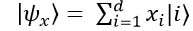
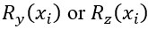
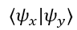
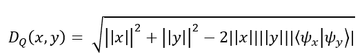

# Quantum Hierarchical Clustering(QHC)

> **Category:** Algorithms | **Source:** [https://qniverse.in/docs/quantum-hierarchical-clusteringqhc/](https://qniverse.in/docs/quantum-hierarchical-clusteringqhc/)

## Quantum Hierarchical Clustering(QHC)

Quantum Hierarchical Clustering (QHC) is a hybrid clustering algorithm that integrates quantum state-based distance estimation with classical hierarchical clustering techniques. Quantum Hierarchical Clustering leverages quantum computing to compute enhanced pairwise distances between data points using quantum simulation backends, subsequently applying hierarchical clustering methods (either agglomerative or divisive) to build comprehensive dendrograms. The primary objective is to exploit quantum inner-product computations, capturing complex data relationships, and offering enhanced insights while preserving the interpretability inherent to hierarchical clustering.

**Presenting here with a video tour of how the Quantum Hierarchical Clustering(QHC) Algorithm works:**

[▶️ Video Demonstration: https://qniverse.in/wp-content/uploads/2025/06/QHC-Algo.mp4?_=1](https://qniverse.in/wp-content/uploads/2025/06/QHC-Algo.mp4?_=1)

## How Quantum Hierarchical Clustering Differs from Classical Hierarchical Clustering

Classical hierarchical clustering methods traditionally use direct feature-space metrics such as Euclidean or Manhattan distances. In contrast, Quantum Hierarchical Clustering employs quantum computational subroutines (specifically the swap test) to measure the inner product between quantum-encoded vectors, creating a quantum-enhanced distance metric. This quantum-driven methodology is capable of highlighting subtle, non-linear correlations and multidimensional relationships often missed by classical methods, especially beneficial in handling high-dimensional or complex data distributions.

## Implementation Workflow for Quantum Hierarchical Clustering

Quantum Hierarchical Clustering follows a structured hybrid approach:

  1. **Quantum Feature Encoding:**  
Each classical data vector x = [x1,x2,…, xd] is transformed into a quantum state using quantum encoding techniques: 
     * **Amplitude Encoding:** Normalizes and represents data in quantum amplitudes.
     * **Angle Encoding:** Applies parameterized rotations like  or on quantum wires.
  2. **Quantum Overlap Measurement:**  
Quantum overlaps  between data points are estimated using the swap test: 
     * A quantum circuit initializes an ancilla qubit in state ∣0⟩, entangles it with data-encoded qubits, and performs a measurement.
     * The resulting probabilities yield overlap estimates, capturing deeper relationships between data points.
  3. **Quantum-Enhanced Distance Metric:**  
Quantum overlaps are converted into a distance measure:

This quantum-derived metric reduces to traditional Euclidean distance under specific normalization conditions but can reveal richer, non-linear structures.

  1. **Classical Hierarchical Clustering:**  
Quantum-enhanced distances guide classical hierarchical clustering: 
     * **Agglomerative:** Iteratively merges the closest clusters based on quantum-derived distances.
     * **Divisive:** Starts with one large cluster, recursively splitting based on maximizing quantum-derived inter-cluster distances.
  2. **Dendrogram Construction:**  
A detailed dendrogram is constructed, representing hierarchical cluster relationships based on quantum-enhanced distances.
  3. **Flat Clustering Extraction:**  
Optimal clusters are identified using validity indices such as silhouette scores, Calinski-Harabasz, and Davies-Bouldin indices computed on quantum-enhanced distance metrics.

## Advantages and Disadvantages Compared to Classical Methods

**Advantages:**

  * **Enhanced Feature Mapping:** Quantum encoding uncovers complex nonlinear relationships, capturing intricate patterns missed by classical methods.
  * **Hybrid Flexibility:** Seamless integration allows leveraging both quantum and classical computational advantages.
  * **Interpretability:** Maintains the intuitive dendrogram structure, enabling clear visualization and interpretability.
  * **Versatility:** Supports multiple clustering approaches, adapting to various data and problem-specific scenarios.
  * **Potential for Enhanced Accuracy:** Quantum methods may provide more accurate clustering outcomes, particularly in highly complex datasets.

**Disadvantages:**

  * **Quantum Overhead:** Increased computational cost due to the need for sophisticated quantum circuits and repeated quantum measurements.
  * **Current Quantum Hardware Limitations:** Dataset sizes are limited by current Near-Intermediate Scale Quantum (NISQ) technology.
  * **Scalability Challenges:** Quadratic complexity in distance computations can make processing large datasets computationally expensive.
  * **Complex Debugging and Development:** Hybrid quantum-classical approaches can introduce additional complexity in debugging, circuit optimization, and overall development processes.
  * **Dependency on Quantum Simulators:** Reliance on quantum simulators due to the limited availability and capabilities of actual quantum hardware.

**Real-World Applications of Quantum Hierarchical Clustering**

  * **Genomics:** Enhanced discovery of gene-expression relationships, facilitating precise identification of phenotype subgroups in genetic data.
  * **Document Clustering:** Improved semantic clustering in large-scale text data, effectively capturing subtle context-dependent semantic overlaps.
  * **Anomaly Detection:** Identifying intricate anomalies within datasets such as financial transactions, network security logs, or manufacturing processes.
  * **Sensor Networks:** Effective hierarchical analysis of sensor data from IoT and industrial environments, capturing complex temporal and spatial correlations.
  * **Healthcare Diagnostics:** Clustering of complex patient data, aiding in diagnostic processes by revealing subtle patient-group characteristics.
  * **Environmental Studies:** Enhanced clustering of environmental data, such as climate patterns or biodiversity metrics, uncovers subtle ecological relationships.

**Quantum Hierarchical Clustering Overview**

Quantum Hierarchical Clustering provides a comprehensive, user-friendly workflow integrating quantum-enhanced hierarchical clustering capabilities:

  * **Data Handling:** Automatic preprocessing, including data cleaning, imputation, and encoding.
  * **Quantum Encoding:** Automated or user-defined encoding schemes (basis or amplitude encoding).
  * **Distance Calculation:** Robust quantum distance metrics via swap-test circuits implemented with quantum simulation platforms.
  * **Clustering Algorithms:** Supports both bottom-up (agglomerative) and top-down (divisive) clustering strategies.
  * **Optimal Cluster Determination:** Employs validity indices for selecting optimal cluster numbers.
  * **Visualization Tools:** PCA-based 2D visualizations and interactive dendrogram representations.
  * **Output Integration:** Generates JSON outputs compatible with external analysis and visualization tools.

## Getting Started with Quantum Hierarchical Clustering: Iris Dataset Example

from quantum_hierarchical_clustering import QuantumHierarchicalClustering

# Example data input (CSV or array)

data = [

[“sepal_length”, “sepal_width”, “petal_length”, “petal_width”, “species”],

[“5.1”, “3.5”, “1.4”, “0.2”, “setosa”],

# Additional data rows…

]

# Instantiate Quantum Hierarchical Clustering

qhc = QuantumHierarchicalClustering(

data=data,

data_format=”csv”,

clustering_method=”agglomerative”,

min_k=2,

max_k=5,

target_column “species”,

encoding_method=”auto”,

restricted_mode=True,

)

# Run clustering

results = qhc.train()

print(results)

**Parameter Details:**

  * **data** : Input dataset in CSV, DataFrame, or array format.
  * **data_format** : Specifies data format (default inferred).
  * **clustering_method** : Clustering method (agglomerative or divisive).
  * **sample_size** : Samples used for evaluating optimal clusters.
  * **random_state** : Ensures reproducibility.
  * **min_k, max_k** : Range for evaluating cluster counts.
  * **target_column** : Optional, for supervised evaluation.
  * **encoding_method** : Encoding strategy (auto, basis, or amplitude).
  * **restricted_mode** : Limits dataset size for quantum compatibility.

**Evaluation Metrics:**

  * **Silhouette Score:** Higher scores imply better-defined clusters.
  * **Calinski-Harabasz Index:** High ratios indicate superior cluster separation.
  * **Davies-Bouldin Index:** Lower values suggest better clustering.

**Evaluation and Visualization:**

  * Internal clustering metrics (silhouette, Calinski-Harabasz, Davies-Bouldin).
  * PCA-based visualization functions are available (generate_2d_plot_data, plot_clusters).

**Conclusion:**

Quantum Hierarchical Clustering enables enhanced data insights through quantum computing, offering users an intuitive hierarchical clustering experience with quantum-driven accuracy and depth. It supports rapid prototyping with small datasets and can be extended to larger scenarios through scalable quantum-classical integrations.
