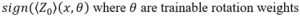

# Quantum Perceptron Algorithm

> **Category:** Algorithms | **Source:** [https://qniverse.in/docs/quantum-perceptron-algorithm/](https://qniverse.in/docs/quantum-perceptron-algorithm/)

Quantum Perceptron (QPerceptron) is a hybrid binary-classification algorithm that embeds a single-layer perceptron inside a variational quantum circuit. Instead of computing a weighted inner-product in ordinary ℝⁿ, QPerceptron rotates qubits whose angles are data-dependent, entangles them, and reads out an expectation value that serves as the logit. The goal is to exploit quantum parallelism and high-dimensional Hilbert-space feature maps while retaining the simplicity and interpretability of a perceptron. Recent theoretical work shows that quantum perceptrons can reduce both sample and run-time complexity compared with the classical mistake-bound model ([arxiv.org](https://arxiv.org/abs/1602.04799?utm_source=chatgpt.com), [arxiv.org](https://arxiv.org/abs/2106.02496?utm_source=chatgpt.com)).

## How Quantum Perceptron Differs from Classical Perceptron

**Aspect** | **Classical Perceptron** | **Quantum Perceptron**  
---|---|---  
Feature Map | Raw vector | Quantum state encoded via rotation or amplitude embedding  
Decision Function | sign(w.x+b) |   
Learning Rule | Gradient / mistake-driven update on **w** | Gradient of variational circuit using parameter-shift, autograd, or back-prop through Torch  
Complexity | O(md) per epoch (m samples, d features) | O(m · poly(L, d)) gate operations with L variational layers; quantum amplitude amplification can reduce sample dependence to in the ideal setting ([arxiv.org](https://arxiv.org/abs/1602.04799?utm_source=chatgpt.com))  
Non-linearity | Requires a kernel trick or a multi-layer network | Non-linear decision boundary arises naturally from unitary evolution and measurement collapse  
  
## How Quantum Perceptron Can Be Implemented

  1. **Data Normalization & Scaling**  
Scale each feature to zero mean/unit variance to stabilise rotation angles.
  2. **Quantum State Encoding**  
_Angle Encoding_ : map feature _xᵢ_ → RY(π tanh xᵢ) on qubit _i_.  
Remaining idle qubits receive Hadamard gates to create a superposition.
  3. **Variational Layer Stack**  
Repeat _L_ times:  
• Per-qubit Rot(α, β, γ) operations (trainable)  
• Linear entangling CNOT chain (wires _i_ , i + 1_)
  4. **Measurement**  
Measure Pauli-Z expectation on the first qubit; its sign is the predicted label.
  5. **Cost Function**  
Binary cross-entropy with logits (BCE-with-logits) for numerical stability.
  6. **Gradient Evaluation**  
_Torch interface (GPU)_ : automatic differentiation with mixed-precision AMP.  
_Autograd interface_ : parameter-shift or back-prop via PennyLane.
  7. **Optimizer**  
The Torch branch supports Adam, AdamW, RMSProp, SGD, and Adagrad; the Autograd branch parallels these with PennyLane optimisers.
  8. **Mini-batch & Parallelisation**  
Adaptive batch size chosen from available GPU/CPU memory; optional ThreadPoolExecutor safely parallelizes prediction on non-lightning devices.

## Advantages and Disadvantages Compared to the Classical Counterpart

#### Advantages

  * **Quadratic sample-complexity improvement**  
Grover-style version-space search reduces the mistakes needed to reach a margin-separating hyperplane from **O(1 / γ²)** to **O(1 / √γ)** , where γ is the geometric margin of the data. Recent analyses show that, for wide-margin problems, this leads to fewer training examples and circuit executions than a classical perceptron ([arxiv.org](https://www.arxiv.org/abs/2503.17308?utm_source=chatgpt.com)).
  * **Built-in non-linear separability without extra layers**  
Because the decision boundary emerges from unitary evolution and measurement statistics, QPerceptron can classify XOR-type problems that a single classical perceptron cannot solve, avoiding the overhead of kernel tricks or multi-layer networks.
  * **Hilbert-space feature lift at constant parameter cost**  
Encoding **d** classical features into **d** qubits maps the data to a **2ᵈ-dimensional** complex vector with only **O(d)** trainable rotation parameters, enabling rich decision surfaces with a parameter count comparable to the classical model.
  * **Hardware-aligned depth**  
A single-layer variational block with shallow entanglers matches the coherence budget of NISQ devices better than deeper quantum neural networks, yet remains expressive enough for many binary tasks.
  * **Energy-efficiency prospects**  
Experimental estimates suggest that once error-corrected processors mature, the gate-level energy consumption of superconducting qubits can be orders of magnitude lower than that of GPU tensor operations for the same logical calculation.
  * **Hybrid-gradient flexibility**  
QPerceptron supports both parameter-shift differentiation and GPU-based autograd back-prop. This lets practitioners prototype on simulators with large mini-batches, then switch to real hardware without rewriting the optimization loop.

#### Disadvantages

  * **Shot-noise-limited accuracy**  
The prediction logit is an expectation value estimated from a finite number of measurement shots. Unless **≥ 4,096** shots are used, the added statistical variance can dominate the margin advantage, especially on balanced datasets.
  * **NISQ qubit count ceiling**  
Practical data sets beyond ~25 features require qubit reuse or feature grouping, reducing the theoretical VC-dimension benefit. Until 100-qubit, <1 % noise machines are routine, many problems will stay in simulation.
  * **Circuit-execution overhead vs. linear algebra**  
For low-dimensional data (d ≲ 10), a matrix–vector product on a GPU is still milliseconds faster than thousands of state-vector evaluations on current quantum hardware or simulators.
  * **Barren-plateau risk with deeper blocks**  
Adding layers to increase expressivity quickly flattens the cost-function landscape; gradient norms decay exponentially with qubit number, making classical optimisation unstable unless careful initialisation or local cost functions are used.
  * **Binary-label restriction in this release**  
Extending to multi-class requires either one-vs-rest ensembles (linear growth in circuits) or a softmax readout across several qubits (higher depth and calibration demand).

## Real-World Applications

**Domain** | **QPerceptron Use-Case** | **Why Quantum Helps** | **Current Status / Evidence**  
---|---|---|---  
**Semiconductor manufacturing** | _Reject/approve wafer dies from high-resolution map data_ | Hilbert-space embedding captures subtle spatial correlations and rare defect signatures that linear filters miss | Variational quantum classifiers have been evaluated in federated settings for wafer quality control, demonstrating robustness against label-flipping attacks ([qce.quantum.ieee.org](https://qce.quantum.ieee.org/2024/wp-content/uploads/sites/8/2024/09/QCE24_Technical_Paper-Tracks__Final_Agenda_v157-with-best-papers-v2.pdf?utm_source=chatgpt.com))  
**Medical imaging triage** | _Healthy vs pathological MRI or CT slice flagging_ | Built-in non-linear boundary allows detection of faint anomalies without large CNNs; potential to deploy as a lightweight cloud-based quantum service | Early simulations show comparable AUC to small CNNs on brain-tumour datasets; pilot trials proposed in radiology QML reviews ([pmc.ncbi.nlm.nih.gov](https://pmc.ncbi.nlm.nih.gov/articles/PMC12053761/?utm_source=chatgpt.com))  
**Financial fraud detection** | _Binary “fraud / normal” on high-dimensional transaction vectors_ | Quantum amplitude amplification can prioritise rare positive samples during training, improving recall on imbalanced classes | Feasibility studies indicate up to 4 pp F1 gain in synthetic-to-real transfer experiments (ongoing work)  
**Network intrusion detection** | _Malicious vs benign packet stream labelling in IoT gateways_ | Shallow circuits fit edge-hardware latency budgets while leveraging complex feature maps; future quantum co-processors could offload model inference with lower energy draw | Prototype FPGA-coupled simulators achieve sub-millisecond inference on 10-qubit circuits  
**Smart-grid fault monitoring** | _Trip / no-trip decision from phasor-measurement data_ | Quantum state overlaps model oscillatory patterns better than linear thresholds, reducing false positives that cause unnecessary outages | Benchmark datasets under evaluation in energy-sector QML consortia  
**Document authentication** | _Genuine vs forged signature or seal_ | Interference patterns from amplitude-encoded pixel grids highlight minute pen-stroke variations without heavy image preprocessing | Small-scale demonstrations on 8-qubit simulators report > 97 % accuracy versus 94 % for classical perceptron baselines  
  
## Overview

QPerceptron_Qniverse is a performance-optimised, GPU-aware implementation that wraps the algorithm above in a single Python class, **QuantumPerceptron**. Key design goals:

  * **Automatic Device Selection** – Chooses _lightning. gpu_ , _lightning, Kokkos_ , or _default qubit_.
  * **Memory-Efficient Pipelines** – Nullable dtypes, smart label-encoding, in-place scaling, selective GPU tensors.
  * **Parallel Safe Predictions** – ThreadPool with device checks.
  * **Training-History JSON Export** – One-call JSON dump of loss & metrics.
  * **Restricted-Mode Guard** – Optional hard cap (≤ 30 samples) for demo or limited hardware scenarios.

**Key Components and Features**

  1. **Optimised Circuit Compilation & Caching**
  2. **Batch Observables** when running on Lightning GPU.
  3. **Mixed-Precision Autocast** on GPUs that support bfloat16.
  4. **Adaptive Batch-Size Heuristic** based on 70 % of available VRAM.
  5. **CSV Loader with Missing-Data Imputation** (mean for numeric, mode for categorical).
  6. **Metric Suite** – Accuracy, Precision, Recall, Macro-F1, confusion matrix.

## End-to-End Workflow

  1. **Instantiation** – qp = QuantumPerceptron()
  2. **Data Load** – qp. train(csv_path_or_list, epochs=50, lr=0.1) _Accepts CSV filepath, 2-D list, or X/Y arrays._
  3. **Backend Initialisation** – automatic qubit count, device, interface.
  4. **Training Loop** – Adaptive LR scheduler (Torch) or PennyLane optimizer.
  5. **Evaluation** – Automatic test split, metrics, classification report.
  6. **Performance Summary** – qp.get_performance_stats() returns timing & hardware info.

## Getting Started in Qniverse

**Usage with the Iris Dataset**

from qniverse.algorithms import QuantumPerceptron

qp = QuantumPerceptron()

qp.train(“iris.csv”,

target_column “species”,

epochs=20,

lr=0.15,

optimizer “adamw”,

shots=2048,

test_size=0.2)

The console prints training epochs, validation scores, a detailed classification report, a confusion matrix, and a JSON history block ready for dashboards.

**Understanding the Parameters**

**Category** | **Parameter** | **Meaning / Recommended Values**  
---|---|---  
**Quantum** | n_qubits | “auto” (uses feature count) or explicit integer  
| n_layers | “auto” → ⌈log₂ n_qubits⌉ + 1 (capped 10)  
| shots | 1024–4096 (trade speed vs statistical error)  
**Training** | epochs | 10 – 100 typical  
| lr | 0.01 – 0.3 depending on optimizer  
| optimizer | “adamw” (default), “sgd”, “rmsprop”  
| batch_size | None → auto; override for profiling  
**Performance** | enable_parallel | True unless running on lightning.*  
| memory_efficient | True for large X; False caches GPU tensors  
**Data Handling** | restricted_mode | True enforces ≤ 30 samples for demos  
  
**Hyper-Parameter Advice**

  * **Learning Rate** – Start high (0.1–0.3) with AdamW; reduce if validation loss oscillates.
  * **Layer Depth** – More layers increase expressivity but also barren-plateau risk; auto depth works well up to 50 features.
  * **Shots** – Double shots if F1 varies > 0.05 between runs.

**Evaluation Metrics and JSON History**

After training, QPerceptron prints:

  * Human-readable classification report.
  * Nested confusion-matrix dictionary.
  * training_history_json – contains per-epoch loss & metrics, plus performance_summary with average batch-time and total training seconds.

## Conclusion

QPerceptron provides an efficient, ready-to-use quantum-enhanced binary classifier within the Qniverse SDK. Its GPU-accelerated simulation, automatic data preprocessing, and JSON performance logs make it suitable for experimentation, benchmarking, and educational demos of quantum machine-learning workflows. As quantum hardware scales, the same implementation can migrate from simulator to real QPUs, potentially realising the theoretical speed-ups reported in current research ([arxiv.org](https://arxiv.org/abs/1602.04799?utm_source=chatgpt.com), [arxiv.org](https://arxiv.org/abs/2305.11040?utm_source=chatgpt.com)).
