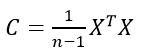
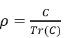
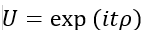
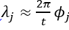
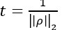
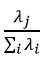

# Quantum Principal Component Analysis (QPCA)

> **Category:** Algorithms | **Source:** [https://qniverse.in/docs/qpca-algorithm/](https://qniverse.in/docs/qpca-algorithm/)

Quantum Principal Component Analysis (QPCA) is a hybrid dimensional-reduction algorithm that translates the covariance structure of classical data into a quantum density matrix and then employs Quantum Phase Estimation (QPE) to extract its eigenvalues. By simulating the unitary (where the density matrix is, QPCA can reveal the principal components of a data set while potentially leveraging quantum parallelism for speed-ups on large, high-dimensional data.

## How Quantum PCA Differs from Classical PCA

Classical PCA diagonalizes a covariance matrix on a classical computer, typically in time proportional to d features, returning eigenvectors and eigenvalues that quantify variance.  
QPCA instead:

  * Encodes the normalised covariance matrix as a quantum **density matrix**.
  * Evolves that matrix under a simulated Hamiltonian to obtain a **unitary operator**.
  * Applies **Quantum Phase Estimation** to recover phase angles proportional to the eigenvalues.
  * Reconstructs principal-component variances from measured ancilla statistics.

The quantum-enhanced subroutines replace matrix diagonalisation with potentially poly-logarithmic depth circuits, shifting the computational bottleneck to state preparation and QPE rather than classical eigen decomposition.

## How Quantum PCA Can Be Implemented

  1. **Data Normalisation and Preparation**
     * Convert raw numeric (or one-hot-encoded) data into a matrix X.
     * Standardise each feature to zero mean and unit variance.
  2. **Density-Matrix Construction**
     * Compute the classical covariance matrix 
     * Normalise to a valid density matrix 
  3. **Hamiltonian Simulation**
     * Exponentiate the density matrix: 
     * Pad to the nearest power-of-two dimension so that U acts on an integer number of qubits.
  4. **Quantum Phase Estimation**
     * Allocate **ancilla qubits** to store eigen-phase estimates.
     * Apply controlled powers U^2^k conditioned on each ancilla.
     * Perform the **inverse Quantum Fourier Transform** on the ancilla register.
  5. **Measurement & Eigenvalue Extraction**
     * Measure ancilla qubits to obtain bit-strings representing phase angles ϕj​.
     * Recover eigenvalues via .
  6. **Post-Processing**
     * Sort eigenvalues, compute percentage variance explained, and (optionally) reconstruct eigenvectors classically if full loading is feasible.

## Advantages and Disadvantages Compared to the Classical Counterpart

#### Advantages

  * **Exponential Feature Space Representation** – Encoding the covariance matrix as a quantum state embeds dd-dimensional statistics into a 2^n -2^n-dimensional Hilbert space (with n =[log2d]), letting a relatively small qubit register capture correlations that would require massive classical memory.
  * **Poly-logarithmic Eigenvalue Estimation** – Quantum Phase Estimation extracts eigenvalues in O(poly logd) depth under fault-tolerant assumptions, versus classical eigen decomposition, offering asymptotic speed-ups on very large feature sets.
  * **Spectral‐Gap Amplification** – Phase amplitudes scale with the eigenvalue gap, allowing rare-variance directions to be distinguished more cleanly than in floating-point classical PCA, which can suffer from numerical round-off.
  * **Privacy Preservation Through Quantum States** – Because only aggregated density-matrix statistics are uploaded to the quantum back-end, raw records remain on-prem, providing an intrinsic data-obfuscation layer.
  * **Hybrid Synergy** – QPCA slots into classical analytics pipelines: state preparation and result interpretation stay classical, while the expensive diagonalisation step is offloaded to quantum hardware, minimising refactor cost for existing workflows.

#### Disadvantages

  * **State-Preparation Bottleneck** – Constructing σ requires O(nd^2) classical time and memory O(d^2), then converts it into quantum amplitudes via O(d) controlled rotations; this overhead can eclipse the quantum speed-up for moderate problem sizes.
  * **Deep-Circuit Requirements** – QPE needs coherent application of U^2k for k ancilla bits; depth grows exponentially with precision, demanding fault-tolerant qubits well beyond today’s NISQ limits.
  * **Noise-Induced Phase Uncertainty** – Gate and read-out errors blur measured phases, collapsing small eigenvalues into sampling noise and requiring heavy error-mitigation or repetition.
  * **Eigenvector Recovery Still Classical** – QPCA returns eigen-_values_ natively; reconstructing eigen-_vectors_ generally needs classical post-processing (or additional tomography), limiting full quantum advantage.
  * **Parameter-Sensitivity** – Poor choices of evolution time t or ancilla precision cause eigen-phase aliasing; tuning these hyperparameters often falls back on classical grid-search.
  * **Limited Demonstrated Scale** – Published demonstrations remain on small (≤ 8-qubit) simulators; no public hardware run has yet beaten classical PCA time-to-solution on real-world data.

## Real-World Applications

**Domain** | **** | **Quantum Benefit** | **Example Use-Case**  
---|---|---|---  
**Finance & Risk Analytics** |  | Faster extraction of latent risk factors from large correlation matrices (10⁴–10⁵ assets) | Real-time portfolio Value-at-Risk stress testing  
**Genomics & Proteomics** |  | Handles 10⁵-dimensional gene-expression vectors where classical PCA is memory-bound | Identifying principal pathways in single-cell RNA-seq data  
**Climate & Remote Sensing** |  | Compresses multi-spectral satellite imagery with hundreds of bands per pixel | Generating low-rank climate anomaly maps for extreme-weather prediction  
**Recommender Systems** |  | Quantum speed-up over matrix factorisation for user-item interaction matrices | Producing latent user factors for streaming-media recommendations  
**Cybersecurity** |  | Detects variance shifts in high-dimensional network-traffic feature sets | Early anomaly detection in zero-trust enterprise networks  
**Drug Discovery** |  | Reduces millions-dimensional molecular fingerprints to tractable latent spaces | Similarity search for candidate compounds against huge libraries  
**Industrial IoT** |  | Compresses heterogeneous sensor streams into few principal health indicators | Real-time fault diagnosis in smart-factory equipment  
**Quantum Chemistry** |  | Uses QPCA as a subroutine to compress quantum states themselves | Identifying dominant electronic configurations in variational eigensolvers  
  
## Overview

The QPCA_Qniverse implementation delivers a full pipeline for quantum-assisted principal-component extraction inside the Qniverse SDK. Core functionality resides in the QuantumPCA class, while QuantumDimensionalityReducer wraps automated data handling, mixed-type detection (numeric, categorical, mixed), and CSV integration.

**Key Components and Features**

  * **Quantum Density-Matrix Builder**  
Constructs a normalised covariance matrix and rescales it to trace-one for valid state preparation.
  * **Hamiltonian Simulation via****expm**  
Uses SciPy’s matrix exponential to obtain later embedded into a power-of-two unitary.
  * **Flexible Quantum Phase Estimation**  
_User-selectable_ ancilla count (num_ancilla) and shot count (shots=None for analytic mode).
  * **Automatic Matrix Padding**  
Pad non-power-of-two matrices with identity blocks, ensuring qubit-register compatibility.
  * **Unified Interface for PCA, MCA, FAMD**  
Sub-classes (QuantumMCA, QuantumFAMD) share the same quantum core while differing in upstream encoding.
  * **Restricted-Mode Safety**  
Guards against excessive sample counts (>30) to remain simulation-feasible on commodity hardware.
  * **CSV Autogeneration Helper**  
In-memory data is saved to a temporary CSV and reloaded, illustrating end-to-end real-world usage.

## End-to-End Workflow

  1. **Initialisation** – Instantiate QuantumDimensionalityReducer (optionally set method).
  2. **Data Loading** – Pass a 2-D list, NumPy array, or Pandas DataFrame (or an on-disk CSV path).
  3. **Pre-Processing** – Automatic type detection, scaling, and one-hot encoding for categorical variables.
  4. **Quantum PCA Execution** – Run perform_quantum_pca() with chosen ancilla bits, evolution time, and shots.
  5. **Result Aggregation** – Receive density matrix, unitary, measurement histogram, eigenvalues, and metadata in a single dictionary.
  6. **Interpretation** – Use QuantumDimensionalityReducer.print_results() for human-friendly insights.

## Getting Started in Qniverse

from qniverse.algorithms import QuantumDimensionalityReducer

**# Example: Iris data (first 30 rows for simulation feasibility)**

reducer = QuantumDimensionalityReducer()

results = reducer.reduce_from_csv(

data=[

[“sepal_length”,”sepal_width”,”petal_length”,”petal_width”,”species”],

[“5.1”, “3.5”, “1.4” , “0.2”, “setosa”],

# … (up to 30 samples)

],

target_column “species”,

num_ancilla=3,

evolution_time=1.0,

shots=None # analytic mode

)

reducer.print_results(results)

The results dictionary now contains eigenvalues approximating the principal-component variances and the measurement distribution used to obtain them.

## Understanding the Parameters

**Parameter** | **Purpose**  
---|---  
num_ancilla | Bits of precision in QPE; more bits ⇒ finer eigen-value resolution (at increased circuit depth).  
evolution_time (t) | Scales the simulated Hamiltonian; choose tt so that eigen-phases fall within (0,2π)(0, 2\pi).  
shots | Number of circuit executions. None uses exact probability amplitudes; finite shots introduce sampling noise.  
restricted_mode | Limits datasets to 30 samples to avoid excessive simulation times on CPUs.  
  
## Hyperparameter Tuning

Although QPCA lacks a discrete **k** parameter, users can experimentally adjust:

  * **Ancilla Count** – Trade precision for depth; typical range 3–6 qubits.
  * **Evolution****Time** –Scale t to spread eigen-phases; a heuristic is 
  * **Sampling Strategy** – Use analytic mode during development; switch to finite shots to model real-device noise.

**Evaluation Metrics and Plot History**

QPCA returns raw eigenvalues sorted by measurement frequency. Suggested classical follow-up metrics include:

  * **Explained Variance Ratio** –> 
  * **Cumulative Variance** –> Determine how many components capture, say, 95 % of total variance.

No plotting is performed automatically; however, the returned eigenvalues can be visualised with conventional Scree plots.

## Conclusion

QuantumPCA offers an insightful bridge between classical covariance analysis and quantum computational primitives. By embedding the covariance structure into a quantum circuit and leveraging QPE, users can explore dimensionality reduction from a quantum vantage point today, while remaining compatible with future fault-tolerant hardware advances. Integrate QPCA into your Qniverse workflows to evaluate quantum readiness for your high-dimensional analytics tasks.
