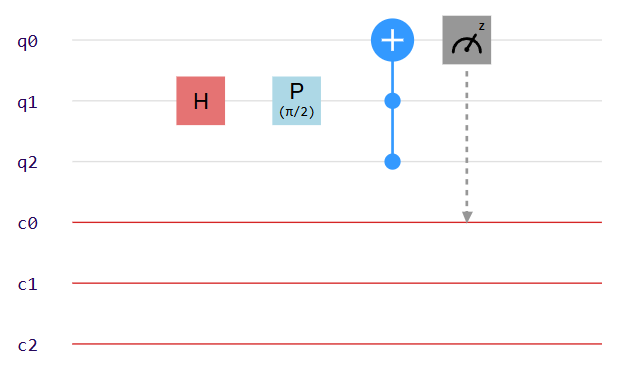
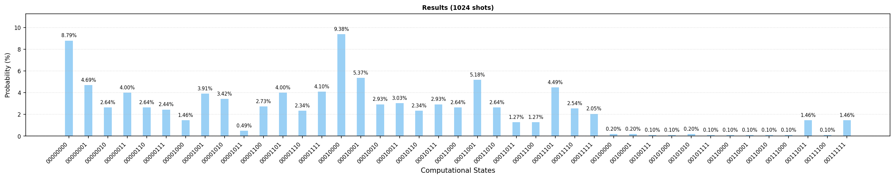

# Creating a Circuit

> **Category:** QSDK Sphinx Manual | **Source:** [https://qniverse.in/docs-category/qsdk/introduction/creating_a_circuit.html](https://qniverse.in/docs-category/qsdk/introduction/creating_a_circuit.html)


# Creating a Circuit

`QniverseCircuit` is the core circuit-construction class in the Qniverse SDK. It is responsible for defining quantum circuits, managing registers, applying gates and modules, visualizing circuits, and executing them on supported backends.

A circuit acts as a container that holds all quantum and classical components, along with the sequence of quantum operations to be executed.

Before adding qubits, classical bits, or gates, you must initialize an empty QniverseCircuit instance.
    
    
    ```python
    from Qniverse.QniverseCircuit import *
    
    qc = QniverseCircuit()
    ```

When the circuit is first created, it contains no quantum or classical elements. No qubits are allocated automatically, and no classical bits are available to store measurement results.

This means that quantum and classical registers must be explicitly defined by the user before any gates or measurements can be applied.

# Registers

Registers define the storage resources of a quantum circuit. They specify how many quantum bits (qubits) and classical bits (clbits) are available and provide a structured way to reference individual wires within the circuit.

**QuantumRegister**

A QuantumRegister represents a collection of qubits that will participate in quantum operations. It holds qubits `size` with a `prefix`. It attaches to a circuit upon add_register.
    
    
    ```python
    from Qniverse.QniverseCircuit import QuantumRegister
    
    q = QuantumRegister(5, 'q')
    ```

In this example, a quantum register named `q` is created with **5 qubits**. Each qubit is indexed starting from `0` and can later be accessed individually once the register is attached to a circuit.

**ClassicalRegister**

A `ClassicalRegister` represents a collection of classical bits used to store measurement outcomes and other classical data.

It holds classical bits `size` with a `prefix`. It attaches to a circuit upon add_register.
    
    
    ```python
    from Qniverse.QniverseCircuit import ClassicalRegister
    
    c = ClassicalRegister(3, 'c')
    ```

This creates a classical register named c containing 3 classical bits. Classical registers are typically used as targets for measurement operations, where quantum state information is converted into classical values.

A valid register name:

  * Must contain **alphabetic characters only**

  * Must **not** conflict with Gates or Python reserved keywords

  * Must be **unique** within a given circuit

  * Keep register sizes positive integers

**Adding Registers to a Circuit**

Registers become active only after being explicitly added to a QniverseCircuit. Until then, they exist as standalone objects and cannot be used in quantum operations.
    
    
    ```python
    qc.add_register(q)
    qc.add_register(c)
    ```

After registers are attached to the circuit, individual qubits and classical bits can be accessed using dot notation followed by index-based addressing.
    
    
    ```python
    # You can now do:
    qc.add_gate(x,q[0])
    ```

Warning

Quantum gates and measurements can only be applied to wires that belong to a circuit. Attempting to use qubits or classical bits that have not been added to a QniverseCircuit will result in an error.

# Applying Gates

Use `add_gate` to insert a quantum gate.

**Description** : Adds a standard quantum gate to the specified qubits in the circuit.

**Syntax** :
    
    
    ```python
    qc.add_gate(gate, *indices)
    ```

**Parameters** :

  * **gate** * (Gate object) — The name of the quantum gate (e.g., H, X, CX).

  * **indices** * (objects) - The indices of the target bits. A mix of Qubit and/or Clbit objects depending on the gate.
    
    * For standard gates (H, X, RX, etc.) → all indices must be Qubit objects.

    * For the MEASURE gate → exactly 2 indices: first a Qubit, then a Clbit.

**Single-Qubit Gates**
    
    
    ```python
    from Qniverse.gates import *
    
    qc.add_gate(h, q[0])
    qc.add_gate(y, q[1])
    ```

Validations performed:

  * Wire must belong to the circuit

  * Duplicate wires are rejected

**Controlled Gates**
    
    
    ```python
    from Qniverse.gates import *
    
    qc.add_gate(ch, q[3], q[2])
    qc.add_gate(cx, q[1], q[4])
    ```

The **last qubit is always the target**.

**Multi-Controlled Gates**
    
    
    ```python
    from Qniverse.gates import *
    
    qc.add_gate(ccx, q[1], q[2], q[4])
    qc.add_gate(c3x, q[1], q[2], q[3], q[4])
    ```

**Parameterized Gates**
    
    
    ```python
    from Qniverse.gates import *
    import numpy as np
    
    qc.add_gate(rx(np.pi / 2), q[1])
    qc.add_gate(u3(np.pi / 2, 0, 0), q[2])
    ```

# Conditional Gate

Conditional gate operations allow quantum gates to be applied based on the measured state of a classical register. This is a core feature of mid-circuit measurement and classical feedback, enabling dynamic quantum circuits where subsequent gate operations depend on prior measurement outcomes.

`add_conditional_gate` : Adds a classically-controlled quantum gate to the circuit. The gate is only applied during simulation if the value of the specified classical register matches the given condition.

**syntax** :
    
    
    ```python
    qc.add_conditional_gate(classical_reg, condition, gate, *qubits)
    ```

**parameters** :

  * **classical_reg** * (ClassicalRegister object) : The classical register whose measured value is checked as the condition.

  * **condition** * (int or str(binary string)) : The trigger value. Accepts a non-negative integer (e.g. 3) or a binary string matching the register size (e.g. “011”).

  * **gate** * (Gate object) : The quantum gate instance to apply conditionally. Cannot be MEASURE, BARRIER, or RESET.

  * **qubits** * (Qubit object) : One or more target qubits for the gate. Must belong to this circuit.

Example:
    
    
    ```python
    # Conditionally apply H to q[1] if c == 1
    qc.add_conditional_gate(c, 1, h, q[1])
    
    (or)
    
    # Conditionally apply X to q[1] if c == '011'
    qc.add_conditional_gate(c, "011", x, q[1])
    ```

# Measurement

Measurement maps a qubit to a classical bit. It acts as a bridge between quantum and classical systems, determining probabilities based on the amplitudes of the quantum state.

A measurement operation incorporated in the same way as any other quantum gate within the circuit. The first argument specifies the qubit to be measured, and the second argument designates the classical bit in which the measurement outcome will be stored.
    
    
    ```python
    from Qniverse.gates import *
    
    qc.add_gate(measure, q[1], c[2])
    ```

Rules:

  * Measure gate requires Quantum and classical bits

  * Both wires must belong to the circuit

`measure_all()` automatically measures all qubits in the circuit, providing a convenient alternative to explicitly adding individual MEASURE gates. The mapping of measurement results to classical bits depends on how the classical registers are defined. It first assigns results to any existing classical registers,such as a user-defined classical register, and then creates a `meas` register for any remaining qubits that do not yet have corresponding classical targets.
    
    
    ```python
    # Assume qc has 3 qubits and a classical register c with 2 bits
    
    qc.measure_all()
    
    # Resulting mapping:
    # q[0] -> c[0]
    # q[1] -> c[1]
    # q[2] -> meas[0] # created automatically
    ```

# Modules

Modules represent a simple abstraction for multi-qubit quantum operations, such as the Quantum Fourier Transform (QFT) and its inverse (IQFT). It provides a flexible Module class for naming and grouping parameterized gates, also two predefined instances, qft and iqft, for ease of use across the library.

Use `add_module` to apply composite circuits.

**Syntax** :
    
    
    ```python
    add_module(module,*qubits)
    ```

**parameters** :

  * **module** * (object) — The module object to be integrated.

  * **qubits** * (Qubit object) — One or more target qubits, ex:q[0],q[1] .

    
    
    ```python
    from Qniverse.module import *
    
    qc.add_module(qft, q[1], q[2], q[3])
    qc.add_module(iqft, q[1], q[3])
    ```

# Initialization

Initialization is the process of setting a qubit to a specific quantum state before running the circuit. Instead of being just 0 or 1, a qubit can be in a combination of both states at the same time. This is called superposition. A general single-qubit state is written as: `∣ψ⟩=α∣0⟩+β∣1⟩`

Here:

  * α (alpha) represents how much of |0⟩ is present.

  * β (beta) represents how much of |1⟩ is present.

The values must satisfy the normalization rule: `∣α∣2+∣β∣2=1`. This condition ensures that the total probability is equal to 1.

`initialize()` function allows you to manually prepare a qubit in any valid single-qubit state by specifying alpha and beta.

**Syntax** :
    
    
    ```python
    initialize(qubit_name, alpha, beta)
    ```

**parameters** :

  * **qubit_name** * (qubit object) : The object of the target qubit.

  * **alpha** * , **beta** * (complex) : The amplitudes of a single-qubit quantum state when you use the Initialize.

    
    
    ```python
    import numpy as np
    
    qc.initialize(
        q[2],
        alpha=complex(np.sqrt(0.5), 0),
        beta=complex(0, np.sqrt(0.5))
    )
    ```

This prepares the qubit in an equal superposition of |0⟩ and |1⟩.

If all qubits in the circuit need to be initialized to the same state, use `initialize_all(alpha, beta)`. This method sets every qubit across all quantum registers to the specified state.

**Syntax** :
    
    
    ```python
    initialize_all(alpha, beta)
    ```

**parameters** :

  * **alpha** * , **beta** * (complex) : The amplitudes of a single-qubit quantum state when you use the Initialize.

    
    
    ```python
    import numpy as np
    
    qc.initialize_all(
        alpha=complex(np.sqrt(0.5), 0),
        beta=complex(0, np.sqrt(0.5))
    )
    ```

Note

Alpha and Beta must be complex numbers, You must pass values using Python’s complex() type.

# Circuit Visualization

`qasm( )`: Generates OpenQASM 2.0 code via the transpiler.

`draw("filename")` : Renders the circuit diagram as an SVG.

`download_circuit(filename="circuit.svg")` : Saves the circuit drawing directly to a file. Useful for very large circuits that cannot be displayed in Jupyter.

**Parameters** : filename (str) # optional
    
    
    ```python
    # Generate and print QASM
    qc.qasm()
    
    # Draw circuit
    qc.draw("circuit.svg")
    
    # download circuit
    qc.download_circuit()
    ```

[ ](../_images/circuit.png)

# Plot Histogram

`plot_histogram( )`: Used to visualize quantum circuit measurement results as a histogram inside a Jupyter Notebook environment. The function can display the raw measurement counts also the probability percentages of measured states.

**Syntax** :
    
    
    ```python
    plot_histogram(result,probability:bool)
    ```

**parameters** :

  * **result** * (dict): The quantum execution result returned by `fetch_job_result()` containing measurement probabilities/counts and total shots.

  * **probability (bool, optional)** Controls histogram display mode.
    
    * False → Displays raw counts.

    * True → Displays probability percentages.

Default value is False.
    
    
    ```python
    result = fetch_job_result(token,job)
    
    plot_histogram(result)
    
    #or
    
    plot_histogram(result,probability=True)
    ```

[ ](../_images/histogram.png)

`download_histogram( )`: Used to save the quantum measurement histogram as an image file.

This function is useful when:

  * The histogram contains many quantum states.

  * The graph becomes too wide inside the notebook output cell.

  * You want to inspect the histogram more clearly.

  * You want to save the plot for reports or analysis.

If the histogram is too large and difficult to view using plot_histogram(), it is recommended to use `download_histogram()` to save the image and inspect it separately.

**Syntax** :
    
    
    ```python
    download_histogram(result,probability:bool,filename)
    ```

**parameters** :

  * **result** * (dict): The quantum execution result returned by `fetch_job_result()` containing measurement probabilities/counts and total shots.

  * **probability** (bool) # optional : Controls histogram display mode.

  * **filename** (str) # optional : Name of the output file. The file format is determined automatically from the file extension. Supported formats depend on matplotlib and commonly includes .png, .svg, .jpg .Default value is `histogram.png`.

    
    
    ```python
    result = fetch_job_result(token,job)
    
    download_histogram(result,probability=True,filename="histogram.png")
    ```

* * *
