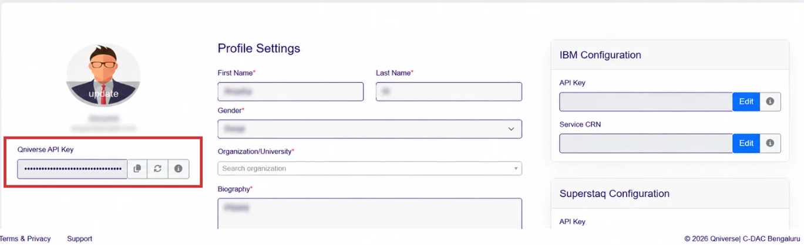

# System Logs

> **Category:** QSDK Sphinx Manual | **Source:** [https://qniverse.in/docs-category/qsdk/system_logs/support.html](https://qniverse.in/docs-category/qsdk/system_logs/support.html)


# System Logs

This section is a comprehensive troubleshooting reference for diagnosing and resolving errors at every stage of the Qniverse SDK workflow: authentication, circuit construction, job submission, and result retrieval.

  * Error: Token not found

> RuntimeError: Token not found. Please define a variable token in your script before using Backend.
> 
> Cause: token was not defined in the top-level (global) scope of your script before Backend() was instantiated.
> 
> Resolution:
> 
>     * Define token = ‘your_token’ at the very top of your script, before any imports that use Backend.
> 
>     * Do not define token inside a function or class.

* * *

  * Error: HTTP 401 Unauthorized

> RuntimeError: Failed to fetch backends from API: 401, {“message”: “Unauthorized”}
> 
> Resolution: Log in to qniverse.in, check your token status, and regenerate if expired.
> 
> Error: HTTP 403 Forbidden
> 
> RuntimeError: Failed to fetch backends from API: 403, {“message”: “Forbidden”}
> 
> Resolution: Your account may not have access to the requested backend type (e.g., QPU). Contact [qniverse@cdac.in](mailto:qniverse%40cdac.in) to request access.

* * *

  * Error: Processor / HPC / Simulator Not Set

> ValueError: Processor and HPC must be set before setting Simulator.
> 
> Cause: The backend was not fully configured. All three of processor, hpc, and simulator must be set in order.
> 
> Resolution: Ensure the backend is configured in sequence:
>         
>         ```python
>         b=Backend()
>         b.processor('CPU')           # Step 1
>         b.hpc('QACC_Cluster')        # Step 2
>         b.simulator('qasm_simulator') # Step 3
>         ```

* * *

  * Error: Invalid HPC for Processor

> ValueError: HPC ‘Param_Utkarsh’ is not valid for processor ‘GPU’n Valid HPCs: QACC_Cluster
> 
> Cause: The chosen HPC does not have the selected processor type. Use Backend.get_hpc(processor=’GPU’) to list valid HPC options for GPU.
> 
> Error: No Measurements in Circuit
> 
> RuntimeError: Circuit has no measurements to sample.
> 
> Resolution: Add at least one measure gate to the circuit before calling run().

* * *

  * Error: Conditional Logic Not Supported

> RuntimeError: Error: Simulator ‘cirq_simulator’ does not support conditional logic.
> 
> Resolution: Switch to an Aer-based or QASM simulator for circuits containing add_conditional_gate.

* * *

  * Error: Missing or Empty Token

> Error: API token is missing or empty.
> 
> Resolution: Ensure token is set and not an empty string. Use token = ‘your_token’.strip() to guard against accidental whitespace.

* * *

  * ConnectionError
    

requests.exceptions.ConnectionError: HTTPConnectionPool(host=’’, port=####): Max retries exceeded

Cause: The API server is unreachable. Possible reasons: VPN not connected, institution firewall blocking the API port, or the server is temporarily down.

Resolution: Check your network connection and VPN. Verify the API server status at the Qniverse portal. Contact [qniverse@cdac.in](mailto:qniverse%40cdac.in) if the server appears down.

* * *

**Bug Report/Feedback**

For SDK‑related techincal support, bug reporting, or feature requests, contact:
    
    
    ```python
    Email: qniverse@cdac.in
    ```

* * *

**FAQ**

Q1. How do I obtain a token?

> Visit the Qniverse platform at qniverse.in and complete the registration process. After logging in, go to the user profile dashboard and copy the `Qniverse API Key`. Store the token securely. If the token is lost or compromised, you can generate a new one by clicking the refresh icon.

[ ](../_images/token.png)

* * *

Q2. How do I check my available API credits?

> 
>     ```python
>     from qniverse.api import credit_balance
>     balance = credit_balance(token=token)
>     print('credits :', balance)
>     
>     # Example output: credits : 850
>     ```
> 
> Credits are consumed when jobs are executed. CPU and GPU simulator jobs consume fewer credits than QPU hardware jobs. Credit top-ups can be requested through the portal or by contacting the support team.

* * *

Q3. Can I have multiple quantum registers in one circuit?

> Yes. You can add any number of QuantumRegister and ClassicalRegister objects to a single QniverseCircuit. Each register must have a unique prefix (alphabetic characters only, no numbers or symbols). Gates can target qubits across different registers.
>     
>     
>     ```python
>     qc = QniverseCircuit()
>     q1 = QuantumRegister(2, 'q')    # Register 'q': q[0], q[1]
>     q2 = QuantumRegister(2, 'p')    # Register 'p': p[0], p[1]
>     c  = ClassicalRegister(4, 'c')
>     qc.add_register(q1)
>     qc.add_register(q2)
>     qc.add_register(c)
>     
>     # Gate across different registers
>     qc.add_gate(cx, q1[0], q2[1])  # CNOT from q[0] to p[1]
>     ```

* * *

Q4: My job is stuck in PENDING status for a long time. What should I do?

> PENDING status indicates the job is queued on the HPC cluster. Wait times vary based on cluster load. You can check queue status on the portal or use job_status(token, job_id). If the job remains PENDING for more than 30 minutes, contact [qniverse@cdac.in](mailto:qniverse%40cdac.in) with your job ID.

* * *

Q5. I get ‘RuntimeError: Circuit has no measurements’. What does this mean?

> This error occurs when run() is called on a circuit that contains no measure gates. Every circuit must include at least one measurement operation before it can be executed. Add measure gates to all qubits you wish to observe before calling run().
>     
>     
>     ```python
>     from qniverse.gates import *
>     
>     # Add measurements before calling run()
>     qc.add_gate(measure, q[0], c[0])
>     qc.add_gate(measure, q[1], c[1])
>     ```

* * *

Q6. How can I list all available simulators?

> 
>     ```python
>     from qniverse.api import *
>     token ="your token"
>     print(get_backend(token))
>     ```

* * *

Q7. How do I cancel a running job?

> 
>     ```python
>     from qniverse.api import cancel_job
>     print(cancel_job(token, job_id))
>     # Cancel is only allowed if job status is PENDING or RUNNING
>     # Returns error if job is already COMPLETED or FAILED
>     ```

* * *
