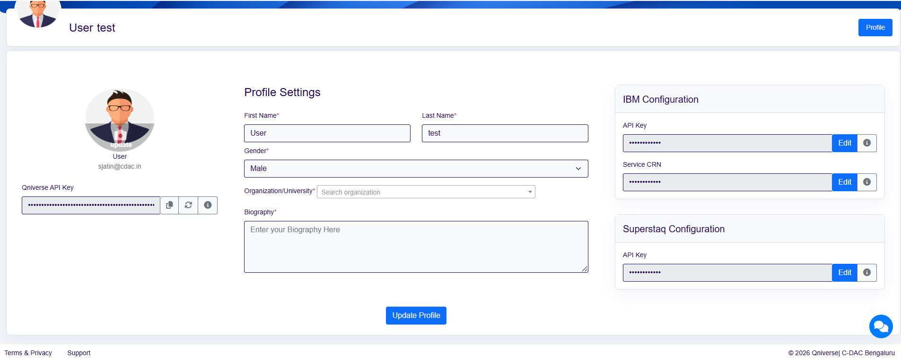
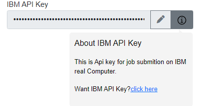

# Profile & Account

> **Category:** User Guide | **Source:** [https://qniverse.in/docs/profile/](https://qniverse.in/docs/profile/)

The User Profile section is an area within the qniverse where users can manage and customize their accounts. This section allows users to update his/her personal information, preferences, and account settings.

The video below provides users on how to update his/her profile details and also add/update an IBM API Key

[▶️ Video Demonstration: https://qniverse.in/wp-content/uploads/2025/04/profilenew.mp4?_=1](https://qniverse.in/wp-content/uploads/2025/04/profilenew.mp4?_=1)

Users can update the details from the profile section:  
**1\. Personal Information**

  * First Name: Users can view and edit their first name.
  * Last Name: Users can view and edit their last name.
  * Organization: Users can name the organization for which they work.
  * Country/State/Region: Users can mention and select their country/State and Region.

**2\. Profile Picture**  
Users can upload or change their profile pictures to personalize their accounts. This image is often displayed next to the name in qniverse across different sections.

**3\. Biography**

A short description or biography where users can share information about themselves and their professional background.

**4\. IBM API Key**

To use the IBM Quantum Computer from Qniverse, you need to generate an API key from the IBM Quantum Computing Service and update in the API key in the profile section as shown in the picture below. You can [click here](https://quantum.ibm.com/ "apikey generation") to generate your API key. Once you have entered your profile details, click on the ‘Update Profile’ button to save the information.

