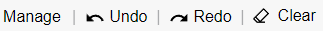

# Circuit Composer Area

> **Category:** User Guide | **Source:** [https://qniverse.in/docs/circuit-composer-area/](https://qniverse.in/docs/circuit-composer-area/)

Here in this section, you can build your quantum circuit by dragging gates onto the horizontal qubit “wires” that make up your quantum register. If you need to edit parameters of the gate and its settings, just select the gate on the horizontal qubit wire and click the Edit icon.

**Here is a brief video tour explaining the composer area and its functionalities.**

[▶️ Video Demonstration: https://qniverse.in/wp-content/uploads/2025/04/composer-area-tools.mp4?_=1](https://qniverse.in/wp-content/uploads/2025/04/composer-area-tools.mp4?_=1)

A user can name his/her circuit as below for easy access. If the user doesn’t provide any name to the circuit, then by default, the circuit is named with the circuit job ID along with a prefix “Circuit” appended. For eg: Circuit_1288  

## Composer-Specific Area Tools****
Access frequently used tools to manage, Undo, Redo, and Clear operations.

  * **Composer Area** : Use the circuit composer to drag and drop the gates, allowing you to view and edit the dropped gates or modify the QASM code generated for the dropped circuit of gates.
  * **Manage:** The manage option provides the user to change the number of Quantum Registers(qubits or ‘q’) and Classical Registers(registers or ‘c’) as required. To add or remove quantum or classical registers, click Manage registers. You can increase or decrease the number of qubits or registers and then click Save.
  * **Undo:** This tool is specifically meant to undo the last change made to the circuit area with absolute certainty.
  * **Redo:** This tool is specifically meant to redo the last change made to the circuit area with absolute certainty.
  * **Clear:** To clear the circuit area all at once.

## Gate-Specific Tools

Access Gate-specific tools to edit, delete, and expand information regarding each gate dropped on the composer area.

  * **Edit:** This option is activated by clicking on the gate in the composer area. This feature allows users to make changes to the qubit number until the gate can be extended as per the user’s preference. To add a control to any gate, modify the control bit number as per preference. For specific gates like the Toffoli gate(CCX), you can add both control bits (a & b) as well as the target bit.
  * **Delete:** To remove a gate from a qubit line, select the gate and click the trash can icon. You can also drag the selected gate outside of the composer area to remove the gate.
  * **Expand:** Upon clicking the gate, initiate the expansion process for the specific gate. This action will trigger the gate to open, revealing additional content of how this gate is made with a combination of other unitary gates or how the gate is managed if interacting with more than one qubit. Users can expect an extended view or access to supplementary features by interacting with the gate through a click.
  * **Information:** This user action activates a detailed display, unveiling comprehensive details or relevant data associated with the selected gate. Users can anticipate and understand specific attributes or functionalities linked to the clicked gate, like its gate matrix. This dynamic interaction enhances the user experience, providing a seamless transition to an expanded state of information or functionality associated with the gate.
  * For a few gates, such as the Pauli X-Gate on clicking, **I** will take to the gate matrix section to show its x, y, and z basis representation.

It contains the gate information such as Gate Name, Operator Gate representation, and the Gate Matrix if available for the specific gate.
