# Gates Palette

> **Category:** User Guide | **Source:** [https://qniverse.in/docs/gate-types/](https://qniverse.in/docs/gate-types/)


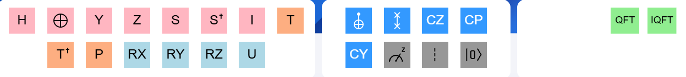

This section lists the classical and quantum operations you can use to manipulate qubits in the quantum circuit using gates. Quantum operations include quantum gates, such as the Hadamard gate, but not quantum gates, such as measurement, barrier, reset, QFT, and iQFT block.

**Gates Palette** :

Each entry below provides details, gate matrix reference, and the OpenQASM reference for each gate operation.

In the field of quantum computing and the quantum circuit model of computation, a quantum logic gate (or quantum gate) is a fundamental building block that operates on qubits. Quantum gates take advantage of two key aspects of quantum mechanics, superposition and entanglement, which are inaccessible to classical gates. You can drag these gates and other operations onto the graphical circuit editor/composer. The different types of gates are color-coded. Click on a gate and select “Info (i)” to learn more about its definition or associated reference.

**Also presented here is a short video tutorial on using these gates and their respective functionalities.**

[▶️ Video Demonstration: gate-pallet-new_MARCH.mp4](https://qniverse.in/wp-content/uploads/2025/04/gate-pallet-new_MARCH.mp4)

## I Gate****
**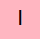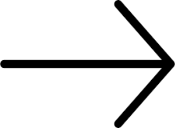 ** 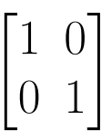 **Identity****Gate Matrix**

The I-gate does not do anything in particular. Its matrix is the Identity matrix itself. It is considered a gate because it is often useful in calculations. Also, they are significant in a way that they can be used to specify a “none” operation when considering real hardware. The identity gate is often used in quantum circuits for various purposes, such as padding or preparing qubits for subsequent operations without altering their states.

**Open QASM reference code:** id q[0];

* * *

## NOT Gate (X-Gate)****
 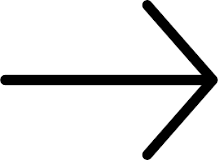 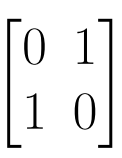 **P****auli -X**

The NOT gate, also known as the Pauli X gate, flips the ∣0⟩ state to ∣1⟩ and vice versa. The NOT gate is equivalent to RX for the angle π or ‘HZH’.The quantum NOT gate is a fundamental quantum gate that plays a crucial role in quantum computing. It is the analog of the classical NOT gate and can be represented in a quantum circuit as a circle with a cross in it.

The NOT gate is reversible, meaning that if you apply a NOT gate twice to the same signal, you get out the same value you started with. The NOT gate is also an inverter because it gives a negative mathematical output.

**Open QASM reference code :** x q[0];

* * *

## Y Gate****
******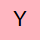  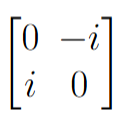 ****Y-Gate Matrix**

The Pauli Y gate is equivalent to Ry for the angle Π. It is comparable to applying X and Z to a global phase factor.

**Open QASM reference code:** y q[0];

* * *

## Z Gate****
**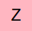 ********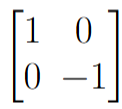Z-Gate Matrix**

The Pauli Z gate acts as identity on the ∣0⟩ state and multiplies the sign of the ∣1⟩ state by -1. It, therefore, flips the ∣+⟩ and ∣−⟩ states. In the +/- basis, it plays the same role as the NOT gate in the ∣0⟩ /∣1⟩ basis.

**Open QASM reference code:** z q[0];

* * *

## H Gate****
**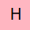 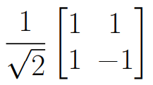 H Gate Matrix**

The H, or Hadamard, gate that rotates the states is useful for making superpositions. If you have a universal gate set on a classical computer and add the Hadamard gate, it becomes a universal gate set on a quantum computer.

**Open QASM reference code:** h q[0]; ****

* * *

## Unitary Gate(U3 Gate)****
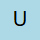 ****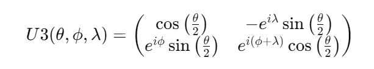

The **U3 gate** is one of the most general single-qubit quantum gates used in quantum computing. It is a universal gate, meaning that any single-qubit operation can be expressed as a U3 gate with appropriate parameters.

**Matrix representation:**

A 2×2 unitary matrix can represent the U3 gate:

where:

  * θ (theta) is a real number between 0 and π (0 and 180 degrees).
  * φ (phi) is a real number between 0 and 2π (0 and 360 degrees).
  * λ (lambda) is a real number between 0 and 2π (0 and 360 degrees).

    
    
    ```python
    
    ```

**Applications:**

The U3 gate is used in various quantum algorithms and circuits, including:

  * **Quantum state preparation:** Used to create specific quantum states.
  * **Quantum gates:** Can be used to implement other quantum gates, such as the Pauli gates (X, Y, Z) and the Hadamard gate.
  * **Quantum algorithms:** Used as a building block in many quantum algorithms, such as Shor’s algorithm for factoring large numbers and Grover’s algorithm for searching unsorted databases.

**Additional details:**

  * The U3 gate can be decomposed into a sequence of other gates, such as rotations around the X, Y, and Z axes.
  * The U3 gate is often used in conjunction with other gates to create more complex quantum operations.
  * The parameters θ, φ, and λ of the U3 gate can be chosen to represent a wide variety of quantum operations.

**Open QASM reference code:** u3 (pi / 2, pi / 2, pi / 2) q[0];

* * *

## P Gate****
**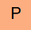 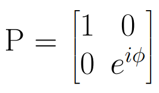 P(Phase) Gate Matrix **

The phase gate (P-gate) is a gate. It is also known as the general phase shift operator in quantum computing.

In Qiskit, the phase gate can be applied to any qubit by calling the p() method on the Quantum Circuit. The p() method is parameterized, so the phase (in radians) that needs to be applied to the qubit must be passed to it.

**Open QASM reference code:** p q[0]**;**

* * *

## T Gate****
**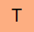 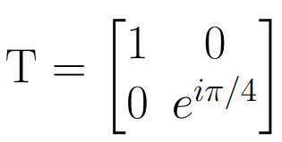 T-Gate Matrix**

The T gate is equivalent to RZ for the angle π/4. In quantum computing, the T gate is a single-qubit gate that creates phase shifts. It’s also known as the π/4 gate.

The T gate rotates the state of a qubit by an angle of π/4 radians. It applies a phase shift to the qubit’s state, specifically to the |1> state, while leaving the |0> state unchanged.  
The T gate is also known as the π/8 gate because of how the RZ(π/4) matrix looks. It’s also known as the fourth root of the Pauli Z gate because applying the T gate four times is equivalent to applying the Pauli Z gate.

**Open QASM reference code:** t q[0];

* * *

## S Gate****
**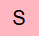 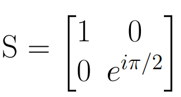 S-Gate Matrix **

The S gate applies a phase of i to the ∣1⟩ state. It is equivalent to RZ for the angle π/2. Also S=P(π/2). Referring to quantum mechanics, the S gate is a 90-degree rotation around the z-axis. It is also known as the phase gate or the Z90 gate. The S gate is related to the T gate by the relationship S = T 2

**Open QASM reference code:** s q[0];

* * *

## T † gate

**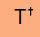  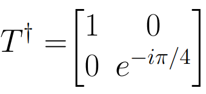 T† gate Matrix ******

In quantum computing, the T gate is a single-qubit gate that creates phase shifts. It rotates the state of a qubit by an angle of π/4 radians. It is also known as the Tdg or T-dagger gate. The T gate is also known as the π/4 gate. It is related to the S gate by the relationship S = T 2.

**Open QASM reference code:** tdg q[0];

* * *

## S†** gate**
**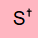  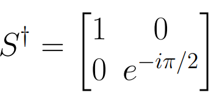 S† gate Matrix **

It is also known as the Sdg or S-dagger gate. The inverse of the S gate.

**Open QASM reference code:** sdg q[0];

* * *

## RX Gate****
**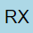 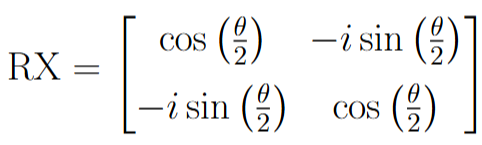 RX Gate Matrix **

In quantum computing, an RX gate is a single-qubit rotation operator that rotates a qubit around the x-axis of the Bloch Sphere by a specified angle, usually denoted by θ. The angle of rotation can be positive or negative and must be specified in radians. The RX gate is represented by the matrix RX, where θ is the angle of rotation in radians in the counter-clockwise direction.

The RX gate is a crucial component in many quantum algorithms and protocols due to its ability to rotate quantum states around the x-axis, making it a valuable tool for manipulating qubits in quantum computing.

In Qiskit, the RX gate can be easily implemented using the following function:

**qc.rx(pi, q[0]). Here, “pi” represents the rotation amount, and “q[0]” denotes the qubit to which we want to apply the RX gate.**

**Open QASM reference code:** rx (pi / 2) q[0];

* * *

## RY Gate****
**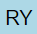 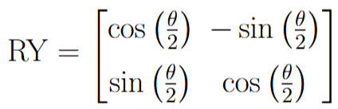 RY Gate Matrix **

In quantum computing, an Ry gate is a single-qubit rotation operator that rotates a qubit around the y-axis by a specified angle, usually denoted by θ. The angle of rotation can be positive or negative and must be specified in radians.

In Qiskit, we can easily implement an RY gate using the following function:

**ry(pi, q[0]), where pi is the rotation amount and q[0] is the target qubit for the RY gate.**

**Open QASM reference code:** ry (pi / 2) q[0];

* * *

## RZ Gate****
**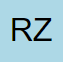 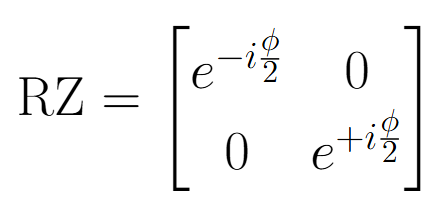 RZ Gate Matrix, where ϕ = 0 – 2π**

The Rz-gate or the Rϕ-gate would be the first parameterized gate that will be introduced. By “parametrized,” we mean that it accepts a parameter and performs an operation based on this parameter. The parameter accepted here is ϕ, and the operation performed is rotation around the z-axis by ϕ radians.

**Open QASM reference code:** rz (pi / 2) q[0];

* * *

## CNOT Gate****
 **NOT** ********  **CNOT** ******** 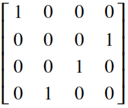 **CNOT Gate Matrix**

The controlled-NOT gate is also called the controlled-X (CX) gate. It operates on a pair of qubits, where one qubit acts as the ‘control’ and the other as the ‘target’. It executes a NOT operation on the target qubit if the control qubit is in the state ∣1.⟩

If the control qubit is in a superposition, this gate creates entanglement.

**Open QASM reference code :** cx q[0], q[1];

**Converting a NOT (X) Gate to a CNOT Gate**

  * **Step 1:** Click on the active NOT gate (+ icon) on the circuit canvas to reveal its floating action menu.

  * **Step 2:** Click the Edit (pencil) icon to open the Edit Gate modal overlay.

  * **Step 3:** Click the blue Add Control button once to convert the operation into a CNOT gate. The standalone “Quantum bit” selection will dynamically split into a `Controller bit (a)` and a `Target bit`.

  * **Step 4:** Click Add Control a second time if a CCNOT (Toffoli) gate is required. This appends a `Controller bit (b)` configuration line.

  * **Step 5:** Use the dropdown menus to map each controller and target parameter to your desired qubit wires.

  * **Step 6:** Click Save to apply the configuration and update the circuit composer layout.

* * *

## Toffoli Gate(CCX)****
**CNOT  CCNOT  ****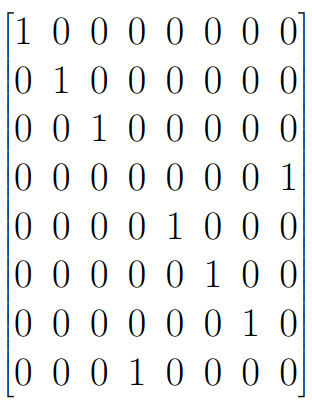****Toffoli Gate Matrix**

The Toffoli gate, also known as the double controlled-NOT gate (CCX), has two control qubits and one target. It applies a NOT to the target only when both controls are in state |1〉. The  _Toffoli gate with the Hadamard gate is a universal gate set for quantum computing._

**Open QASM reference code :** ccx q[0], q[1], q[2];

**Upgrading an Existing CNOT Gate to a CCNOT Gate**

  * **Step 1:** Click on the CNOT gate node on the circuit canvas to reveal the floating action menu.

  * **Step 2:** Click the Edit (pencil) icon to open the Edit Gate modal overlay.

  * **Step 3:** Click the blue Add Control button to append an additional control slot to the existing configuration.

  * **Step 4:** Use the newly generated `Controller bit (b)` dropdown alongside the existing fields to reassign the control and target wire hierarchy as needed.

  * **Step 5:** Click Save to commit the changes and render the updated 3-wire CCNOT configuration on the circuit composer

* * *

## SWAP Gate****
** 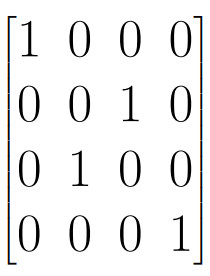 Swap Gate Matrix**

The Swap gate, often denoted as SWAP, is a two-qubit quantum gate used in quantum computing. As the name suggests, it swaps the states of two qubits.

**Open QASM reference code :** swap q[0], q[1];

* * *

## Measurement Gate****
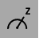

Measurement in the standard basis, also known as the z basis or computational basis. It can be used to implement any kind of measurement when combined with gates. It is not a reversible operation. Quantum measurements are typically described as operations that collapse the quantum state to one of its basis states with certain probabilities.

In a quantum circuit, a measurement is represented by a measurement operator or a measurement gate. The most common type of measurement is the projective measurement, which projects the quantum state onto one of the basis states. The measurement outcomes are probabilistic, and the probabilities are determined by the magnitudes of the probability amplitudes associated with each basis state.

The measurement process is often denoted by the symbol **M** in quantum circuits.

**Open QASM reference code :** measure q[0] -> c[0];

* * *

## Reset Gate****
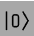

In quantum computing, the reset gate, also known as the initialization gate, doesn’t have a single, universally accepted mathematical expression. This is because it’s not a fundamental unitary operation like the RX, RY, or RZ gates. It’s a conceptual operation achieved through a combination of techniques. Here’s a breakdown of the reset gate and its implementation:

**Function:**

  * The reset gate aims to bring a qubit to the ground state, which is typically represented as |0⟩ in the computational basis.
  * However, unlike classical bits that can be directly set to 0 or 1, qubits exist in superpositions. Resetting a qubit requires manipulating its state to favor the |0⟩ basis.

**Implementation Approaches:**

There are two common approaches to implementing a reset gate:

**Measurement and Conditional Operation:**

  *     * This approach involves measuring the qubit in the Z-basis (|0⟩ or |1⟩).
    * If the measurement outcome is |1⟩, a bit-flip operation (X gate) is applied to the qubit to flip it to the |0⟩ state. If the outcome is already |0⟩, no further operation is needed.

**Error Correction Techniques (Advanced):**

  *     *       * In practice, real quantum hardware can introduce errors during operations.
      * Advanced techniques from the field of quantum error correction can be used to “reset” a qubit by manipulating its state to be closer to the ideal |0⟩ state while mitigating potential errors.

**Expressions for Implementation:**

The specific expressions for the reset operation depend on the chosen approach.

  *     * **Error correction techniques:** These involve complex mathematical formulations specific to the chosen error correction code.

  * Measurement operator (in Z-basis): |Z⟩⟨Z| (projects onto the |0⟩ state) or |X⟩⟨X| (projects onto the |1⟩ state).
  * Conditional X gate: X (applied only if measurement outcome is |1⟩).

The specific expressions for the reset operation depend on the chosen approach.

**Measurement-based approach:**

  * Measurement operator (in Z-basis): |Z⟩⟨Z| (projects onto the |0⟩ state) or |X⟩⟨X| (projects onto the |1⟩ state).
  * Conditional X gate: X (applied only if measurement outcome is |1⟩).
  * **Error correction techniques:** These involve complex mathematical formulations specific to the chosen error correction code.

**Open QASM reference code:** reset q[0];

* * *

## Barrier Gate****
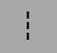

In quantum computing, a barrier is a visualization tool used in quantum circuit diagrams. The barrier is not an actual quantum gate or operation but is employed to separate and group quantum gates within a circuit. It is represented by a double vertical line.

The barrier helps to organize and clarify the structure of a quantum circuit, especially when dealing with complex algorithms or when trying to highlight certain parts of the circuit for analysis. It does not affect the quantum computation itself and is purely a visual aid.

By inserting a barrier in a quantum circuit diagram, one can emphasize specific sections, making it easier to understand the logical structure of the algorithm or to isolate particular quantum operations. It is particularly useful in cases where different parts of the circuit are functionally distinct or are intended to be treated as separate entities.

**Open QASM reference code:** barrier q[0];

* * *

## Quantum Fourier Transform(QFT)********
**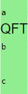  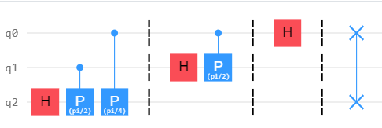 **

**QFT(Expanded view)**

The Quantum Fourier Transform (QFT) is a fundamental operation in quantum computing that plays a pivotal role in various quantum algorithms, particularly those related to quantum cryptography and quantum simulation. It extends the classical Fourier Transform to quantum mechanics, enabling the manipulation of information encoded in the amplitudes of quantum states.

QFT transforms quantum states from one basis to another, specifically between the computational (Z) basis and the Fourier basis. While classical Fourier Transform operates on continuous functions, QFT operates on the amplitudes of quantum states, which can represent multiple possibilities simultaneously due to superposition.

In quantum circuits, the Hadamard gate (H-gate) acts as the single-qubit QFT, converting between the Z-basis and X-basis states. The QFT is also applicable to multi-qubit systems, where it transforms the entire quantum state from the computational basis to the Fourier basis and vice versa.

One of the most prominent applications of QFT is in Shor’s algorithm, a quantum algorithm for integer factorization, where it enables efficient computation of the discrete Fourier transform, a crucial step in the algorithm’s implementation. Additionally, QFT finds applications in quantum phase estimation, quantum error correction, and various quantum machine learning algorithms. Despite its significance, the implementation of QFT in large-scale quantum systems remains a challenge due to the sensitivity of quantum states to errors and decoherence.

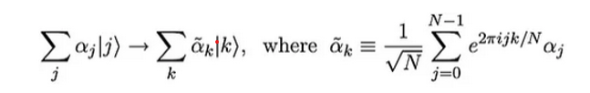

Step 1: Apply a Hadamard gate (H-gate) to the first qubit.

  * Apply controlled rotations (phase gates) on subsequent qubits controlled by previous qubits.

Step 2: Controlled Rotations:

For each qubit j from 2 to n:

  * Apply Hadamard gate (H-gate) to qubit j.
  * Apply controlled rotations (phase gates) on qubit j, controlled by qubits 1 to j-1.
  * Our phases will increase π/2**1, π/2**2, till the number of qubits j-1.

Step 3: Swap Gates

  * Perform swap gates to reverse the order of the qubits.

* * *

## Inverse Quantum Fourier Transform(iQFT)****
** 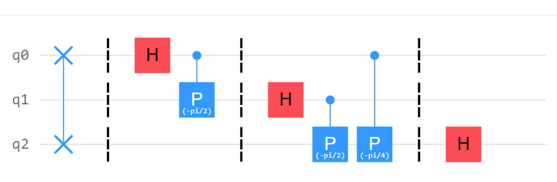 ****iQFT(Expanded view)**

The Inverse Quantum Fourier Transform (IQFT) is a crucial tool in quantum computing, particularly in quantum algorithms such as Shor’s algorithm and quantum phase estimation. It is the opposite operation of the Quantum Fourier Transform (QFT), which is analogous to the classical Discrete Fourier Transform (DFT).

Here’s a brief overview of the iQFT and its significance in quantum computing:

****

**Purpose** : The IQFT is used to convert quantum states from the frequency domain back to the time domain. In other words, it reverses the effect of the QFT, allowing us to retrieve the original quantum state after it has been transformed.

**Algorithmic Applications:** The QFT is applied to a quantum state representing the period of a function in Shor’s algorithm. After performing operations on this transformed state, the IQFT is used to recover the period, which is crucial for factoring large numbers efficiently. Quantum phase estimation is another algorithm where the QFT and IQFT play a significant role. The QFT is applied to the eigenvectors of a unitary operator to estimate their corresponding eigenvalues. The IQFT is then applied to convert these estimated eigenvalues back into the original quantum states.

**Implementation:** The implementation of the IQFT depends on the specific quantum architecture and the available quantum gates. Like the QFT, the IQFT is typically implemented using a combination of Hadamard gates and controlled-phase gates.

**Efficiency:** The efficiency of the IQFT, like other quantum algorithms, depends on factors such as the number of qubits, gate errors, and decoherence. Optimizing the implementation of the IQFT is crucial for improving the performance of quantum algorithms that rely on it.

* * *

## CZ Gate(Controlled-Z)****
** 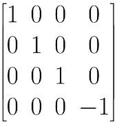 CZ Gate Matrix**

The Controlled-Z (CZ) gate is a fundamental two-qubit gate in quantum computing that induces a controlled phase shift between the states |1⟩ and |-1⟩ while leaving other computational basis states unchanged. It’s one of the key building blocks for implementing quantum algorithms and performing quantum computations.

The CZ gate performs a phase shift of π (or equivalently, a phase factor of -1) on the target qubit if and only if the control qubit is in the state |1⟩. If the control qubit is in the state |0⟩, no phase shift is applied to the target qubit.

The CZ gate is commonly used to create entanglement between qubits, which is essential for various quantum algorithms and protocols, including quantum teleportation, superdense coding, and quantum error correction.

**Open QASM reference code:** ******cz q[0], q[1];**

* * *

## CP Gate(Controlled Phase)****
******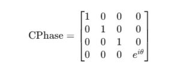**

In quantum computing, the Controlled-Phase (CP) gate is a two-qubit quantum gate that introduces a phase shift to the target qubit based on the state of the control qubit. The CP gate is represented by a line connecting the control qubit and the target qubit, with a small symbol denoting the phase shift applied when the control qubit is |1⟩.

The CP gate applies a phase shift to the target qubit depending on the state of the control qubit. Mathematically, if the control qubit is in the state |1⟩, the CP gate applies a phase shift of θ radians (where θ is the phase angle) to the target qubit, leaving it unchanged if the control qubit is in the state |0⟩.

In superconducting qubits, it can be implemented by exploiting the interaction between qubits mediated by microwave pulses, while in trapped ions, it can be realized through laser pulses inducing conditional phase shifts.

**Open QASM reference code:** cu1 (pi / 2) q[0], q[1];

* * *

## CY Gate(Controlled-Y)****
**  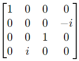 CY Gate Matrix**

The CY gate in quantum computing is a controlled Y gate. It is a two-qubit gate where the Pauli-Y gate is applied to the target qubit only if the control qubit is in the state |1⟩. The CY gate is a specific case of a controlled unitary gate, similar to the more commonly known controlled-X (CNOT) gate, but instead applies the Pauli-Y operation to the target qubit. It is represented by a 4×4 matrix and is useful in various quantum computing tasks, including state manipulation, entanglement generation, and error correction.

If the control qubit is 0, the target qubit remains unchanged.  
If the control qubit is 1, the target qubit is flipped (0 becomes 1, and 1 becomes 0).

Pauli-Y Gate

In quantum computing, a qubit can exist in a superposition of two states, |0⟩ and |1⟩. A two-qubit system can be represented by a four-dimensional state vector:
    
    
    ```python
    |ψ⟩ = α|00⟩ + β|01⟩ + γ|10⟩ + δ|11⟩
    ```

where α, β, γ, and δ are complex numbers such that 

|α|² + |β|² + |γ|² + |δ|² = 1.
    
    
    ```python
    
    ```

**How the CY Gate Operates**

When applied to a two-qubit state |ψ⟩, the CY gate transforms it as follows:
    
    
    ```python
    CY |ψ⟩ = CY (α|00⟩ + β|01⟩ + γ|10⟩ + δ|11⟩)
    ```

By applying the matrix multiplication, we get:
    
    
    ```python
    = α|00⟩ + β|01⟩ - iγ|10⟩ + iδ|11⟩
    ```

**Interpretation:**

  * If the control qubit is in the |0⟩ state, the target qubit remains unchanged.
  * If the control qubit is in the |1⟩ state, the target qubit undergoes a phase shift of -π/2 (for the |10⟩ state) or π/2 (for the |11⟩ state).

**Applications of CY Gate**

  * **Entanglement Generation** : The CY gate can be used to create entangled states, particularly when combined with other gates like the Hadamard and CNOT gates.
  * **Quantum Algorithms** : In certain quantum algorithms, the CY gate may be used to introduce specific phase shifts or as part of more complex controlled operations.
  * **Quantum Fourier Transform:** Used to decompose functions into a basis of periodic functions.
  * **Shor’s algorithm** is used to factor large numbers efficiently.
  * **Grover’s algorithm** is used for searching unsorted databases efficiently.
  * **Quantum Error Correction** : CY gates can be used in quantum error correction codes and protocols that require specific phase corrections depending on the state of qubits.

**Open QASM reference code:** cy q[1], q[2];

* * *

## C3X Gate**(****3-Qubit controlled X gate**)
**** ********

The C3X (controlled-controlled-X) gate is a fundamental four-qubit quantum gate. It’s essentially a Toffoli gate with an additional control qubit. Its primary function is to conditionally flip the target qubits based on the states of the two control qubits.

**Operation Breakdown:**

  * **Control Qubits:** The gate will have an effect if both control qubits are in the |1> state.
  * **Target Qubit:** If the condition above is met, the target qubit will be flipped (|0> becomes |1> and vice versa). If either control qubit is in the |0> state, the target qubit remains unchanged.

**Matrix Representation:**

A 16×16 unitary matrix can represent the C3X gate. Each row and column corresponds to a possible state of the four qubits. The diagonal elements represent the probability amplitudes of the corresponding states after applying the gate.

**Applications:**

  * **Quantum Error Correction:** The C3X gate is essential for building quantum error-correcting codes, which protect quantum information from noise and decoherence.
  * **Quantum Algorithms:** It’s used as a building block in various quantum algorithms, such as Shor’s algorithm for factoring large numbers and Grover’s algorithm for quantum search.
  * **Quantum Computing Architecture:** The C3X gate, along with other basic gates, forms the foundation of many quantum computing architectures.

**Key Points to Remember:**

  * The C3X gate is a four-qubit gate.
  * It requires both control qubits to be in the |1> state for the target qubit to be flipped.
  * It’s a crucial component in quantum error correction and various quantum algorithms.

**Open QASM reference code:** c3x q[0], q[1], q[2], q[3]

* * *

## C4X Gate**(****4-qubit controlled X gate)**
 ****

The C4X gate, also known as the Controlled-Controlled-Controlled-X gate, is a five-qubit quantum gate in quantum computing that performs the following operation:

**C4X(control1, control2, control3, control4, target):**

If all three control qubits are 1, the target qubit is flipped (0 becomes 1, and 1 becomes 0). If any of the control qubits are 0, the target qubit remains unchanged.

The **C4X gate** is a quantum logic gate used in quantum computing, where **C4X** stands for “Controlled-4 X.” It’s a generalization of the **CNOT (Controlled-NOT)** gate to more than one control qubit.

**Understanding the C4X Gate**

  1. **Basic Concept:**
     * A **CNOT gate** flips the state of a target qubit if the control qubit is in the state |1⟩.
     * A **C4X gate** extends this concept to four control qubits. The target qubit is flipped if all four control qubits are in the state |1⟩.

  1. **Mathematical Representation:**
     * The **C4X gate** can be represented using a matrix, though it becomes a very large matrix for 5 qubits (4 control + 1 target). The basic operation can be expressed as: 
       * If all four control qubits are in the state |1⟩, the target qubit undergoes an X operation (NOT operation).
       * If any of the control qubits are in the state |0⟩, the target qubit remains unchanged.

  1. **Circuit Symbol:**
     * The **C4X gate** is typically represented in a quantum circuit diagram with four control lines connected to a single target line. The controls are indicated by dots (•), and the target is marked with an X.

  1. **Applications:**
     * **C4X gates** are used in more complex quantum algorithms where multi-qubit control operations are necessary. For example, in error correction, quantum cryptography, or certain types of quantum search algorithms.
     * These gates can be part of a larger decomposition in quantum circuits that require precise control based on multiple qubits.

  1. **Decomposition:**
     * In practical quantum circuits, implementing a **C4X gate** directly can be challenging due to hardware limitations. Therefore, it is often decomposed into a sequence of simpler gates, such as **CNOT** gates, **Toffoli gates (CCX)** , and other elementary operations.

**Open QASM reference code:** c4x q[0], q[1], q[2], q[3], q[4]

* * *

## C5X Gate(5-qubit controlled X gate)****
 ****

****

The **C5x gate** refers to a controlled gate operation in quantum computing where there are six control qubits. In general, a **CkX** gate is a controlled gate where “k” refers to the number of control qubits, and “X” refers to the Pauli-X (also known as the NOT gate) operation on a target qubit. The operation of the C5X gate can be understood as follows:

1\. **Control Qubits (5 qubits):**

  * These are the five qubits that determine whether the Pauli-X operation will be applied to the target qubit.
  * The C5X gate will only flip the state of the target qubit if **all five control qubits** are in the ∣1⟩ state (i.e., all are in the state representing the binary value 1).

2\. **Target Qubit:**

  * This is the qubit that will be flipped if the condition on the control qubits is satisfied.

4\. **Quantum Circuit Representation:**

  * In a quantum circuit, the C5X gate is often represented by a series of control qubits connected to a target qubit with a line ending in an X symbol.
  * This gate can be decomposed into a series of CNOT (CX) gates and other quantum gates to be implemented on quantum hardware since the direct implementation of a C5X gate may not be straightforward on most quantum computers.

5\. **Applications:**

  * Such multi-controlled gates are used in complex quantum algorithms, such as Grover’s search algorithm, where multiple conditions must be checked simultaneously before performing a specific operation.
  * They are also essential in error correction codes and other quantum operations that require conditional logic based on multiple qubits.

**Open QASM reference code:** c5x q[0], q[1], q[2], q[3], q[4], q[5]

* * *
