# Measurement on Basis(x,y,z)

> **Category:** User Guide | **Source:** [https://qniverse.in/docs/gate-matrices/](https://qniverse.in/docs/gate-matrices/)

In quantum computing, operations on qubits are performed using quantum gates, which are mathematically represented by unitary matrices. A key characteristic of these gate matrices is that they preserve the total probability of quantum states. Their unitarity guarantees this: when a gate’s matrix is multiplied by its conjugate transpose, the result is the identity matrix. This property ensures that applying a quantum gate doesn’t alter the overall ‘length’ of a quantum state vector, thus maintaining its valid probabilistic interpretation. However, when we _measure_ a qubit after applying a gate, we observe a classical outcome. This measurement is performed in a chosen basis. While the most common basis is the computational basis (|0⟩ and |1⟩), we can also measure in other bases, such as the X, Y, or Z bases.

  * **Z Basis:** This is the standard computational basis, with eigenstates |0⟩ and |1⟩.
  * **X Basis:** Also known as the Hadamard basis, with eigenstates |+⟩ = (|0⟩ + |1⟩)/√2 and |-⟩ = (|0⟩ – |1⟩)/√2.
  * **Y Basis:** With eigenstates |+i⟩ = (|0⟩ + i|1⟩)/√2 and |-i⟩ = (|0⟩ – i|1⟩)/√2.

The probabilities of observing each outcome in a given basis are determined by the squared magnitudes of the amplitudes of the quantum state in that basis. The unitary gates manipulate these amplitudes, influencing the probabilities of measurement outcomes in _any_ chosen basis, while always ensuring that the sum of all probabilities must equal 1.

**An overview of the Gate Matrices for gates is presented here:**

[▶️ Video Demonstration: https://qniverse.in/wp-content/uploads/2025/04/1de8-d6a7-4383-ba24-b07b46fd31ab.mp4?_=1](https://qniverse.in/wp-content/uploads/2025/04/1de8-d6a7-4383-ba24-b07b46fd31ab.mp4?_=1)

A qubit state |ψ⟩ = α |0⟩ + β |1⟩ is fully described by two complex numbers α and β. Before working with gates and the Bloch sphere, it is worth being precise about what these numbers represent.

**Amplitude:** The coefficients α and β are called the probability amplitudes of the state. They are, in general, complex numbers. The probability of observing the qubit in state |0⟩ upon measurement is |α|^2, and the probability of observing |1⟩ is |β|^2.

Normalisation requires: **|α|2 + |β|2 = 1.**

**Phase:** Any complex amplitude can be written in polar form as r e^iφ, where r ≥ 0 is the magnitude and φ ∈ [0, 2π) is the phase. Two kinds of phase arise in quantum mechanics:

•**Global phase.** If both amplitudes share a common phase factor e^iγ, so that |ψ′⟩ = eiγ |ψ⟩, no measurement can distinguish |ψ′⟩ from |ψ⟩. The global phase is physically unobservable and is routinely absorbed into the state definition.

**• Relative phase.** The phase difference between α and β is observable — it affects interference and determines where the state lies on the Bloch sphere. Writing α = |α| and β = |β| eiϕ, the angle ϕ is precisely the azimuthal angle on the Bloch sphere (see equation (2).

## Mathematical Background

**State Representation**  
A single-qubit pure state lives in C2 and is written as |ψ⟩ = α |0⟩+β |1⟩, with |α|2 +|β|2 = 1. Absorbing the global phase, every pure state admits the **Bloch parameterisation** :  
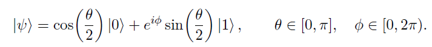

This maps uniquely to the **Bloch vector**

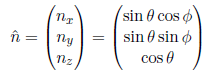

a unit vector on the surface of the Bloch sphere. The computational basis states sit at the poles: |0⟩ at the north pole (θ = 0, ˆn = (0, 0, 1)) and |1⟩ at the south pole (θ = π, ˆn =(0, 0,−1). Any equatorial point (θ = π/2) is an equal-weight superposition.

**Gates as Rotations**  
Quantum gates are unitary matrices U satisfying UU† = I, which preserve the state-vector norm. On the Bloch sphere, every single-qubit unitary corresponds to a rotation: a rotation by angle α about axis ˆn = (nx, ny, nz) is

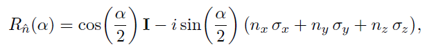

where σx, σy, and σz are the Pauli matrices. Because gates are rotations, they can never move a pure state off the surface of the Bloch sphere.

**Reading Gate Actions**  
When a gate U acts on a state |ψ⟩, the output state is |ψ′⟩ = U |ψ⟩. Written as column vectors in the {|0⟩ , |1⟩} basis:

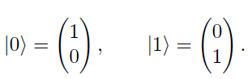

The gate examples below apply this rule explicitly for each input state.

## Worked Example: The Hadamard Gate

The Hadamard gate H = 1/√2 (1 1 1 −1) is the most important single-qubit gate for creating superpositions. It corresponds to a 180-degree rotation about the (x + z)/ √2 axis of the Bloch sphere, and it maps each computational-basis pair to the corresponding conjugate basis. We show its action on all three natural pairs of orthogonal states.

**Pair 1: Computational Basis {|0⟩ , |1⟩}**

H on |0⟩ (north pole → +x equator)

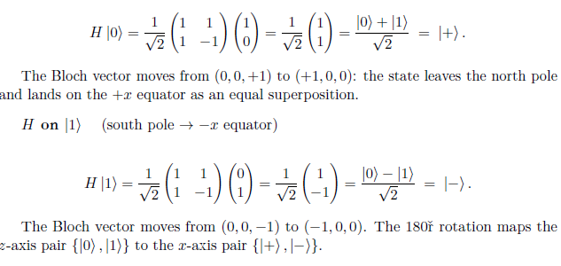

**Pair 2: Hadamard Basis {|+⟩ , |−⟩}**

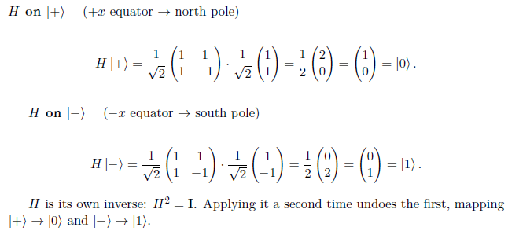

**Pair 3: Circular Basis {|+i⟩ , |−i⟩}**

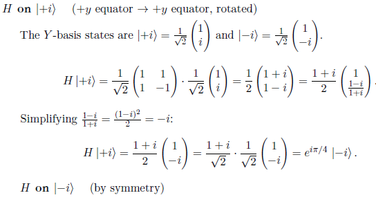

H |−i⟩ = e−iπ/4 |+i⟩ .  
The H gate maps the Y -basis states back onto themselves (up to a global phase), reflecting the fact that the rotation axis (x+z)/√2 is perpendicular to ˆy: a 180-degree rotation about that axis sends +ˆy → −ˆy and vice versa on the Bloch sphere.

## Single-Qubit Gate Matrices(w.r.t :Z-Basis):**Pauli-X Gate (NOT Gate)**
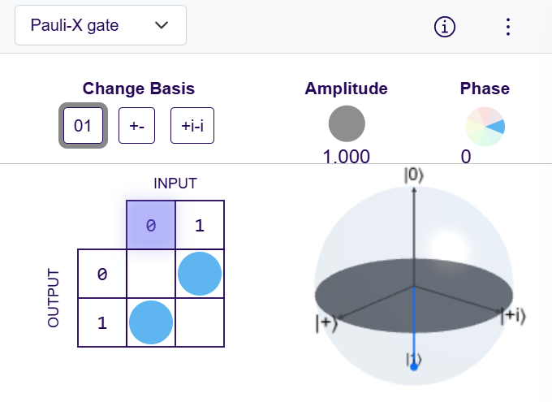 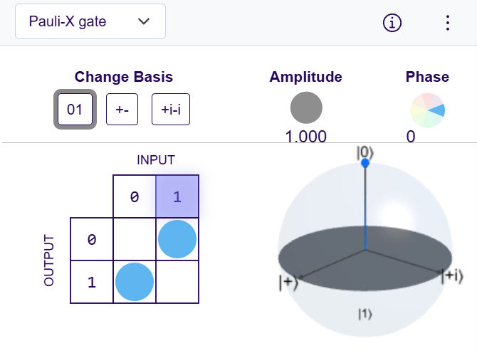

**Pauli-X gate representation for input states 0 and 1**

The Pauli-X gate is the quantum analogue of the classical NOT gate. It performs a π rotation about the x-axis of the Bloch sphere.

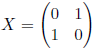

Action on the basis states:

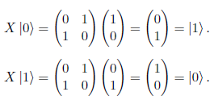

The Bloch vector is flipped from the north pole to the south pole and vice versa: (0, 0, +1) ↔ (0, 0, -1).

****

## Pauli-Y Gate

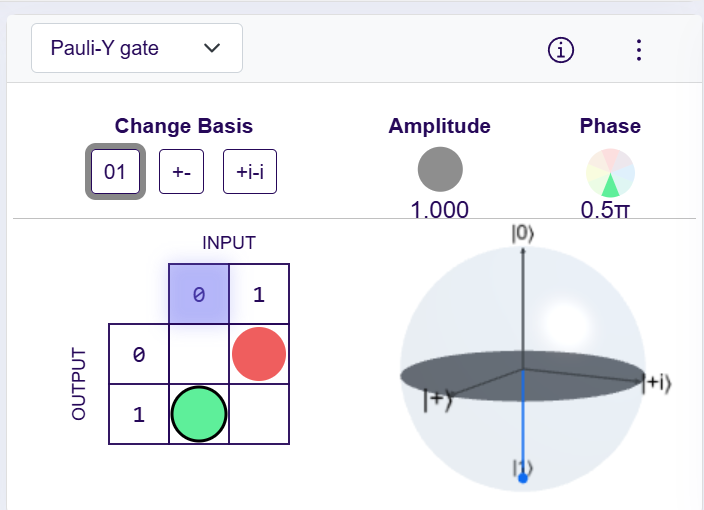 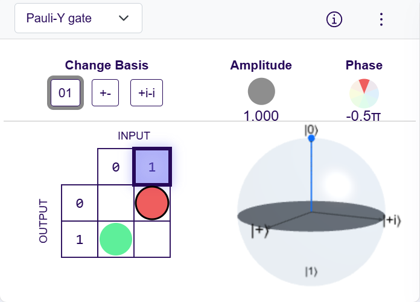

**Pauli-Y gate representation for input states 0 and 1**

The Pauli-Y gate combines a bit flip and a phase flip. It performs a 180-degree rotation about the y-axis of the Bloch sphere.

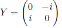

Action on the basis states:

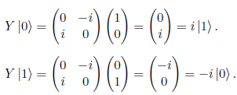

Like the X gate, Y swaps |0⟩ and |1⟩, but it also introduces imaginary phase factors ±i. On the Bloch sphere, the Bloch vector is again flipped between poles, but the rotation axis is ˆy.

## Pauli-Z Gate

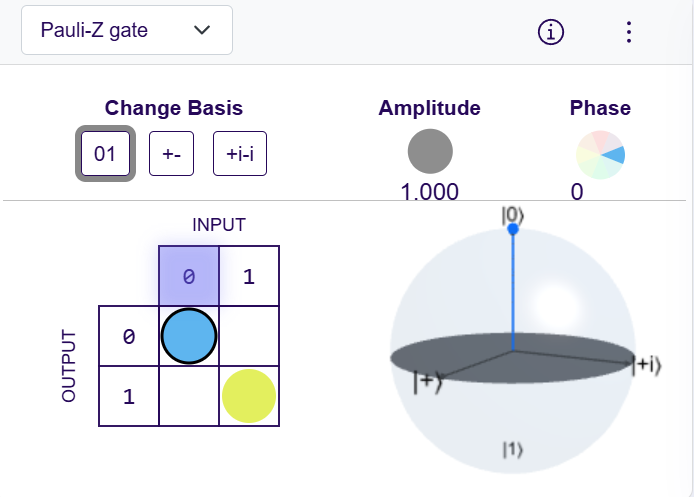 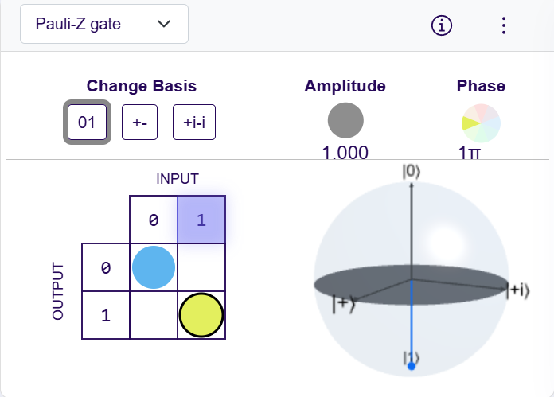

**Pauli-Y gate representation for input states 0 and 1**

The Pauli-Z gate is a pure phase flip. It performs a 180-degree rotation about the z-axis of the Bloch sphere.

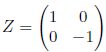

Action on the basis states:

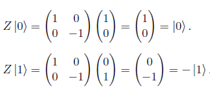

Both states remain at the poles (ˆn is unchanged), but |1⟩ acquires a phase of −1. A π rotation about ˆz leaves the z-axis fixed.

## Hadamard Gate

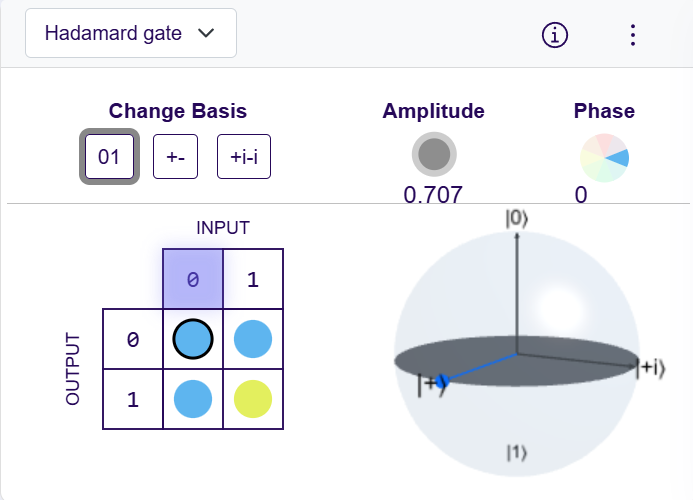 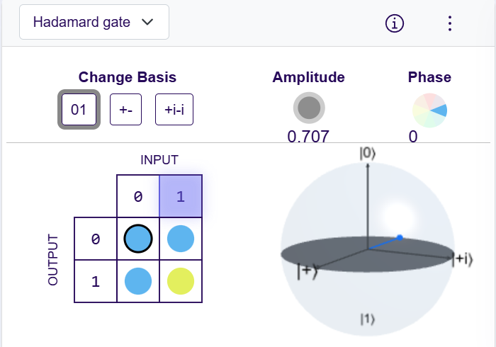

**Hadamard gate representation for input states 0 and 1**

The Hadamard gate creates equal superpositions. It can be expressed as H = (X+Z)/√2 and performs a 180-degree rotation about the (x + z)/√2 axis.

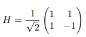

Action on the basis states:

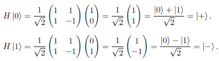

Both poles are mapped to the equator of the Bloch sphere, creating maximal superpositions. For the full analysis, including the circular basis.

## Identity Gate

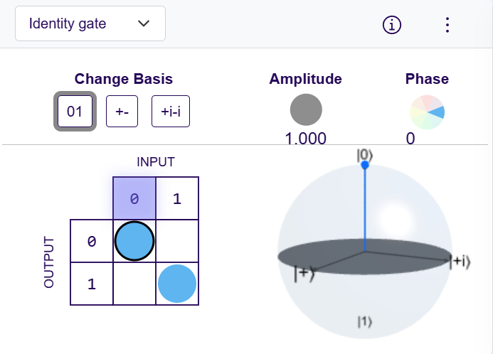 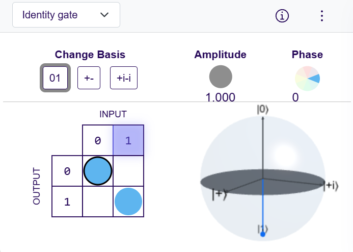

**Identity gate representation for input states 0 and 1**

In quantum computing, the identity gate matrix is represented by the identity matrix, I. The identity gate leaves the qubit state completely unchanged — a zero-degree rotation. It is represented in circuit diagrams as a box labelled I.

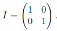

Action on the basis states:

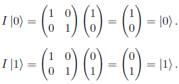

The Bloch vector is unaffected: (0, 0, +1) → (0, 0, +1) and (0, 0,−1) → (0, 0,−1).

## Phase(S) Gate

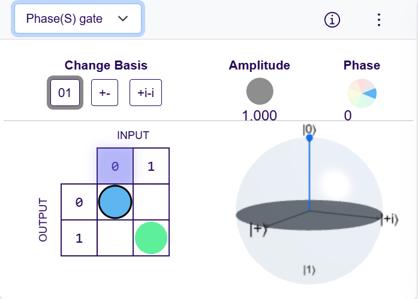 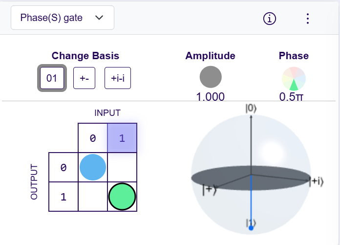

**Phase Gate(S) gate representation for input states 0 and 1**

The S gate, also known as the phase gate or the Z90 gate, is a single-qubit operation that rotates a qubit by 90 degrees around the z-axis. The S gate (also called the Z90 gate or phase gate) performs a 90-degree rotation about the z-axis. Note that

S = T^2 and S^2 = Z.

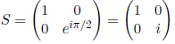

Action on the basis states:

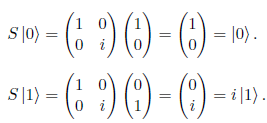

The north pole is unchanged. The south pole acquires a phase of i: the Bloch vector remains at (0, 0,−1) in magnitude, but the relative phase between amplitudes is rotated by 90 degrees.

## Phase(T) Gate

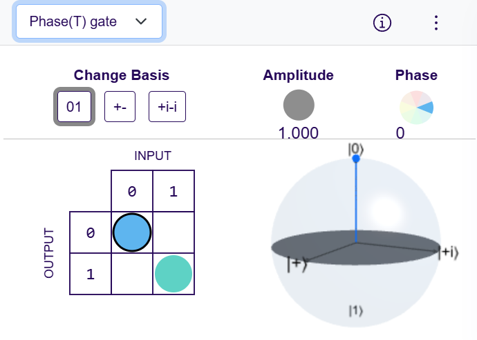 

**Phase Gate(T) gate representation for input states 0 and 1**

The T gate is a phase gate that rotates a qubit’s state by 45 degrees around the Z-axis of the Bloch sphere. It is also referred to as the π/4 gate because it rotates the qubit state by π/4 radians. The T gate is a non-Clifford gate that operates on a single qubit, taking one bit as input and returning one bit as output.

The T gate (also called the π/4 gate) performs a 45-degree rotation about the z-axis. It is a non-Clifford gate, essential for universal quantum computation.

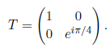

Action on the basis states:

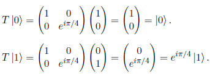

As with the S gate, |0⟩ is unaffected. The state |1⟩ acquires the phase eiπ/4 = 1+i/ √2, representing a 45-degree rotation of the Bloch vector about ˆz.

## Gate Reference Table

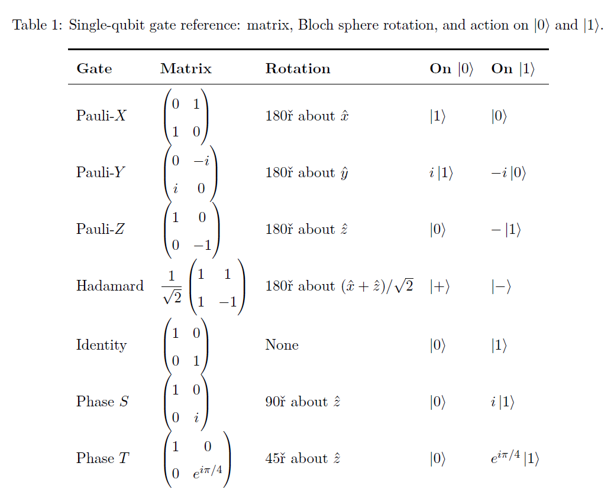
