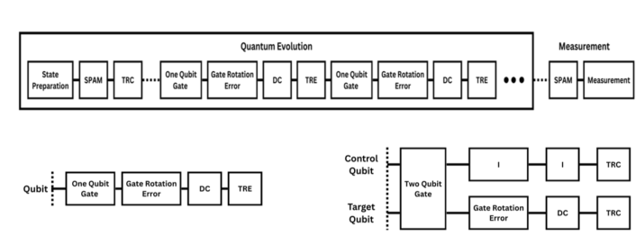
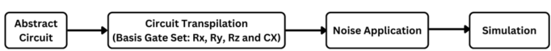

# Noise Modeling in Qniverse

> **Category:** User Guide | **Source:** [https://qniverse.in/docs/noise-modeling-in-qniverse/](https://qniverse.in/docs/noise-modeling-in-qniverse/)

## The NISQ Era and the Challenge of Physical Imperfections

Quantum computing today is driven by Noisy Intermediate-Scale Quantum (NISQ) devices, which have limited qubits and are highly vulnerable to noise. Errors from gate infidelities, measurement faults, and environmental interactions quickly corrupt even small circuits, producing results that deviate from their ideal, noise-free outputs. Accurately modeling this noisy behavior is essential—not just academically, but for understanding hardware limits, developing error-mitigation strategies, and designing algorithms resilient to imperfections. Noise simulation provides a controlled way to study error propagation and evaluate circuit performance without relying on costly or inconsistent hardware experiments.

## The Qniverse Noise Architecture

The Qniverse noise architecture is a sophisticated, two-part system designed to accurately capture the complexity of physical quantum computing systems. The model provides a configurable environment that allows users to independently tune the parameters of various error sources, providing granular control over the simulation. The architecture is a hybrid of incoherent and coherent error channels, each with a distinct effect on the quantum state.

## Incoherent Error Channels

Incoherent errors are irreversible processes that lead to the loss of quantum information. They are modelled using three primary channels, each grounded in well-established theoretical frameworks.

### 1\. SPAM Channel (State Preparation and Measurement)

This channel captures errors that arise specifically during qubit initialization and final measurement. The model assumes a simple bit-flip error with probability p. In practice, this means that a prepared or measured |0⟩ state may be prepared/misidentified as |1⟩, and vice versa, with that some probability. These errors are treated independently from gate errors, reflecting the fact that state preparation and readout have distinct noise mechanisms compared to circuit evolution.

In **Qniverse** , users can tune the parameter _p (i.e Initialization Error & Measurement Error)_ to control bit-flip error probability, enabling realistic simulation of device-specific initialization and readout noise.

### 2\. Depolarizing Channel

The depolarizing channel represents gate infidelities by introducing random bit-flip and phase-flip errors. Conceptually, it assumes that with some probability p, the quantum state undergoes a Pauli error, chosen uniformly at random from the three non-identity Pauli operators (X, Y, Z). With the remaining probability, the state is left unchanged. The overall effect of this process is to push the quantum state toward a maximally mixed state, thereby reducing coherence and introducing uniform uncertainty.

In **Qniverse** , users can tune the parameter _p (i.e Depolarization Error)_ to control the strength of depolarizing noise, enabling realistic simulation of gate-level imperfections and loss of coherence.

### 3\. Thermal Relaxation and Dephasing Channel

This channel models the time-dependent loss of quantum information caused by interactions with the environment. It accounts for two key physical processes:

  * **Thermal relaxation:** the decay of an excited state |1⟩ into the ground state |0⟩, characterized by the relaxation time T1.
  * **Dephasing:** the loss of relative phase information in a superposition state, characterized by the dephasing time T2.

The rate at which these errors occur depends on the average gate execution time Tg and the duration of the computation. Importantly, the model assumes that each qubit experiences these effects independently. Over time, thermal relaxation drives qubits toward their ground state, while dephasing suppresses off-diagonal elements of the density matrix, eroding quantum coherence.

In **Qniverse** , users can specify the parameters _T₁_ , _T₂_ , and _Tg_ (in microseconds) to control relaxation, dephasing, and gate duration, allowing precise modeling of time-dependent decoherence effects.

## Coherent Error Channels: Unitary Over/Under-Rotations

Coherent errors are a distinct class of quantum noise, different from incoherent errors in both nature and effect. Instead of being random and irreversible, they are deterministic and unitary. This means that no information is fundamentally lost; rather, the quantum state is systematically rotated in an unintended direction.

These errors usually arise from miscalibrated control pulses or from gradual drifts in hardware parameters over time. In the Qniverse model, they are represented as small deviations in the intended gate rotations. For example, a single-qubit rotation gate designed to apply an angle θ might instead apply θ+ϵ (an over-rotation) or θ−ϵ (an under-rotation), where ϵ is a fixed but configurable offset. This treatment applies to all gates in the chosen universal basis set, such as Rx, Ry, Rz, and controlled-NOT.

In **Qniverse** , users can specify the rotation error _ε_ (in degrees) to control over- and under-rotation effects for _Rx_ , _Ry_ , and _Rz_ gates, enabling accurate simulation of coherent gate calibration errors.

**Complete Unified Noise Architecture**

## Simulation Workflow

The Qniverse simulation process follows a standardized four-step workflow, ensuring that circuits are consistently prepared, transformed, and executed under realistic noise conditions.

### Step 1: Circuit Input

The process begins when a user provides a quantum circuit written in one of the supported frameworks. At this stage, the circuit exists as an abstract description of the desired algorithm, expressed in high-level quantum gates that may not directly correspond to operations available on hardware or simulators.

### Step 2: Transpilation

The circuit is automatically transpiled into a fixed universal gate set consisting of Rx, Ry, Rz, and the controlled-NOT (CX). This step is handled by the Qiskit transpiler.

**Reasons for Transpilation:**

  * **Hardware compatibility:** At the physical level, all quantum gates are realized as rotation pulses acting on the Bloch sphere. Single-qubit gates correspond to precisely timed microwave or laser pulses that rotate the qubit’s state vector about the x, y, or z. Two-qubit gates (such as CX or CZ) arise from engineered qubit–qubit interactions, but can likewise be described as sequences of conditional rotations. In essence, every quantum operation reduces to the controlled application of rotation pulses on one or more qubits.
  * **Noise consistency:** The Qniverse noise model is defined specifically for the universal basis gates. By ensuring every circuit is expressed in this common language, noise can be applied systematically and fairly across different circuits and backends.

### Step 3: Noise Application

Once transpiled, the circuit is augmented with the hybrid noise model. At every instance where a basis gate is executed, the configured incoherent and coherent error channels are applied.

### Step 4: Noisy Simulation

The noisy circuit is executed on the chosen backend, sampled multiple times (e.g., 1024 shots).

**Compete Simulation Workflow**

## The Central Role of Transpilation in Noise Propagation

In the Qniverse workflow, transpilation is the key factor that determines how noise accumulates in a circuit. High-level gates written by the user, such as a controlled-phase (cp) gate, are not native to hardware and must be decomposed into the universal basis set (Rx, Ry, Rz and CX) for execution. This decomposition, handled by the Qiskit transpiler, increases both gate count and circuit depth. Since each basis gate is a potential error source in the Qniverse noise model, deeper decompositions naturally lead to stronger deviations from the ideal outcome.

Crucially, different frameworks decompose the same logical gate in different ways. For example, the cp gate may be broken down into distinct sequences of basis gates in Qiskit versus Cirq or Cudaq. These differences directly affect how much noise accumulates: frameworks that generate longer or less efficient decompositions experience greater degradation in the final output.

**Note:** Because of this, the same circuit with identical noise parameters can produce different results when executed across different frameworks. The variation arises not from the noise model itself, but from the framework-specific transpilation that changes how the circuit is expressed in basis gates.
