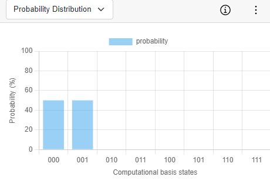
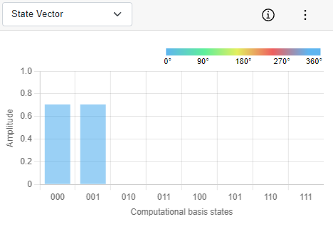

# Visualization

> **Category:** User Guide | **Source:** [https://qniverse.in/docs/visualization/](https://qniverse.in/docs/visualization/)

The visualizations are shown in the window at the bottom of the Qniverse workspace. You can choose from a combination of histograms, state vectors, or probability distributions at the bottom of the workspace.

  * **Visualizations** : Visualizations characterize your circuit as you build it. They use a single-shot state vector simulator, which is different from the system specified in run settings. Note that the visualizations ignore any measurement operations you add. Click on Run to get results from the listed backend. The Visualization here has been categorized as Probability Distribution and State Vector.

[▶️ Video Demonstration: https://qniverse.in/wp-content/uploads/2024/12/visulaizations.mp4?_=1](https://qniverse.in/wp-content/uploads/2024/12/visulaizations.mp4?_=1)

## Probability Distribution****

This view visualizes the probabilities of the quantum state as a bar graph. The horizontal axis labels the computational basis states. The vertical axis measures the probabilities in terms of percentages. In this view, the quantum phases are not represented and are, therefore, incomplete. However, it is useful for predicting the outcomes if each qubit is measured and the value stored in its classical bit.

Understanding and manipulating probability distributions in quantum computing is fundamental for designing quantum algorithms, error correction, and optimizing quantum circuits.

The probability distribution of a quantum state can be represented as a set of probabilities associated with each possible outcome. For example, if a quantum system is in a state ∣φ⟩=α∣0⟩+β∣1⟩, the probability distribution is {∣α ∣2,∣β ∣2}

## State Vector****

The state vector provides a complete description of the system’s quantum state, including information about the probabilities of finding the system in various possible states upon measurement.

This view visualizes the quantum state as a bar graph. The horizontal axis labels the computational basis states. The vertical axis measures the amplitudes in terms of percentages. In this view, the quantum phases are not represented and are, therefore, an incomplete representation. However, it is useful for predicting the outcomes if each qubit is measured and the value stored in its classical bit.

For a quantum system with n qubits, the state vector is a complex vector with 2^n components, corresponding to all possible basis states of the system. The basis states are often represented using binary notation. The state vector evolves according to the Schrödinger equation, which describes the unitary evolution of quantum states under the influence of quantum gates and operations. The evolution of the state vector is crucial for understanding the behavior of quantum algorithms.

**State Vectors and Quantum States:**

  * A state vector mathematically encodes the complete information about a quantum system’s state at a specific point in time.

  * It’s a complex number vector where each element represents the amplitude (probability coefficient) of finding the system in a particular basis state (e.g., 0 or 1 for a qubit).

**Visualizing with Derived Information:**

  * While state vectors themselves are not visual, we can derive information from them to create visualizations

**Density Matrices (for mixed states):** State vectors aren’t as straightforward when dealing with mixed states (ensembles of pure states). Here, density matrices, derived from the state vector, are used for visualizations. These matrices capture the average behavior of the ensemble.
