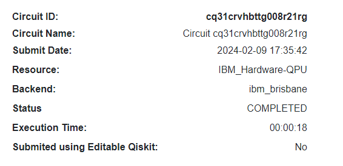
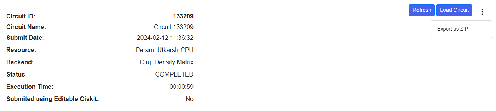
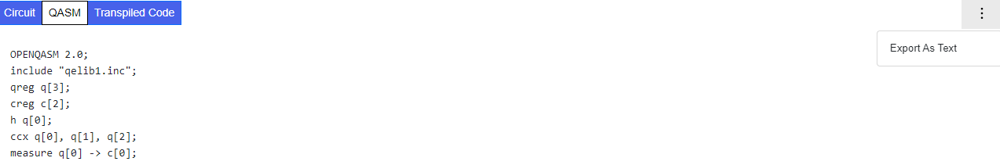
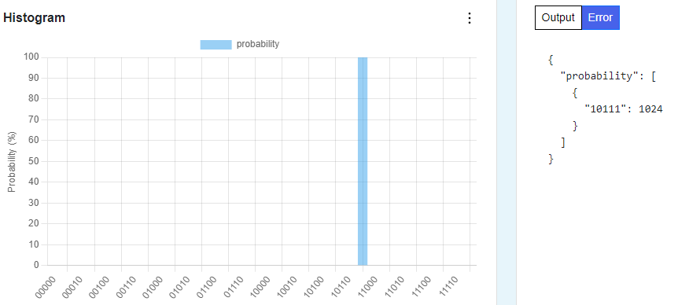
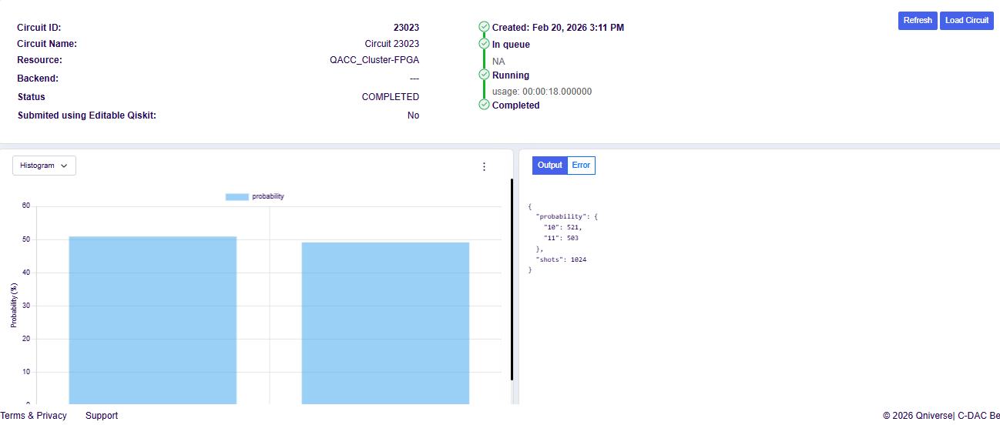
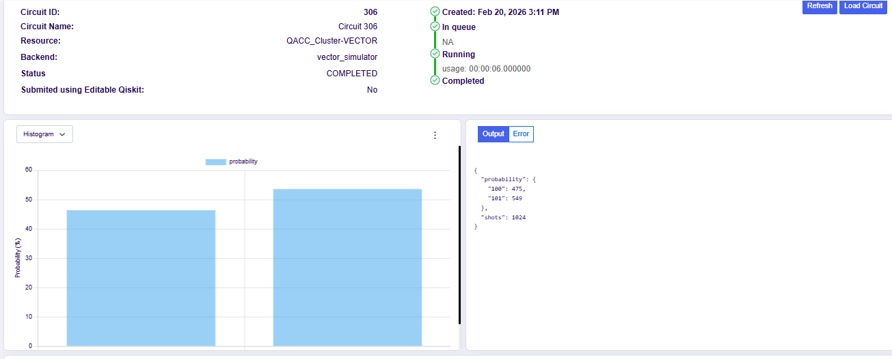
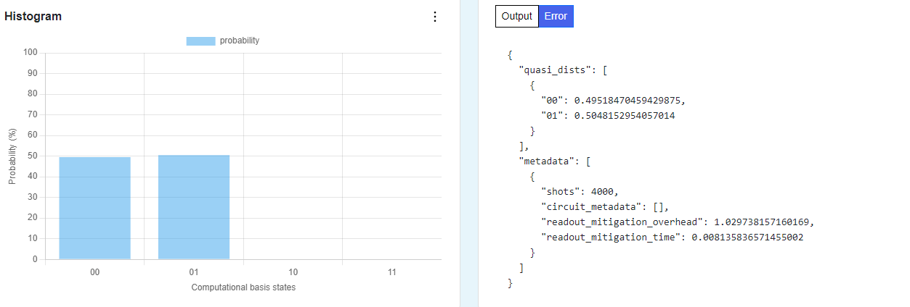

# View Jobs

> **Category:** User Guide | **Source:** [https://qniverse.in/docs/view-jobs/](https://qniverse.in/docs/view-jobs/)

Once your job is completed, the details are updated in the Jobs panel

**Also presented here is a brief video tour showing how to access a detailed section for a specific job, along with other features such as job results with visualizations, output, and its corresponding circuit diagram with other operations.**

[▶️ Video Demonstration: https://qniverse.in/wp-content/uploads/2024/12/jobs-section.mp4?_=1](https://qniverse.in/wp-content/uploads/2024/12/jobs-section.mp4?_=1)

## CPU Job Details****
  

## GPU Job Details****
****

**Job Submitted on Qiskit_aer_simulator_statevector_gpu.**

## FPGA

## Vector Card

Job submitted on Vector Card platform.

## QPU Job Details****

  * The Jobs results page displays run details, the status of the recent jobs, and monthly usage of the listed processors.
  * After selecting/clicking a job, the user can view the job details by clicking on it. The job details include circuit ID and name, submit date, resource, backend, the status of the job, runtime, whether the job is submitted using editable Qiskit, and diagrams of the original and transpiled circuit, a histogram of the results, and OpenQASM tabs that allow the user to view the transpiled circuits in users’ selection format before running the circuit i.e. QASM/Qiskit/Cirq/Editable Qiskit.
  * Each selected job can be exported in a **.zip format** folder containing circuit image, HistogramImage, QASMcode, and output if error-free.
  * Users can click the **Refresh** button to update the latest results, which may still be in progress. Users can load the original circuit by clicking on **Load Circuit.**
  * You can download the circuits and the histogram by clicking the three dots in the right corner of each section and then selecting a format for the download.
  * Users can download QASM and the transpiled code in **.txt** format.
