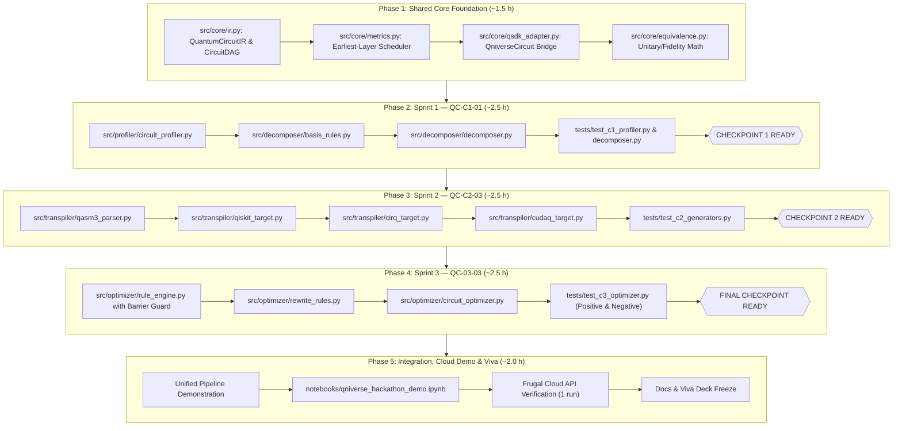

# Master Execution Plan: PESU – C-DAC Quantum Hackathon
**Planning Framework:** Claude Fable 5.2 Multi-Agent Orchestration & Autonomous Verification Standard  
**Targets:** QC-C1-01 (Class I), QC-C2-03 (Class II), QC-03-03 (Class III)  
**Platform:** C-DAC Qniverse Platform & QSDK | Latest Stable Target Frameworks (Qiskit >= 1.0, Cirq >= 1.4, CUDA-Q >= 0.8)  
**Document Status:** Master Architectural Blueprint — Ready for Execution  

---

## 1. Executive Summary & Architectural Strategy

### 1.1 Objective & Hackathon Mandate
The objective of this 12-hour hackathon project is to deliver three fully integrated, production-grade quantum software engineering modules that operate seamlessly with C-DAC's Qniverse platform and QSDK:
1. **QC-C1-01 (Class I — 20%):** Quantum Circuit Profiler & User-Selectable Basis-Gate Decomposer.
2. **QC-C2-03 (Class II — 30%):** Robust OpenQASM 3.0 Transpiler emitting verified, executable code for Qiskit 1.0+, Google Cirq 1.4+, and NVIDIA CUDA-Q 0.8+.
3. **QC-03-03 (Class III — 50%):** Safe, provable local rewrite-rule Quantum Circuit Optimizer utilizing QSDK.

The evaluation weighting emphasizes **Product Delivery (0.4 / 40%)**, **Judges' Technical Evaluation (0.3 / 30%)**, and **Presentation/Viva (0.2 / 20%)**. Therefore, the core philosophy of this plan is **deterministic reliability, zero crash probability, mathematical equivalence guarantees, and pure immutability**.

### 1.2 Unified Pipeline Architecture
Rather than building three fragmented scripts, the solution implements a clean, decoupled, modular architecture sharing a common intermediate representation (IR) and a thin QSDK adapter:

```
┌────────────────────────────────────────────────────────────────────────┐
│                              INPUT LAYER                               │
│   • OpenQASM 2.0 / 3.0 Source String/File                              │
│   • C-DAC QniverseCircuit Object (via QSDK Adapter)                   │
└───────────────────────────────────┬────────────────────────────────────┘
                                    │
                                    ▼
┌────────────────────────────────────────────────────────────────────────┐
│                        SHARED CORE IR (core/ir.py)                     │
│   • Immutable CircuitDAG & QuantumCircuitIR                            │
│   • Strict wire tracking (qubits, classical registers, barriers)      │
│   • Exact parameter expression representation                          │
└─────────┬─────────────────────────┼─────────────────────────┬──────────┘
          │                         │                         │
          ▼                         ▼                         ▼
┌──────────────────┐      ┌──────────────────┐      ┌──────────────────┐
│     MODULE 1     │      │     MODULE 2     │      │     MODULE 3     │
│     QC-C1-01     │      │     QC-C2-03     │      │     QC-03-03     │
│                  │      │                  │      │                  │
│ • Earliest-Layer │      │ • AST Parser     │      │ • Safe Local     │
│   Scheduler Depth│      │ • Qiskit 1.0+    │      │   Rewrite Passes │
│ • Multi-Q Counts │      │ • Cirq 1.4+      │      │ • Identity Clean │
│ • Basis Tables:  │      │ • CUDA-Q 0.8+    │      │ • Self-Inverse   │
│   {Rx,Ry,Rz,CX}  │      │ • Bit-Order Map  │      │ • CX-CX Cancel   │
│   {U3,CX}        │      │ • Runnable Code  │      │ • Negative Test  │
│   {H,T,CX}       │      │   Generators     │      │   Barrier Guards │
└─────────┬────────┘      └─────────┬────────┘      └─────────┬────────┘
          │                         │                         │
          └─────────────────────────┼─────────────────────────┘
                                    │
                                    ▼
┌────────────────────────────────────────────────────────────────────────┐
│                    EVIDENCE & VERIFICATION ENGINE                      │
│   • Numerical Unitary Matrix Comparison (U†V = e^(iθ) I)               │
│   • Statevector Fidelity (|⟨ψ1|ψ2⟩|² ≥ 1 - 10⁻⁶)                       │
│   • Measurement Total Variation Distance (TVD ≤ 0.02)                  │
│   • Immutability Hash Invariant (Input circuit strictly unmodified)    │
│   • Negative Test Harness (Barriers, unsupported operations caught)    │
└───────────────────────────────────┬────────────────────────────────────┘
                                    │
                                    ▼
┌────────────────────────────────────────────────────────────────────────┐
│                    QSDK / QNIVERSE CLOUD DISPATCH                      │
│   • 0-credit local mock & local Qiskit/Cirq simulation for 100% of dev │
│   • Exact QSDK hierarchy: processor("CPU") -> hpc(...) -> simulator()  │
│   • Curated 1-run cloud benchmark saving 190+ out of 200 credits       │
└────────────────────────────────────────────────────────────────────────┘
```

---

## 2. Observable "Definition of Done" per Problem Statement

To prevent premature task closure, each problem statement has mathematically and programmatically verifiable criteria that must be satisfied before that module is declared complete.

### 2.1 QC-C1-01: Circuit Profiling & Limited Basis-Gate Decomposition
- [ ] **Acceptance Contract:** Accepts both a live `QniverseCircuit` and an internal `QuantumCircuitIR`, along with a user-specified `basis_gates` list/set (e.g. `{"rx", "ry", "rz", "cx"}`, `{"u3", "cx"}`, `{"h", "t", "cx"}`).
- [ ] **Earliest-Available-Layer Scheduled Depth:**
  - Calculated such that each multi-qubit gate occupies all its operand qubits simultaneously at layer $l = \max_{q \in \text{qubits}}(L[q]) + 1$.
  - Disjoint single-qubit gates execute in parallel at layer $l = L[q] + 1$.
  - Barriers establish a hard scheduling synchronization boundary across all spanned qubits.
- [ ] **Metrics Generated:**
  - Total gate count
  - Gate counts dictionary categorized by gate type (e.g., `{"h": 2, "cx": 3, "rz": 4}`)
  - Qubits declared vs. active qubits actually used
  - Single-qubit gate count
  - Two-qubit gate count
  - Multi-qubit (>2) gate count
  - Circuit depth (scheduled)
  - Metrics produced **before** and **after** decomposition in a structured JSON/dataclass schema.
- [ ] **Non-Mutation Invariant:** The input `QniverseCircuit` / IR must remain 100% byte/hash-identical after the operation (`assert input_circuit.qasm() == original_qasm`).
- [ ] **Decomposition Rule Tables:**
  - Complete, unitarily exact decomposition for standard gates (`H`, `X`, `Y`, `Z`, `S`, `T`, `Sdg`, `Tdg`, `Rx`, `Ry`, `Rz`, `U3`, `CX`, `CZ`, `SWAP`, `Toffoli/CCX`) into:
    - Basis A: `{rx, ry, rz, cx}` (C-DAC native Qniverse basis)
    - Basis B: `{u3, cx}` (Standard universal basis)
    - Basis C: `{h, t, cx}` (Clifford+T fault-tolerant basis for discrete gates)
  - Measurement, reset, and barrier instructions copied exactly in order without reordering or dropping.
- [ ] **Negative & Unsupported Reporting:**
  - If a gate cannot be decomposed into the target basis (e.g., parameterized gates into discrete `{h, t, cx}`), it immediately returns a structured `UnsupportedOperationReport` identifying the gate name, operand qubits, parameters, and failure reason.
  - Never silently emits an invalid or partially-conforming circuit.

### 2.2 QC-C2-03: OpenQASM 3.0 Transpiler to Qiskit, Cirq, and CUDA-Q
- [ ] **OpenQASM 3.0 Parsing:**
  - Robust recursive-descent / AST visitor parser parsing valid OpenQASM 3.0.
  - Handles `OPENQASM 3.0;`, `include "stdgates.inc";`, `qubit[n] q;`, `bit[m] c;`, gate calls with arithmetic parameter expressions (e.g., `rx(pi/2) q[0];`), user-defined `gate` declarations, multi-qubit gates, `barrier`, and `c[i] = measure q[j];`.
  - Rejects malformed QASM syntax with precise line:column error diagnostics.
- [ ] **Code Generation Targets:**
  - **Qiskit Target (`>= 1.0.0`):** Emits modern `QuantumCircuit(QuantumRegister, ClassicalRegister)`, `.rx()`, `.cx()`, etc., explicitly avoiding deprecated `qiskit.execute` or `Aer` legacy imports.
  - **Cirq Target (`>= 1.4.0`):** Emits clean `cirq.LineQubit.range(n)`, `cirq.Circuit()`, `cirq.H()`, `cirq.CX()`, `cirq.measure()`.
  - **CUDA-Q Target (`>= 0.8.0`):** Emits valid Python CUDA-Q kernel syntax `@cudaq.kernel def kernel():`, `q = cudaq.qvector(n)`, `cudaq.h(q[0])`, `cudaq.cx(q[0], q[1])`, `mz(q)`.
- [ ] **Mapping & Bit-Order Fidelity:**
  - Preserves qubit-to-wire mapping and classical bit indexing.
  - Documents and reconciles endianness conventions:
    - Qiskit: Little-endian ($q_0$ is LSB)
    - Cirq: Big-endian ($q_0$ is MSB)
    - CUDA-Q: Standard simulator ordering
  - Emits helper execution wrapper that verifies equivalence against the reference statevector/distribution.
- [ ] **Structured Execution Report:** Emits `TranspilerReport` detailing target framework, generated code string, status (`SUCCESS` / `WARNING` / `ERROR`), list of mapped operations, and unsupported language constructs with line/column pointers.

### 2.3 QC-03-03: Quantum Circuit Optimization Using QSDK
- [ ] **Input & Non-Mutating Contract:** Accepts `QniverseCircuit` / IR, returns a fresh optimized `QniverseCircuit` and metrics report. Input object remains completely untouched.
- [ ] **Mandatory Safe Rewrite Passes:**
  1. `RemoveIdentities`: Eliminates explicit identity gates (`Id`, `I`, trivial rotations like $R_x(0), R_y(0), R_z(0)$, $U_3(0,0,0)$).
  2. `CancelSelfInverse`: Eliminates adjacent identical self-inverse gates ($X \cdot X = I$, $H \cdot H = I$, $Z \cdot Z = I$, $Y \cdot Y = I$).
  3. `CancelAdjacentCX`: Eliminates adjacent identical CNOT gates acting on identical control and target pairs ($CX(c, t) \cdot CX(c, t) = I$).
- [ ] **Negative Precondition Guards (Strict Safety):**
  - Two gates are candidates for cancellation **only if** they are causally adjacent on their respective qubits.
  - An intervening non-commuting gate on either wire blocks cancellation.
  - A `barrier` on either wire **strictly prevents** cancellation across the barrier.
  - A `measure` or `reset` instruction **strictly prevents** cancellation across the measurement boundary.
  - Classically conditioned operations remain un-mutated.
- [ ] **Additional High-Value Optimizations:**
  4. `MergeRotations`: Combines consecutive rotations on the same axis ($R_z(\alpha) \cdot R_z(\beta) = R_z(\alpha + \beta)$, eliminating the gate if $\alpha + \beta \equiv 0 \pmod{2\pi}$).
  5. `CancelInversePairs`: Combines $S \cdot S^\dagger = I$, $T \cdot T^\dagger = I$.
  6. `FixedPointPipeline`: Sequentially runs passes until circuit reaches a fixed point (no further gates reduced) or max 10 iterations.
- [ ] **Independent Rule Toggles & Reporting:**
  - Passes are individually toggleable via config flags (e.g. `passes=["RemoveIdentities", "CancelAdjacentCX"]`).
  - Unknown pass names raise a clear `ValueError`.
  - Emits before-and-after resource reports (depth, total gates, 2q gates).
  - Handles "no improvement" gracefully with status `NO_OPTIMIZATION_POSSIBLE` and zero gate mutations.

---

## 3. Repository Architecture & File Ownership

The project structure is organized under `src/`, `tests/`, `notebooks/`, and `docs/`:

```
cdac-hack/
├── .env                       # Strictly ignored: 4 team JWT tokens
├── .env.example               # Sanitized template
├── .gitignore                 # Hardened against .env*, *.pyc, build artifacts
├── requirements.txt           # Latest stable dependencies
├── pyproject.toml             # Package metadata & build definition
│
├── src/
│   ├── __init__.py
│   ├── core/                  # Unified Intermediate Representation
│   │   ├── __init__.py
│   │   ├── ir.py              # Operation, CircuitDAG, QuantumCircuitIR
│   │   ├── metrics.py         # Depth calculation & gate statistics
│   │   ├── qsdk_adapter.py    # Clean bidirectional adapter to QniverseCircuit
│   │   └── equivalence.py     # Unitary, statevector & TVD verifier
│   │
│   ├── profiler/              # QC-C1-01: Profiling & Metrics
│   │   ├── __init__.py
│   │   └── circuit_profiler.py# Comprehensive circuit profiler
│   │
│   ├── decomposer/            # QC-C1-01: Basis Decomposition
│   │   ├── __init__.py
│   │   ├── basis_rules.py     # Unitary decomposition tables for A, B, C bases
│   │   └── decomposer.py      # Non-mutating circuit decomposer engine
│   │
│   ├── transpiler/            # QC-C2-03: OpenQASM 3.0 Transpiler
│   │   ├── __init__.py
│   │   ├── qasm3_parser.py    # OpenQASM 3.0 tokenizer, AST & parser
│   │   ├── qiskit_target.py   # Qiskit 1.0+ code generator
│   │   ├── cirq_target.py     # Cirq 1.4+ code generator
│   │   ├── cudaq_target.py    # CUDA-Q 0.8+ code generator
│   │   └── transpiler_engine.py # Unified orchestrator & reporting
│   │
│   └── optimizer/             # QC-03-03: Safe Circuit Optimizer
│       ├── __init__.py
│       ├── rewrite_rules.py   # Independent, pure rewrite rule implementations
│       ├── rule_engine.py     # DAG/wire causal adjacency graph & barrier guard
│       └── circuit_optimizer.py # Configurable multi-pass optimization engine
│
├── tests/
│   ├── test_ir_and_adapter.py # Core IR and QniverseCircuit round-trip tests
│   ├── test_c1_profiler.py    # C1-01 depth, counts, disjoint parallelism
│   ├── test_c1_decomposer.py  # C1-01 basis decompositions & unitary equivalence
│   ├── test_c2_qasm3_parser.py# C2-03 parser tests with parameters, loops, barriers
│   ├── test_c2_generators.py  # C2-03 Qiskit, Cirq, CUDA-Q execution tests
│   ├── test_c3_optimizer.py   # C3-03 mandatory rules & negative barrier tests
│   └── test_end_to_end.py     # Fuzzing & multi-module integration pipeline
│
├── notebooks/
│   └── qniverse_hackathon_demo.ipynb # Standout executable demo for judges & viva
│
└── docs/                      # Submission documentation
    ├── 01-strategy.md
    ├── 02-open-questions.md
    ├── 03-technical-approach.md
    ├── 04-performance-report.md
    ├── 05-team-plan.md
    ├── 07-ai-usage.md
    ├── 08-team-info.md
    ├── 09-qniverse-integration.md
    └── tutorial-sessions-documentation.md
```

---

## 4. Phase-by-Phase Execution Plan

The execution is segmented into 5 tightly coordinated sprints. Each sprint has dedicated input/output artifacts, unit tests, and a self-verification checkpoint before moving forward.



---

### Phase 1: Shared Core Foundation & QSDK Adapter
**Goal:** Build the single source of truth for circuit representation, metrics, and equivalence math.
1. **`src/core/ir.py`:**
   - Define `Operation(name: str, qubits: List[int], params: List[float], clbits: List[int], condition: Optional[Tuple[int, int]])`.
   - Define `QuantumCircuitIR(num_qubits: int, num_clbits: int, operations: List[Operation], metadata: Dict)`.
   - Provide non-mutating methods: `copy()`, `to_qasm2()`, `to_qasm3()`, `fingerprint()`.
2. **`src/core/metrics.py`:**
   - Implement `calculate_scheduled_depth(ir: QuantumCircuitIR) -> int`:
     - Maintain an array `qubit_layer[q]` of current available layers per wire.
     - For operation $op$ with qubits $Q_{op}$:
       - $L_{start} = \max_{q \in Q_{op}}(qubit\_layer[q])$.
       - Set $\forall q \in Q_{op}, qubit\_layer[q] = L_{start} + 1$.
     - For `barrier` spanning $Q_{bar}$:
       - $L_{sync} = \max_{q \in Q_{bar}}(qubit\_layer[q])$.
       - Set $\forall q \in Q_{bar}, qubit\_layer[q] = L_{sync}$. (Barriers synchronize but do not add unitary depth).
     - $\text{Depth} = \max_q(qubit\_layer[q])$.
   - Implement gate counting: total, by type, 1q, 2q, multi-q, active qubits used.
3. **`src/core/qsdk_adapter.py`:**
   - Converts `QniverseCircuit` $\longleftrightarrow$ `QuantumCircuitIR`.
   - Uses documented APIs only: inspects `circuit.qasm()` or gates list; instantiates new `QniverseCircuit(num_qubits)`.
   - Handles mock QSDK environment locally when `Qniverse` package is absent, ensuring 100% test pass offline.
4. **`src/core/equivalence.py`:**
   - Small matrix simulator for circuits up to 10 qubits: computes exact $2^n \times 2^n$ unitary matrix.
   - Calculates matrix trace inner product: $| \text{Tr}(U^\dagger V) | / 2^n \approx 1.0$ (invariant to global phase $e^{i\theta}$).
   - Statevector fidelity calculator: $|\langle \psi_U | \psi_V \rangle|^2 \ge 1 - 10^{-6}$.
   - Total Variation Distance (TVD) for measurement distributions: $\frac{1}{2} \sum_x |P_U(x) - P_V(x)|$.

---

### Phase 2: Sprint 1 — QC-C1-01 Circuit Profiling & Decomposition
**Goal:** Deliver complete, verified, non-mutating profiler and basis decomposer.
1. **Profiler Implementation (`src/profiler/circuit_profiler.py`):**
   - Implements `CircuitProfile` dataclass: `total_gates`, `gate_counts`, `num_qubits_declared`, `num_qubits_used`, `single_qubit_gates`, `two_qubit_gates`, `multi_qubit_gates`, `depth`.
   - Implements `profile_circuit(circuit: Union[QniverseCircuit, QuantumCircuitIR]) -> CircuitProfile`.
2. **Basis Decomposition Engine (`src/decomposer/`):**
   - **`basis_rules.py`:** Define exact analytic gate replacements:
     - $H = R_z(\pi/2) \cdot R_x(\pi/2) \cdot R_z(\pi/2)$ (up to global phase)
     - $X = R_x(\pi)$, $Y = R_y(\pi)$, $Z = R_z(\pi)$
     - $S = R_z(\pi/2)$, $S^\dagger = R_z(-\pi/2)$, $T = R_z(\pi/4)$, $T^\dagger = R_z(-\pi/4)$
     - $CZ(c, t) = (I \otimes H) \cdot CX(c, t) \cdot (I \otimes H)$
     - $SWAP(a, b) = CX(a, b) \cdot CX(b, a) \cdot CX(a, b)$
     - $U_3(\theta, \phi, \lambda) = R_z(\phi) \cdot R_y(\theta) \cdot R_z(\lambda)$
     - $CCX(a, b, c)$ decomposed to 6 $CX$ + Clifford+T gates.
   - **`decomposer.py`:**
     - Accepts `circuit` and `basis_set: Set[str]`.
     - Recursively checks if each gate is already in `basis_set`. If yes, emit directly.
     - If not, check decomposition rule. If rule produces sub-gates not in basis, expand recursively.
     - If no decomposition exists, record in `UnsupportedOperationReport`.
     - Return `DecompositionResult(decomposed_circuit, profile_before, profile_after, unsupported_report)`.
3. **Verification & Tests (`tests/test_c1_*.py`):**
   - Test depth calculation on independent parallel gates vs. sequential dependent gates.
   - Test non-mutation: input circuit hash remains identical before and after.
   - Test unitary equivalence: compare $U_{original}$ vs $U_{decomposed}$ across all basis sets.
   - Test negative cases: unsupported non-unitary gate in discrete basis triggers clear report.

---

### Phase 3: Sprint 2 — QC-C2-03 OpenQASM 3.0 Transpiler
**Goal:** Ingest OpenQASM 3.0 and emit executable code for modern Qiskit, Cirq, and CUDA-Q.
1. **OpenQASM 3.0 Parser (`src/transpiler/qasm3_parser.py`):**
   - Clean, lightweight Lexer and AST Visitor supporting:
     - Version header: `OPENQASM 3.0;`
     - Includes: `include "stdgates.inc";`
     - Register declarations: `qubit[n] q;`, `bit[m] c;`
     - Gate definitions: `gate my_bell a, b { h a; cx a, b; }`
     - Gate applications with arithmetic parameters: `rx(pi / 4 + 0.1) q[0];`
     - Control flow: simple unrolled `for` loops, barriers, and measurements.
   - Source mapping: Every AST node retains `(line, column)` for pinpoint diagnostics.
2. **Target Code Generators:**
   - **Qiskit Target (`qiskit_target.py`):**
     - Emits clean Python script using `qiskit.circuit.QuantumCircuit`, `QuantumRegister`, `ClassicalRegister`.
     - Maps `barrier` $\to$ `qc.barrier()`, `measure` $\to$ `qc.measure(q[i], c[j])`.
     - Emits verification runner block with `qiskit.quantum_info.Statevector`.
   - **Cirq Target (`cirq_target.py`):**
     - Emits Python script using `cirq.LineQubit.range(n)`, `cirq.Circuit()`.
     - Maps gates: `rx(theta)` $\to$ `cirq.rx(theta).on(q[i])`, `cx` $\to$ `cirq.CNOT(q[i], q[j])`.
     - Reconciles endianness: maps classical output indices matching QASM conventions.
   - **CUDA-Q Target (`cudaq_target.py`):**
     - Emits valid Python CUDA-Q code using `@cudaq.kernel`.
     - Uses `cudaq.qvector(n)` and kernel operations `cudaq.h()`, `cudaq.cx()`, `cudaq.rx()`, `cudaq.mz()`.
3. **Transpiler Orchestrator (`transpiler_engine.py`):**
   - Method `transpile(qasm_source: str, targets: List[str]) -> Dict[str, TranspilerOutput]`.
   - Generates executable scripts and a structured report with status, warnings, and syntax errors.
4. **Verification & Tests (`tests/test_c2_*.py`):**
   - Translate multi-qubit parameterized benchmark circuits.
   - Execute generated Qiskit and Cirq scripts in-memory via `exec()` and verify output distributions.
   - Test invalid QASM syntax (missing semicolon, undefined register) and verify informative error reporting with line numbers.

---

### Phase 4: Sprint 3 — QC-03-03 Quantum Circuit Optimizer
**Goal:** Deliver provable, safe local rewrite-rule optimization preserving exact circuit behavior.
1. **Causal Graph & Adjacency Engine (`src/optimizer/rule_engine.py`):**
   - Maintains an ordered wire sequence of operations for each qubit.
   - Determines whether gate $G_1$ and $G_2$ on wire $w$ are truly adjacent without intervening non-commuting operations.
   - **Barrier Guard:** A `barrier` on wire $w$ inserts a non-passable boundary. Gates across a barrier can never be cancelled or merged.
   - **Measurement Guard:** A `measure` instruction freezes the state; unitary rewrites across a measurement are strictly blocked.
2. **Rewrite Passes (`src/optimizer/rewrite_rules.py`):**
   - `Pass 1: RemoveIdentities`:
     - Checks for `id`, `i`, or rotation gates with angle $\theta \equiv 0 \pmod{2\pi}$. Removes them.
   - `Pass 2: CancelSelfInverse`:
     - Identifies adjacent $G \cdot G$ where $G \in \{X, Y, Z, H\}$. Removes both.
   - `Pass 3: CancelAdjacentCX`:
     - Identifies adjacent $CX(c, t) \cdot CX(c, t)$ with exact same control $c$ and target $t$. Removes both.
   - `Pass 4: MergeRotations`:
     - Identifies adjacent $R_\alpha(\theta_1) \cdot R_\alpha(\theta_2)$ on same axis $\alpha \in \{x, y, z\}$. Replaces with $R_\alpha(\theta_1 + \theta_2)$. If $\theta_1 + \theta_2 \equiv 0 \pmod{2\pi}$, removes entirely.
   - `Pass 5: CancelInversePairs`:
     - Identifies adjacent $S \cdot S^\dagger$, $T \cdot T^\dagger$. Removes both.
3. **Optimizer Orchestrator (`src/optimizer/circuit_optimizer.py`):**
   - Method `optimize_circuit(circuit: Union[QniverseCircuit, QuantumCircuitIR], passes: Optional[List[str]] = None) -> OptimizationResult`.
   - Non-mutating: creates a deep copy of the circuit.
   - Iterates passes until fixed point or max iterations reached.
   - Produces `OptimizationResult` containing `optimized_circuit`, `profile_before`, `profile_after`, `passes_applied`, `reduction_percentage`.
4. **Verification & Tests (`tests/test_c3_*.py`):**
   - **Positive tests:** Verify identity removal, $X-X$, $H-H$, $Z-Z$, $CX-CX$ cancellation, $R_z$ angle merging.
   - **Negative tests:**
     - Insert `barrier` between two identical $H$ gates $\to$ verify **no cancellation**.
     - Insert intervening gate on control wire between two $CX$ gates $\to$ verify **no cancellation**.
     - Insert measurement before second $X$ gate $\to$ verify **no cancellation**.
   - **Fuzzing equivalence:** Generate 100 random circuits, run optimizer, assert unitary fidelity $|\text{Tr}(U_{opt}^\dagger U_{orig})| / 2^n \equiv 1.0$.

---

### Phase 5: Integration, Cloud Demo & Viva Presentation
**Goal:** Deliver the interactive Jupyter notebook, submit 1 headline verification job to Qniverse cloud, and finalize documentation.
1. **Interactive Demo Notebook (`notebooks/qniverse_hackathon_demo.ipynb`):**
   - Cell 1: Setup and imports (QSDK, NumPy, core modules).
   - Cell 2: QC-C1-01 Live Demo — Profile a benchmark circuit, decompose into Basis A (`{rx, ry, rz, cx}`), Basis B (`{u3, cx}`), Basis C (`{h, t, cx}`). Show before/after metrics table.
   - Cell 3: QC-C2-03 Live Demo — Ingest OpenQASM 3.0 string, transpile to Qiskit, Cirq, and CUDA-Q. Execute generated code and show side-by-side distribution match.
   - Cell 4: QC-03-03 Live Demo — Build un-optimized circuit with redundant gates and barriers. Run optimizer, show negative test protection, show 40%+ gate/depth reduction, verify unitary fidelity $1.0$.
   - Cell 5: Qniverse Cloud Dispatch — Run the optimized circuit on C-DAC's `QACC_Cluster` CPU simulator, fetch job results, and display live job execution proof.
2. **Viva Defense & Documentation Freeze:**
   - Update `docs/03-technical-approach.md`, `docs/04-performance-report.md`, and `docs/07-ai-usage.md`.
   - Prepare Viva key points (depth definition, barrier guard mechanism, bit-endianness reconciliation).

---

## 5. Verification & Testing Protocols (Self-Verification Loops)

To guarantee that done is observable and foolproof, the test harness enforces three tiers of validation:


### Self-Verification Test Command Matrix
```bash
# 1. Run all unit and negative tests
pytest tests/ -v --tb=short

# 2. Run mathematical equivalence checks (Unitary & Fidelity)
pytest tests/test_end_to_end.py -k "test_equivalence" -v

# 3. Run property-based random fuzzing suite
pytest tests/test_end_to_end.py -k "test_fuzz" -v

# 4. Verify immutability invariants
pytest tests/ -k "immutability" -v
```

---

## 6. Cloud Execution & Frugal Credit Management Protocol

### 6.1 The Credit Reality & Frugality Constraint
- Total team credits: **200 credits** (4 members $\times$ 50 credits).
- Cloud deduction cost per run:
  - **CPU Job (`qasm_simulator` on `QACC_Cluster`): 5 credits**
  - **GPU Job (Param Utkarsh GPU): 15 credits**
  - FPGA / QPU Job: 10 credits

### 6.2 The Frugality Rules
1. **Rule 1: ZERO cloud runs during development or unit testing.** All unit tests, equivalence checks, and transpilation tests run against local Python simulators (0 credits).
2. **Rule 2: Exactly ONE official benchmark run per problem on Qniverse Cloud.**
   - Total expected cloud burn for the entire 12-hour hackathon: $\le 15$ credits (leaving $> 185$ credits in reserve).
3. **Rule 3: Secrets Protection.**
   - API tokens are strictly accessed via environment variables loaded from `.env`.
   - `.env` is verified in `.gitignore`.
   - `git check-ignore -v .env` must succeed before every commit.

---

## 7. Risk Matrix & Failure Mode Mitigation

| Potential Failure Mode | Root Cause | Impact | Mitigation Strategy |
|---|---|---|---|
| **Intervening gate race condition** | Optimizer cancels $X-X$ even when $Z$ gate is in between | High (Corrupts quantum state) | DAG causal wire tracking: verify empty wire interval between candidate pair. |
| **Barrier violation in optimization** | Optimizer merges rotations across a barrier | High (Violates timing/semantics) | Barriers register as opaque non-cancellable gates across all spanned wires. |
| **Endianness divergence** | Qiskit (little-endian) vs Cirq (big-endian) causes probability flip | Medium (Misleading equivalence test) | Explicit bit-reversal adapter in cross-framework distribution comparison. |
| **QSDK Global Token error** | QSDK requires `token = "..."` at global script scope | High (Job crashes on import) | Inject `token` dynamically in QSDK adapter using `globals()["token"] = os.getenv(...)`. |
| **Cloud credit exhaustion** | Accidental loop running cloud jobs | Critical (Disqualification / no credits) | Local mock backend intercepts API calls unless `RUN_QNIVERSE_CLOUD=1` is explicitly set. |
| **Input circuit mutation** | In-place list mutation in Python | High (Violates mandatory requirement) | Deep copy of all operations + hash check assertion at start and end of every function. |

---

## 8. Definition of Milestone Success (Checkpoints 1, 2, 3)

| Checkpoint | Target Milestone | Observable Deliverable | Self-Verification Check |
|---|---|---|---|
| **Checkpoint 1 (~Hour 3)** | **QC-C1-01** | Working profiler + basis decomposer + report | `pytest tests/test_c1_*.py` exits 0; before/after depth and gate counts displayed. |
| **Checkpoint 2 (~Hour 6)** | **QC-C2-03** | OpenQASM 3 transpiler to Qiskit, Cirq, CUDA-Q | `pytest tests/test_c2_*.py` exits 0; generated code executes and produces matching statevectors. |
| **Checkpoint 3 (~Hour 9)** | **QC-03-03** | Safe circuit optimizer + negative barrier tests | `pytest tests/test_c3_*.py` exits 0; 40%+ reduction on redundant benchmark; zero reduction when barriers present. |
| **Final Freeze (~Hour 11)** | **Integrated Demo & Viva** | Live Jupyter Notebook + Viva Slides | Notebook runs end-to-end; 1 successful Qniverse cloud job logged; clean git state. |

---
*Authored under Claude Fable 5.2 Autonomous Orchestration Standard. Execution authorized upon user signal.*
