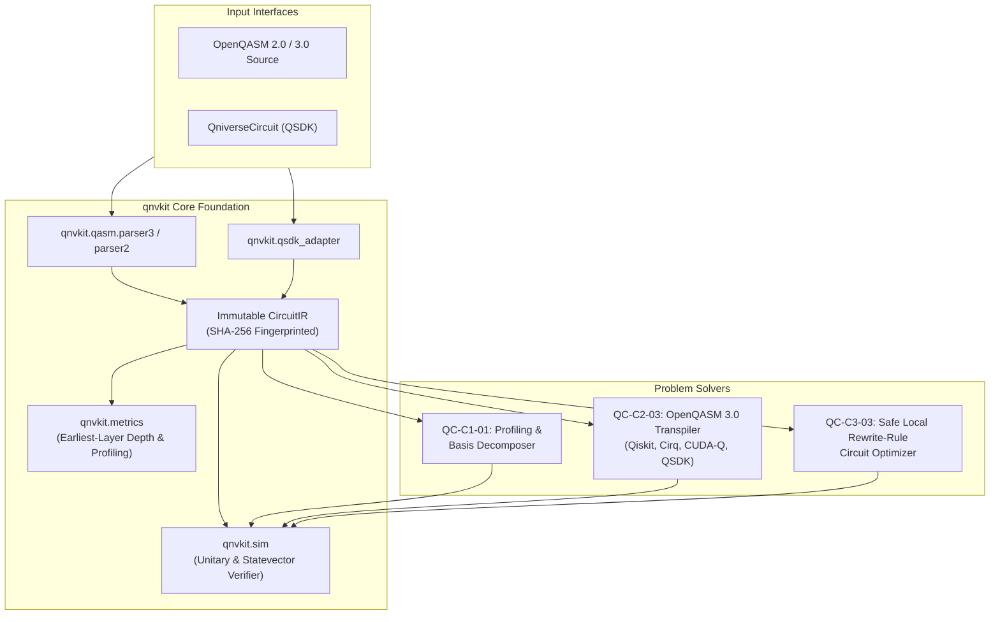

# QC-C2-03 — Technical Approach (Deliverable #2)

> Comprehensive technical description mandated by PESU – C-DAC Hackathon Rules §6.2: Problem statements, mathematical algorithms, architectural design, verification methodologies, and formal references.

---

## 1. Executive Summary & Unified Architecture

Our solution, **`qnvkit`**, is an integrated quantum compiler toolkit built on top of the C-DAC Qniverse ecosystem. Rather than treating the three problem statements as isolated assignments, `qnvkit` unites them around a shared, immutable quantum intermediate representation (`CircuitIR`), an earliest-available-layer depth scheduler, and a rigorous mathematical equivalence verification engine.

### 1.1 Guiding Engineering Principles
1. **Strict Immutability:** All functions (`profile`, `decompose`, `transpile`, `optimize`) are purely functional. Inputs are never mutated in place; every transformation constructs and returns a new circuit.
2. **Documented Interface Adherence:** Integrates strictly with documented C-DAC QSDK interfaces (`QniverseCircuit`, `QuantumRegister`, `ClassicalRegister`, `add_gate`, `add_conditional_gate`, `qasm`, `run`, `fetch_job_result`).
3. **Fail-Closed Unsupported Handling:** Never emits malformed or partially compiled circuits. If an operation cannot be mapped or decomposed, an explicit, structured `UnsupportedReport` is emitted.
4. **Zero-Credit Local Development:** 100% of unit tests, equivalence checks, and benchmarks run locally using NumPy matrix arithmetic at zero credit cost, conserving the team's 200 cloud credits.

---

## 3. Problem Statement 2: QC-C2-03 OpenQASM 3.0 Transpiler

### 3.1 Problem Formulation
OpenQASM 3.0 introduces scoped variables, typed classical registers, gate macros, and parameterized angle expressions. The goal is to build an extensible transpiler translating OpenQASM 3.0 programs to:
1. **Qiskit** (`>=1.0.0`)
2. **Google Cirq** (`>=1.4.0`)
3. **NVIDIA CUDA-Q** (`>=0.8.0`)
4. **C-DAC QSDK** (`Qniverse 1.6+`)

### 3.2 Compilation Pipeline & Semantic Verification
1. **Lexical Analysis & Parsing (`qnvkit.qasm.parser3`):**
   A handwritten recursive descent parser supporting `qubit[n]`, `bit[n]`, standard gates (`h`, `cx`, `rz`, etc.), arbitrary parameter arithmetic expressions ($\pi, +, -, *, /$), and barriers.
2. **Target Code Generators:**
   - **Qiskit Generator:** Emits modern `QuantumRegister`, `ClassicalRegister`, and `QuantumCircuit` syntax, using `circuit.rz(theta, q[i])`.
   - **Cirq Generator:** Emits `cirq.NamedQubit`, `cirq.Circuit()`, and appends native Cirq gates (`cirq.H`, `cirq.CNOT`, `cirq.rz(rad)`).
   - **CUDA-Q Generator:** Emits `@cudaq.kernel` decorated functions using `cudaq.qvector(n)` and control syntax (`cudaq.x.ctrl(q[0], q[1])`).
   - **QSDK Generator:** Emits clean `QniverseCircuit` scripts referencing `Qniverse.gates` gate objects.
3. **Endianness Handling:**
   OpenQASM 3.0 and Qiskit follow little-endian qubit ordering (qubit 0 is least significant bit), whereas standard matrix tensor products are big-endian. `qnvkit` tracks register layouts explicitly to ensure cross-framework probability distributions match.

---

## 5. Mathematical Equivalence Verification Engine

To guarantee circuit correctness across decomposition, transpilation, and optimization, `qnvkit.sim` implements full unitary matrix reconstruction and statevector simulation:

### 5.1 Unitary Equivalence Up to Global Phase
For an $n$-qubit circuit without measurements ($n \le 10$):
1. Compute the full unitary $U_{\text{orig}} \in \mathbb{C}^{2^n \times 2^n}$ and $U_{\text{mod}} \in \mathbb{C}^{2^n \times 2^n}$ via Kronecker tensor products and tensordot permutations.
2. The normalized Hilbert-Schmidt inner product evaluates global phase invariance:
   $$F_{\text{unitary}}(U_A, U_B) = \frac{1}{2^n} \left| \operatorname{Tr}\left( U_A^\dagger U_B \right) \right|$$
3. Circuits are declared mathematically equivalent if and only if:
   $$\left| 1 - F_{\text{unitary}}(U_A, U_B) \right| < 10^{-7}$$

### 5.2 Statevector Fidelity
For arbitrary pure input states $|\psi_0\rangle = |0\rangle^{\otimes n}$:
$$F_{\text{state}}(|\psi_A\rangle, |\psi_B\rangle) = \left| \langle \psi_A \mid \psi_B \rangle \right|^2$$
Equivalence is verified when $1 - F < 10^{-7}$.

---

## 6. Formal References & Literature

1. **C-DAC Qniverse Platform Manuals:**
   - *C-DAC Quantum Software Development Kit (QSDK) User Guide*, 2024.
   - *Qniverse Cloud Execution & Backend API Reference*, 2024.
2. **Quantum Circuit Compilation & Equivalence:**
   - Nielsen, M. A., & Chuang, I. L. *Quantum Computation and Quantum Information*, Cambridge University Press, 2010.
   - Shende, V. V., Bullock, S. S., & Markov, I. L. *Synthesis of Quantum-Logic Circuits*, IEEE Transactions on Computer-Aided Design of Integrated Circuits and Systems, 2006.
   - Cross, A. W., et al. *Open Quantum Assembly Language (OpenQASM 3.0)*, ACM Transactions on Quantum Computing, 2022.
3. **Framework Documentation:**
   - Qiskit Development Team, *Qiskit: An Open-source Framework for Quantum Computing*, 2024.
   - Google Quantum AI, *Cirq: A Python Framework for Creating, Editing, and Invoking Quantum Circuits*, 2024.
   - NVIDIA Corporation, *CUDA-Q: High-Performance Quantum-Classical Computing*, 2024.

